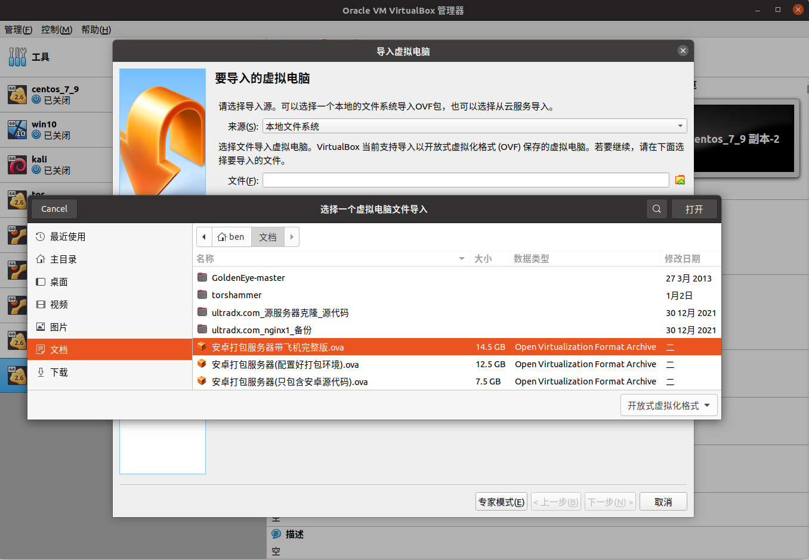
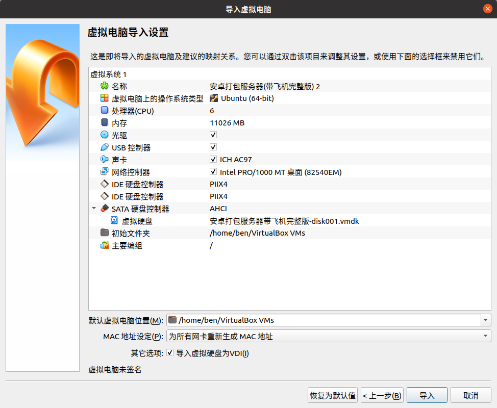
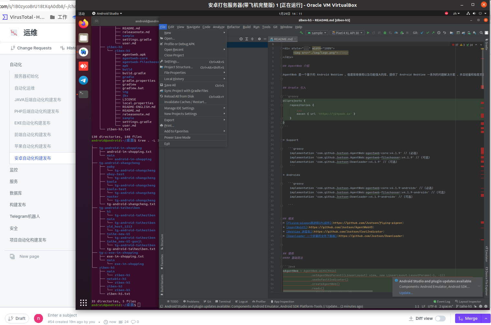
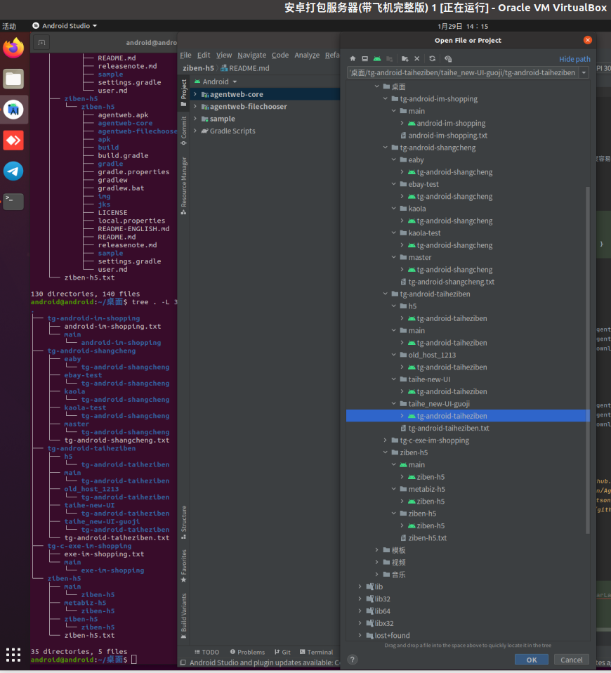
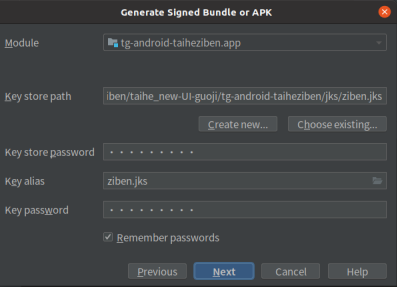
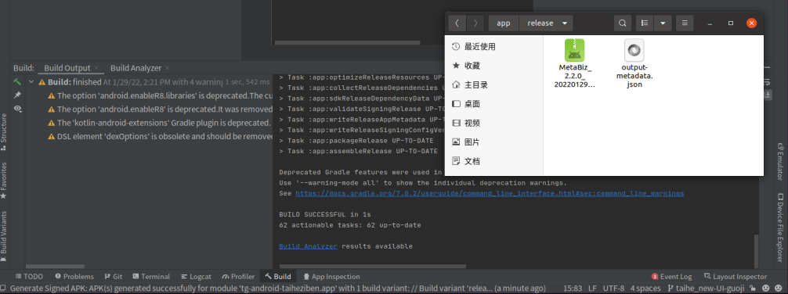

# VirtualBox 安卓自动化构建发布

安卓打包
1 电脑安装 virtualbox 注意电脑主板 boot 要开启 CPU 虚拟化
<https://www.virtualbox.org/wiki/Downloads>
2 下载镜像 安卓打包服务器带飞机完整版.ova 镜像 账号 android 密码 android
3 导入镜像开箱就可打包

选择 为所有网卡重新生成 MAC 地址

虚拟机内进入桌面的安卓各个分支源代码 git pull 就可拉最新代码 点击 android studio 点击 左上角 File -> Open -> 选择在桌面的 安卓各个分支源代码

点击 左上角 Build -> Generate Sigened Bundle... 选择 APK key store password key alias key pasword 这3个都填写 证书文件名(具体填写问安卓开发)

选择 release 点击 左下角 Build BUILD SUCCESSFUL in 1s 就打包成功咯

后期 渠道包数量起来了 再整理 使用 grable 命令行快速批量打 几百个 包的笔记
