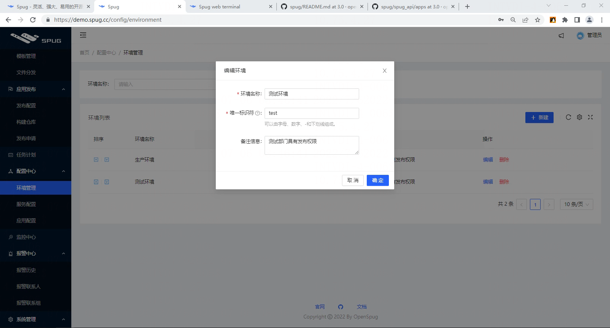

# config 配置中心模块

> GitHub 仓库源文件：[点击打开网页渲染版](https://github.com/ben2023niao/ben-ops-notes/blob/main/doc/md/202304141557-DevOps%20%E4%B8%8E%20SRE%2B%E9%AB%98%E6%95%88%E8%BF%90%E7%BB%B4%2B%E7%9F%A5%E8%AF%86%E7%AC%94%E8%AE%B0-config%20%E9%85%8D%E7%BD%AE%E4%B8%AD%E5%BF%83%E6%A8%A1%E5%9D%97.md)

<https://demo.spug.cc/config>

