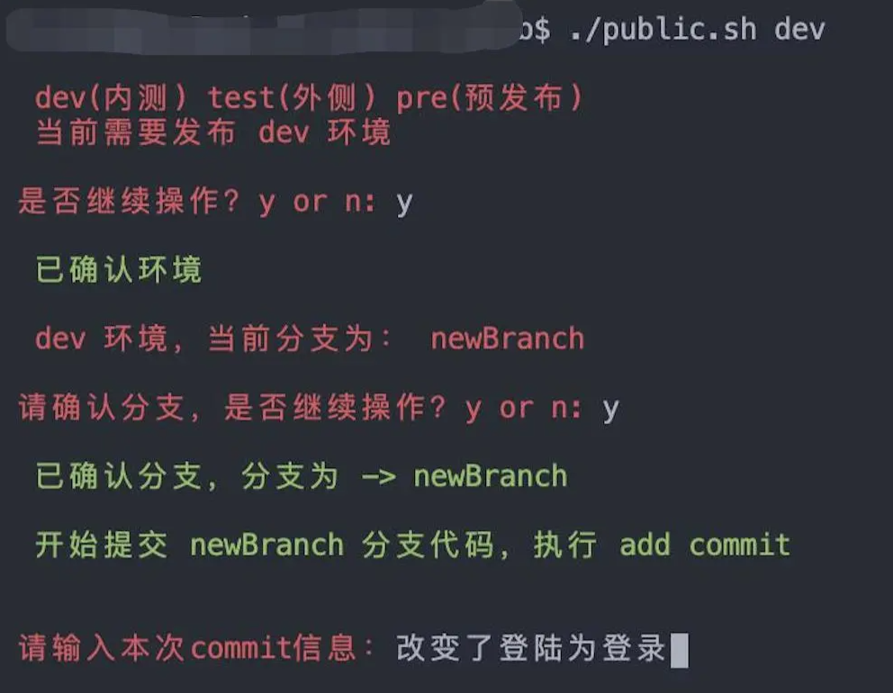
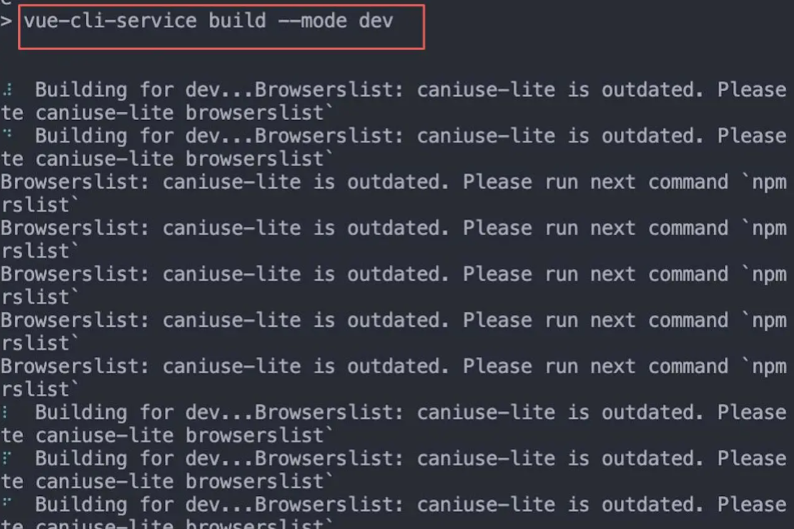
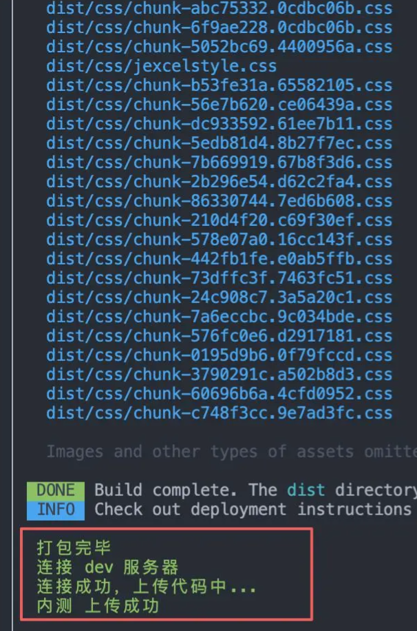

# 前端自动化构建发布

> GitHub 仓库源文件：[点击打开网页渲染版](https://github.com/ben2023niao/ben-ops-notes/blob/main/doc/md/202304141557-DevOps%20%E4%B8%8E%20SRE%2B%E9%AB%98%E6%95%88%E8%BF%90%E7%BB%B4%2B%E7%9F%A5%E8%AF%86%E7%AC%94%E8%AE%B0-%E5%89%8D%E7%AB%AF%E8%87%AA%E5%8A%A8%E5%8C%96%E6%9E%84%E5%BB%BA%E5%8F%91%E5%B8%83.md)







```bash
#!/bin/bash
set -e

if [ "$1"x != "devx" ] && [ "$1"x != "testx" ] && [ "$1"x != "prex" ];then
echo -e "\033[41;37m 不存在 $1 环境 只有 -> dev(内测) test(外侧) pre(预发布) \033[0m"
exit
fi
function devFn() {
ssh root@ip rm -rf 服务器项目路径/*

echo -e "\033[32m 连接成功，上传代码中... \033[0m"

rsync -e "ssh -p 端口" --exclude=storage -a 本地代码路径/dist/* root@ip:服务器项目路径/

echo -e "\033[32m 内测 上传成功 \033[0m\n"
}
function testFn() {
ssh -p 端口 root@ip rm -rf 服务器项目路径/*

echo -e "\033[32m 连接成功，上传代码中... \033[0m"

rsync -e "ssh -p 端口" --exclude=storage -a 本地代码路径/dist/* root@ip:服务器项目路径/

echo -e "\033[32m 外侧上传成功 \033[0m\n"
}
function preFn() {
echo "执行链接预发布服务器"
}
function build() {
cd source
npm run build:$1
echo -e "\033[32m 打包完毕 \033[0m"
echo -e "\033[32m 连接 $1 服务器 \033[0m"
if [ "$1"x == "devx" ];then
devFn
elif [ "$1"x == "testx" ];then
testFn
elif [ "$1"x == "prex" ];then
preFn
else
echo -e "\033[41;37m 应该不会走到这里来吧... \033[0m"
exit
fi
}
#获取当前分支
branch=$(git symbolic-ref --short HEAD)
#判断是否是rel分支
if [ ${branch} == "rel" ];then
echo -e "\n\033[32m 当前在rel分支\n 不出意外应该刚发布过内测\n 所以无需执行git操作\n 所以是否直接发布 $1 环境\033[0m"
read -p $'\n\033[31m是否直接打包上传？y or n: \033[0m' isbuild
if [ "$isbuild" != 'y' ];then
exit
fi
build $1
else
#此sh脚本只适用于单子发布rel环境,提醒
echo -e "\n\033[31m dev(内测) test(外侧) pre(预发布) \033[0m"
echo -e "\033[31m 当前需要发布 $1 环境 \033[0m"
#询问是否继续发布当前环境
read -p $'\n\033[31m是否继续操作？y or n: \033[0m' isVersion
if [ "$isVersion" != 'y' ];then
exit
fi
echo -e "\n\033[32m 已确认环境 \033[0m\n"
echo -e "\033[31m $1 环境，当前分支为： ${branch} \033[0m"
#确认当前分支，是否继续
read -p $'\n\033[31m请确认分支，是否继续操作？y or n: \033[0m' isContinue
if [ "$isContinue" != 'y' ];then
exit
fi
echo -e "\n\033[32m 已确认分支，分支为 -> ${branch} \033[0m\n"
echo -e "\033[32m 开始提交 ${branch} 分支代码，执行 add commit \033[0m\n"
git add .
read -p $'\n\033[31m请输入本次commit信息：\033[0m' commitInfo
git commit -m ${commitInfo}
echo -e "\033[32m 开始切换分支 \033[0m\n"
git checkout rel
echo -e "\033[32m 开始拉取 rel origin \033[0m\n"
git pull origin rel
echo -e "\033[32m 开始 merge 修改至 rel \033[0m\n"
git merge ${branch}
#判断merge是否成功
if [ $? == 0 ];then
echo -e "\033[32m merge ${branch} -> rel 成功 \033[0m\n"
echo -e "\n\033[32m 开始推送 rel 至远端 origin \033[0m\n"

git push origin rel

echo -e "\n\033[32m 推送 rel 至远端 origin 成功 \033[0m\n"
echo -e "\n\033[32m 执行打包 \033[0m\n"

build $1
else
echo -e "\033[31m merge失败，请检查 \033[0m"
exit
fi
fi
```
