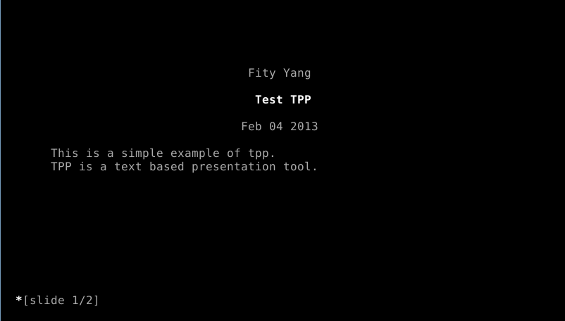
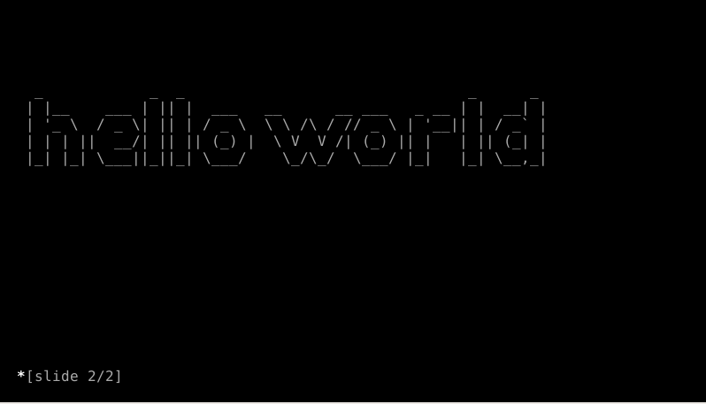
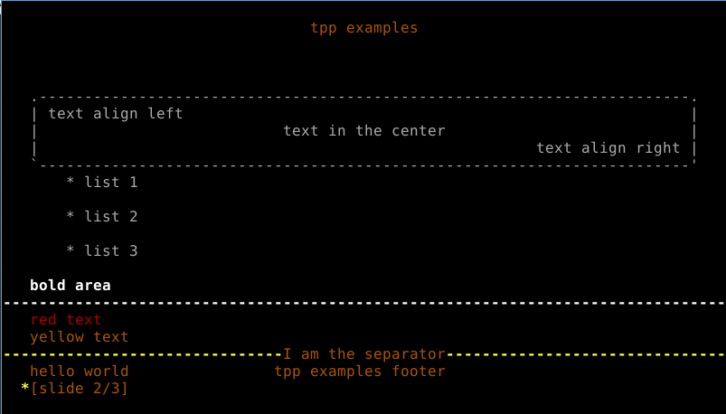
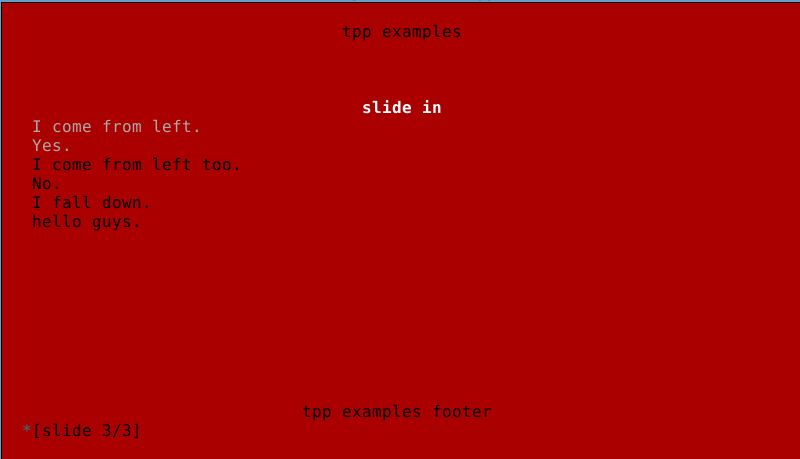
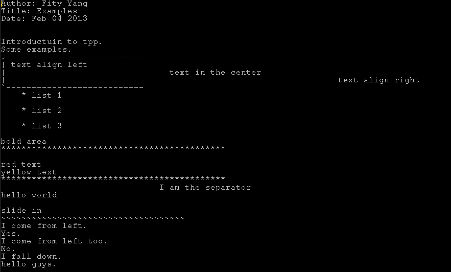
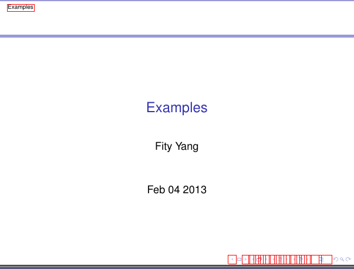
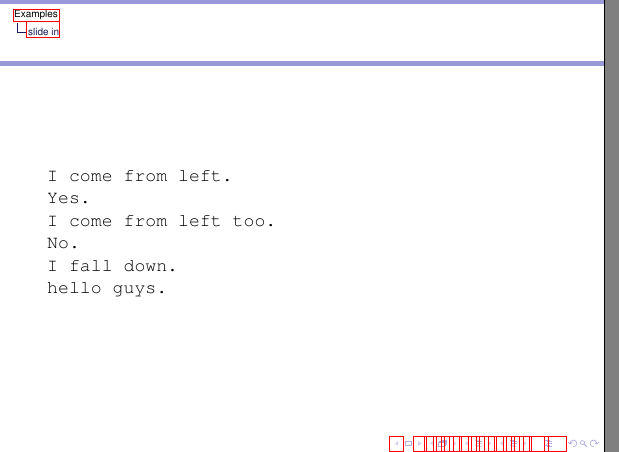
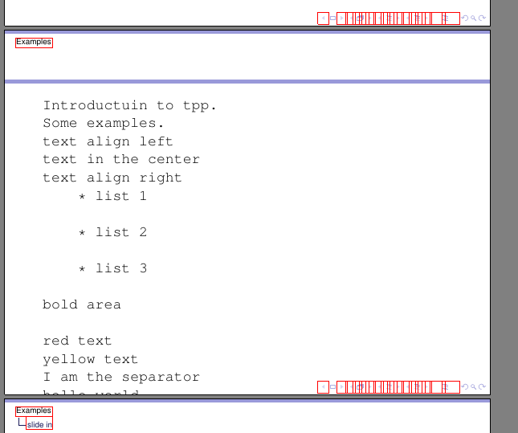

# 命令行快速写 PPT（TPP）

TPP是一款基于文本界面的presentation工具，也就是文字版的ppt。装X当真是犀利无比啊。至于为什么说吊丝，作者example里各种asdf,qwert,jkl看得真是亲切无比啊。吊丝青年心中默默想着：高富帅用的大概都是Mary,Jane这种女神的英文名吧。

先看个最简单的效果图：

关于安装：

各发行版的软件源里应该都有，软件包名称就叫tpp，不确定的可以先搜一下，例如，fedora可以yum search tpp。也可以到[官网](http://www.ngolde.de/tpp.html "官网")下载源码自己手动安装。不推荐这样安装，因为软件依赖比较烦，但是强烈建议下载一份。因为tpp并没有官方的教程（貌似这玩意儿也不需要教程），而google出来的TPP，嗯，有好几个版本，但和这个TPP没有半毛钱关系。要了解tpp的语法和各种特性需要看一下example文件夹中的各个tpp文件，里面什么都有。

此外，安装完tpp之后强烈建议再把figlet包装上。用来支持tpp的–huge选项，效果如下图：


关于tpp命令的使用：

```html
tpp [-t <type> -o <output file>] <file>
```

目前，可使用的type有默认的ncurses，autoplay自动播放，latex生成tex文件，txt生成文本文件。如果用了autoplay类型，还可以加-s选项决定每一张的播放时间，单位是秒。具体可以通过直接输入tpp或者tpp --help查看。

关于播放时的快捷键：

使用鼠标滚轮控制前后，或者可以使用方向键控制。还可以用空格播放下一张，对应的，按b可以回到前一张。按s可以回到第一张，e跳到最后一张，l刷新当前页，c调出命令行，j跳到指定页面，前面所有字母命令不区分大小写。q命令结束播放，退出tpp。

终于到了编写具体tpp文件的时候了。

tpp文件的命令都以两个短划线开始。例如--author是作者，--title是标题，--heading是页面标题（我这么称呼而已，菜逼英语不好）。

更详细的语法可以参照example文件夹下的各个例子。

以下是常用的大部分效果：

```
--author 作者
--title 标题
--date today（可以自动插入当天日期），还可以加各种格式，例如%a表示星期，%b表示月份，%e表示日期，%H表示小时，%M表示分钟，%S表示秒，%Z表示时区，%Y表示年份。
--heading 页面标题
--exec bash命令
--newpage 开始新页面
文字下面加---暂停（一步一步显示）
--beginoutput 开始文本框（可以用来显示代码）
--endoutput 结束文本框
--beginshelloutput 开始shell文本框（模拟shell输入输出）
--endshelloutput 结束shell文本框
--boldon 下面开始文本加粗
--boldoff 结束文本加粗
--revon 下面开始知道revoff文本反白
--revoff 结束文本反白
--ulon 开始文本下划线
--uloff 结束文本下划线
--huge 显示大的艺术字
--sethugefont 设置艺术字字体， standard标准字体，block砖块字体
--beginslideleft 下一行开始文本从左边进入，对应的还有right（从右边进入），top（从顶部进入），bottom（从底部进入）
--endslideleft 结束
--horline 在下一行画一条水平线
--header 页眉
--footer 页脚
--center 文本居中
--right 右对齐（默认左对齐）
--bgcolor 背景色（例如red,blue,yellow）
--color 设置文本颜色（直到出现新的color设置）
--fontcolor 设置文本颜色（全局）
```

嗯，制作ppt常用的命令（基本是所有了其实）应该都在这了。

再附两张效果图：




效果图包含动画，具体的tpp文件内容如下：

 展开源码

```python
eg.tpp

 1 --header tpp examples
 2 --footer tpp examples footer
 3 --author Fity Yang
 4 --title Examples
 5 --date today
 6 Introductuin to tpp.
 7 Some examples.
 8 --newpage one
 9 --beginoutput
10 text align left
11 ---
12 --center text in the center
13 ---
14 --right text align right
15 --endoutput
16 * list 1
17 ---
18
19 * list 2
20 ---
21
22 * list 3
23 ---
24
25 --boldon
26 bold area
27 --boldoff
28 --horline
29
30 --color red
31 red text
32 ---
33 --color yellow
34 yellow text
35 ---
36 --horline
37 --center I am the separator
38 ---
39 hello world
40 --newpage
41 --bgcolor red
42 --heading slide in
43 --beginslideleft
44 I come from left.
45 ---
46 Yes.
47 ---
48 --endslideleft
49 --color black
50 --beginslideright
51 I come from left too.
52 No.
53 --endslideright
54 --beginslidetop
55 I fall down.
56 --endslidetop
57 --beginslidebottom
58 hello guys.
59 --endslidebottom
```

根据该tpp文件生成的txt文件内容如图：


根据tpp文件生成的tex文件内容如下：

 展开源码

```python
eg.tex

 1 % Filename: tpp.tex
 2 % Purpose: template file for tpp latex export
 3 % Authors: (c) Andreas Gredler, Michael Prokop http://grml.org/
 4 % License: This file is licensed under the GPL v2.
 5 % Latest change: Fre Apr 15 20:34:37 CEST 2005
 6 %%%%%%%%%%%%%%%%%%%%%%%%%%%%%%%%%%%%%%%%%%%%%%%%%%%%%%%%%%%%%%%%%%%%%%%%%%%%%%%%
 7
 8 \documentclass{beamer}
 9
10 \mode<presentation>
11 {
12 \usetheme{Montpellier}
13 \setbeamercovered{transparent}
14 }
15
16 \usepackage[german]{babel}
17 \usepackage{umlaut}
18 \usepackage[latin1]{inputenc}
19 \usepackage{times}
20 \usepackage[T1]{fontenc}
21
22 \author{Fity Yang}
23 \title[Examples]{Examples}
24 \date{Feb 04 2013}
25 \begin{document}
26 \begin{frame}
27 \titlepage
28 \end{frame}
29 \begin{frame}[fragile]
30 \begin{verbatim}
31 Introductuin to tpp.
32 Some examples.
33 text align left
34 text in the center
35 text align right
36 * list 1
37
38 * list 2
39
40 * list 3
41
42 bold area
43
44 red text
45 yellow text
46 I am the separator
47 hello world
48 \end{verbatim}
49 \end{frame}
50 \section{slide in}
51 \begin{frame}[fragile]
52 \begin{verbatim}
53 I come from left.
54 Yes.
55 I come from left too.
56 No.
57 I fall down.
58 hello guys.
59
60 \end{verbatim}
61 \end{frame}
62 \end{document}
63 %%%%% END OF FILE %%%%%%%%%%%%%%%%%%%%%%%%%%%%%%%%%%%%%%%%%%%%%%%%%%%%%%%%%%%%%%
```

根据tex文件生成的pdf文件效果如下：





说明：页面上那些很丑陋的红色的按钮真的可以点的啊！

完。
～EOF～
