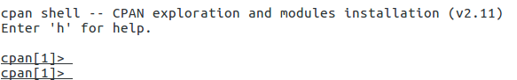

# 高效思维导图/流程图/架构图 Graph Easy

1. 安装

1.1 首先需要安装 graphviz 软件包

执行：sudo apt-get install cflow graphviz

1.2 安装perl  cpan(perl的软件包管理) ，Ubuntu系统自带

1.3 安装Graph::Easy

执行：sudo perl -MCPAN -e shell

输入y后即可进入以下界面：



执行：install Graph::Easy

等待几分...OK。

## 使用

- Graph-easy 使用手册：[https://metacpan.org/pod/Graph::Easy](https://link.jianshu.com/?t=https://metacpan.org/pod/Graph::Easy)
- 执行命令

```
echo "[ Bonn ] -> [ Berlin ] [ Berlin ] -> [ Frankfurt ] { border: 1px dotted black; } [ Frankfurt ] -> [ Dresden ] [ Berlin ] ..> [ Potsdam ] [ Potsdam ] => [ Cottbus ]" | graph-easy

+------+ +---------+ ............. +---------+
| Bonn | --> | Berlin | --> : Frankfurt : --> | Dresden |
+------+ +---------+ :...........: +---------+
 :
 :
 v
 +---------+ +-----------+
 | Potsdam | ==> | Cottbus |
 +---------+ +-----------+
```

## 其他例子

```
演示
分支 graph-easy <<< '[a]->[b]->[c][b]->[d]->[e]'
+---+ +---+ +---+ +---+
| a | --> | b | --> | d | --> | e |
+---+ +---+ +---+ +---+
 |
 |
 v
 +---+
 | c |
 +---+
闭环 graph-easy <<< '[a]->[b]->[c]->[b]->[d]->[e]'
 +--------------+
 | v
 | +---+ +---+ +---+ +---+
 | | a | --> | b | --> | d | --> | e |
 | +---+ +---+ +---+ +---+
 | |
 | |
 | v
 | +---+
 +----------- | c |
 +---+
合流 graph-easy <<< '[a]->[b]->[c][d]->[e]->[b]'
+---+ +---+ +---+
| a | --> | b | --> | c |
+---+ +---+ +---+
 ^
 |
 |
+---+ +---+
| d | --> | e |
+---+ +---+
流程说明 graph-easy <<< '[a]- say hello ->[b]'
+---+ say hello +---+
| a | -----------> | b |
+---+ +---+
上下结构 graph-easy <<< 'graph{flow:south;}[上]->[中]->[下]'
+---+
| 上 |
+---+
 |
 |
 v
+---+
| 中 |
+---+
 |
 |
 v
+---+
| 下 |
+---+
读取文本
首先，编辑文本 vim graph-easy.text

[Instapaper] {size: 2,7;}
[RSS(Feedly)] -> [Instapaper]{ origin: RSS(Feedly); offset: 2,0;}
[WeChat] -> [Instapaper]{ origin: WeChat; offset: 2,-6;}
[Website] -> [Instapaper]
[IFTTT]{size: 1,7;}
[Instapaper] -> [Diigo]{ origin: Instapaper; offset: 2,-2;}
[Instapaper] -> [IFTTT]{ origin: Instapaper; offset: 2,0;}
[Instapaper] -> [Evernote]{ origin: Instapaper; offset: 2,2;}
[Webtask(Serverless)]{size: 2,7;}
[IFTTT] -> [Webtask(Serverless)]{ origin: IFTTT; offset: 2,0;}
然后，执行此文件 graph-easy graph-easy.text

 +----------+
 +-----> | Diigo |
 | +----------+
 |
 |
 |
+-------------+ +--------------+ +----------+ +---------------------+
| RSS(Feedly) | --> | | --> | | --> | |
+-------------+ | Instapaper | | IFTTT | | Webtask(Serverless) |
+-------------+ | | | | | |
| WeChat | --> | | | | | |
+-------------+ +--------------+ +----------+ +---------------------+
 ^ |
 | |
 | |
 +---------+ | +----------+
 | Website | +-----> | Evernote |
 +---------+ +----------+
边的风格
 -> 实线
 => 双实线
 .> 点线
 ~> 波浪线
 - > 虚线
 .-> 点虚线
 ..-> dot-dot-dash
 = > double-dash
例如graph-easy <<< '[hello].>[world]'

+-------+ +-------+
| hello | ..> | world |
+-------+ +-------+

echo "[ DB-M1 ] - 4 -> [ DB-M2 ] [ DB-M2 ] - 4 -> [ DB-M1 ]" | graph-easy
echo "[ DB-M1 ] <-> [ DB-M2 ] " | graph-easy
echo "[ DB-M1 ] - 4 -> [ DB-M2 ] [ DB-M1 ] . (1,2,3,4) .> [ M1-insert ] [ DB-M2 ] . (1,2,3,4) .> [ M2-insert ] [ DB-M2 ] - 4 -> [ DB-M1 ]" | graph-easy
or

graph-easy <<< '[ DB-Master ] - 4 -> [ DB-Shadow Master ] [ DB-Master ] . (1,2,3,4) .> [ Master-insert ] [ DB-Shadow Master ] '

graph-easy <<< '[ DB-Master ] - 4 -> [ DB-Shadow Master ] [ DB-Master ] . (1,2,3,4) .> [ Master-insert ] [ DB-Shadow Master ] [ DB-Master ] - 网络抖动，故障转移 -> [ DB-Shadow Master ]'
自用的例子
graph-easy <<< '[ 服务层 ] - (如果是写操作) -> [ 主数据库 ] [ 服务层 ] - (如果是读操作) -> [ 从数据库 ]'
hash 分片
graph-easy <<< '[ user-service ] - (%2==1) -> [ db1 ] [ user-service ] - (%2==0) -> [ db2 ]'
流程控制
垂直拆分
graph-easy <<< '[ user-center ] { flow: down; } -> [ user-db ]'
多表 join
graph-easy <<< 'graph { flow: up; } [ user-base ], [ user-ext ] --> { end: back,0; } [ user-service ]'
水平拆分
graph-easy <<< 'graph { flow: down; } [user-center] - (0-10W) -> [user-db1] [user-center] - (10W-20W) -> [user-db2]'
前后端分离
graph-easy <<< 'graph { flow: down; } [用户前台] -> [user-center] --> { start: front,0; } [user-db1],[user-db2],[user-db3]'
多对多服务
graph-easy <<< '[Application] - 1 -> [f-service] - 4 -> [Application] [f-service] - 2 -> [BD-T1] [f-service] {flow:down;}- 3 ->[esb] - 5 -> [data-center] - 6 -> [ DB-T2 ]'
方案 2

graph-easy <<< '[Application] - 1 -> [f-service] - 3 -> [Application] [f-service] - 2 -> [BD-T1] [f-service] {flow:down;}- 4 ->[log] - 5 -> [service] - 6 -> [ DB-T2 ]'
数据一致性
graph-easy <<< '[f-service]{flow:down;}--> { start: front,0; }[BD-T1], [DB-T2] [Pair check]{flow:up;}--> { start: front,0; }[BD-T1], [DB-T2]'
database
graph-easy <<< '[service-A] - put -> [cache] - get -> [service-B]
graph-easy <<< '[service] - Put -> [cache] [service] - Update -> [cache] [service] - Apply -> [sso]'
```

```
```

## 参考资料

<https://www.jianshu.com/p/54255050d42f>

<https://juejin.im/post/5a09c43451882535c56c6bbf>
