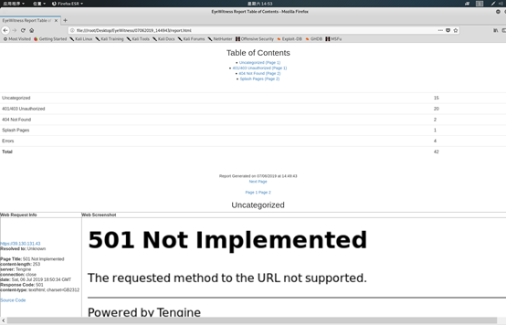

# WEB资产识别

WEB资产识别，使用EyeWitness<https://github.com/FortyNorthSecurity/EyeWitness>

```
python EyeWitness.py -f 目标.txt –web –active-scan –add-http-ports 80,81,88,443,888,2082,2083,3122,4848,6588,7000,7001,7002,7003,8000,8080,8081,8089,8090,8443,8500,8888,9000,9001,9200,9043,9080,10000,10051,50000 –addhttps-ports 443,8443,9043

nmap -T4 -iL 目标.txt -oX scan.xml -p 80,81,88,443,888,2082,2083,3122,4848,6588,7000,7001,7002,7003,8000,8080,8081,8089,8090,8443,8500,8888,9000,9001,9200,9043,9080,10000,10051,50000 -Pn --open -n

python EyeWitness.py -x scan.xml --web --no-dns --active-scan
```


