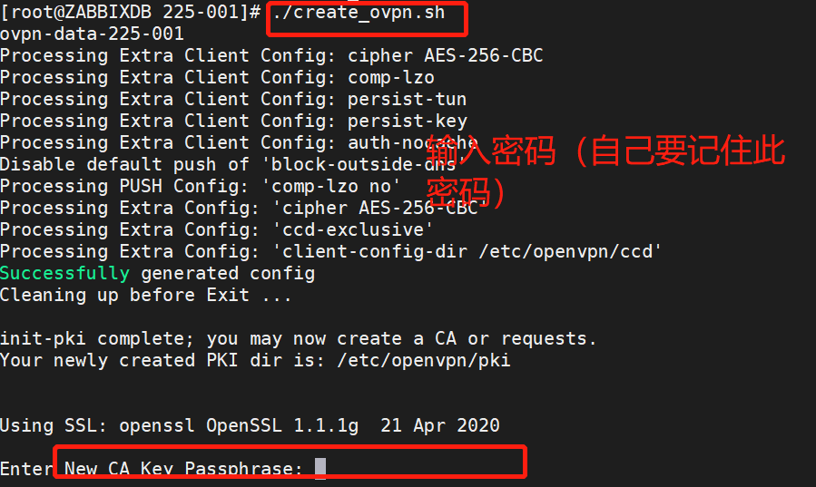
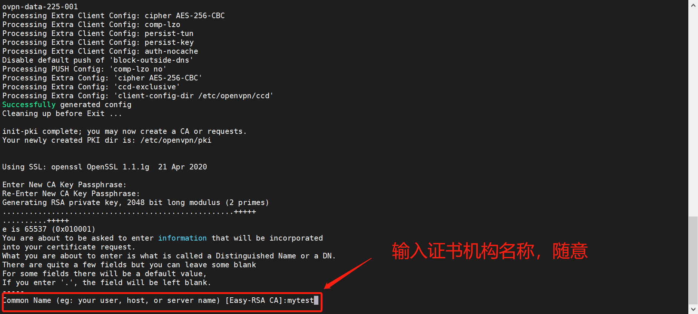
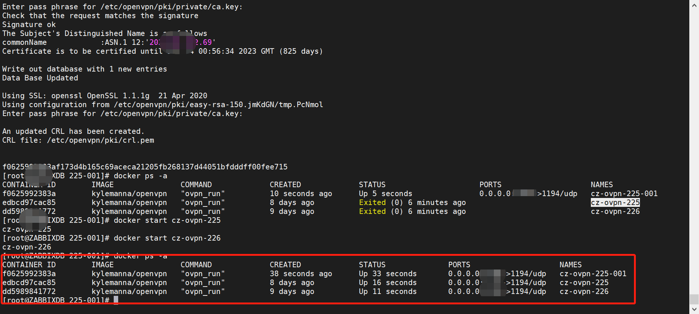

# Docker一键部署OpenVPN

> GitHub 仓库源文件：[点击打开网页渲染版](https://github.com/ben2023niao/ben-ops-notes/blob/main/doc/md/202304141557-Linux%20%E4%B8%8E%20Shell%2B%E6%97%A5%E5%B8%B8%E8%BF%90%E7%BB%B4%2BDocker%2B%E7%9F%A5%E8%AF%86%E7%AC%94%E8%AE%B0-Docker%E4%B8%80%E9%94%AE%E9%83%A8%E7%BD%B2OpenVPN.md)

以下是创建openvpn的脚本：

**create_ovpn.sh**

```bash
#!/bin/bash
OVPN_DATA="ovpn-data-225"
# OVPN_DATA：这个是卷的名称，可以随便起。上面的225，我个人用来表示10.225,这个段。
docker volume create --name $OVPN_DATA
docker run -v $OVPN_DATA:/etc/openvpn --rm kylemanna/openvpn ovpn_genconfig -e "cipher AES-256-CBC" -e "ccd-exclusive" -e "client-config-dir /etc/openvpn/ccd" -E "cipher AES-256-CBC" -E "comp-lzo" -E "persist-tun" -E "persist-key" -E "auth-nocache" -d -D -N -c -s 203.0.113.1/24 -u udp://203.0.113.1:1192
docker run -v $OVPN_DATA:/etc/openvpn --rm -it kylemanna/openvpn ovpn_initpki
#Start OpenVPN server process
docker run --name cz-ovpn-225 -v $OVPN_DATA:/etc/openvpn -d -p 1192:1194/udp --cap-add=NET_ADMIN kylemanna/openvpn
```

以下这一行配置是我经过多次测试，用来分配固定IP后，用户上网进行分流（注：官网的配置指南中的配置，使用动态分配IP,并且所有的流量均通过VPN，实际上不需要这样。）

```bash
docker run -v $OVPN_DATA:/etc/openvpn --rm kylemanna/openvpn ovpn_genconfig -e "cipher AES-256-CBC" -e "ccd-exclusive" -e "client-config-dir /etc/openvpn/ccd" -E "cipher AES-256-CBC" -E "comp-lzo" -E "persist-tun" -E "persist-key" -E "auth-nocache" -d -D -N -c -s 203.0.113.1/24 -u udp://203.0.113.1:1192
```

基本配置与官网一致。现在运行脚本，创建openvpn服务器：



回车后，创建openvpn容器。


这里要注意，输入密码一定要正确，就是上一步填写的密码，否则会出错。



可以创建很多个OpenVPN服务器。

接下来就是创建用户和删除用户了。

所有脚本如下：

**./create_client.sh mytest**

```bash
#!/bin/bash
export OVPN_DATA="ovpn-data-225-001"
if [ -n "$1" ] ; then
 docker run -v $OVPN_DATA:/etc/openvpn --rm -it kylemanna/openvpn easyrsa build-client-full $1 nopass
 docker run -v $OVPN_DATA:/etc/openvpn --rm kylemanna/openvpn ovpn_getclient $1 > /root/docker/225-001/$1.ovpn
 if [ "`ls -A /var/lib/docker/volumes/$OVPN_DATA/_data/ccd/`" ]; then
 cat /var/lib/docker/volumes/$OVPN_DATA/_data/ccd/*|grep -oE '10.225.1.*'|sort -t $'.' -k4 -n >/root/docker/225-001/currentip.ini
 else
 echo "" >/root/docker/225-001/currentip.ini
 fi
 grep -vwf /root/docker/225-001/currentip.ini /root/docker/225-001/allip.ini >/root/docker/225-001/diffip.ini
 theip=`cat /root/docker/225-001/diffip.ini | head -n 1`
 #echo $theip
 echo 'ifconfig-push '$theip'
push "route 203.0.113.1 203.0.113.1 vpn_gateway"
push "route 203.0.113.1 203.0.113.1 vpn_gateway"' | docker run -v $OVPN_DATA:/etc/openvpn -i --rm kylemanna/openvpn tee /etc/openvpn/ccd/$1
fi
```

**./del_client.sh mytest**

```bash
#!/bin/bash
export OVPN_DATA="ovpn-data-225-001"
if [ -n "$1" ] ; then
 docker run --rm -it -v $OVPN_DATA:/etc/openvpn kylemanna/openvpn ovpn_revokeclient $1 remove
 docker run --rm -it -v $OVPN_DATA:/etc/openvpn kylemanna/openvpn rm -f /etc/openvpn/ccd/$1
fi
```

```
```
