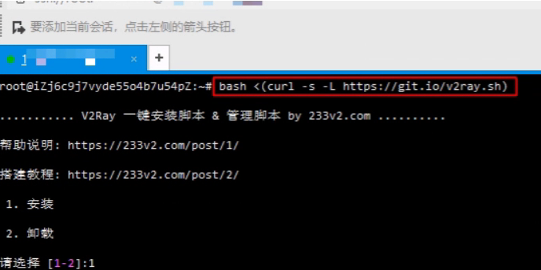
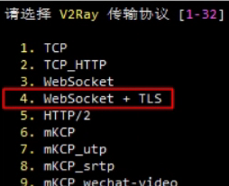
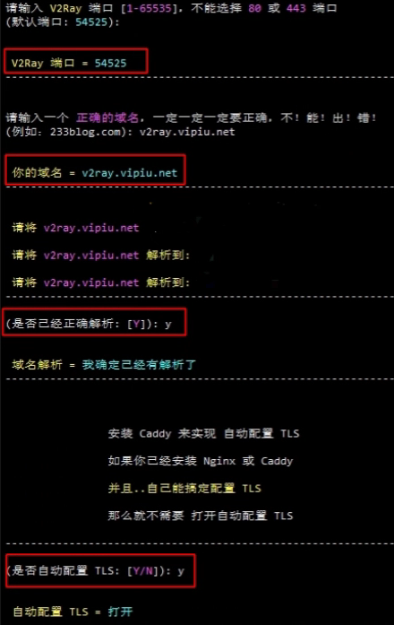
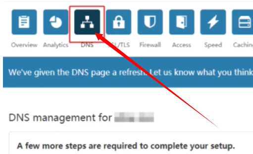
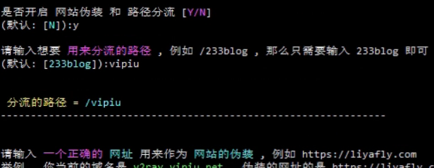
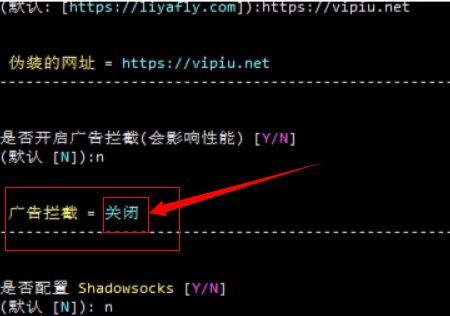
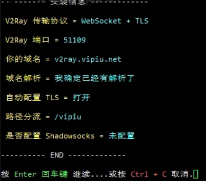
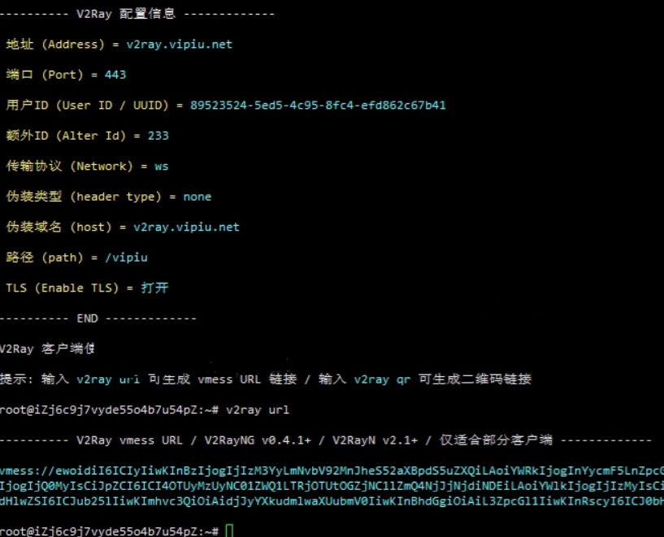
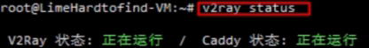
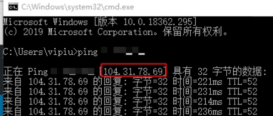

# 复活被墙的IP

## 网站域名被假墙的解决处理方法 v2ray在linux下详解网站假墙处理

最近很多站长在用境外服务器做站的时候出现了被要挟放广告，如果不放直接利用国内防火墙将网站的域名假墙和污染，针对于这种情况本站将处理的方法发出来，本文主要讲如何使用CLF的免费CDN来复活我们被墙的IP，本文章仅作研究，请各位勿用于非法用途，供大家参考使用！

### V2Ray简介

v2ray是Project V里面的一个核心工具，其主要负责网络协议和功能的实现，与其它Project V通信。V2Ray可以单独运行，也可以和其它工具配合，以提供简便的操作流程。

### 主要特性

多入口多出口: 一个V2Ray 进程可并发支持多个入站和出站协议，每个协议可独立工作。
可定制化路由: 入站流量可按配置由不同的出口发出。轻松实现按区域或按域名分流，以达到最优的网络性能。
多协议支持:V2Ray可同时开启多个协议支持，包括Socks、HTTP、Shadowsocks、VMess等。每个协议可单独设置传输载体，比如TCP、mKCP、WebSocket等。
隐蔽性:V2Ray的节点可以伪装成正常的网站（HTTPS），将其流量与正常的网页流量混淆，以避开第三方干扰。
反向代理: 通用的反向代理支持，可实现内网穿透功能。
多平台支持: 原生支持所有常见平台，如Windows、Mac OS、Linux，并已有第三方支持移动平台。

### 正文

首先需要一台VPS。

### 安装/卸载

要求：Ubuntu 14+ / Debian 7+ / CentOS 7
使用root用户输入下面命令安装或卸载

1. bash <(curl -s -L https://git.io/v2ray.sh)

关于操作系统推荐使用Debian9，脚本会自动启用BBR优化。并且不会有各种杂七杂八的问题，特别是需要用到WebSocket + TLS传输协议的情况下建议还是使用Debian9比较稳妥。
如果提示curl: command not found，那是因为没装Curl
ubuntu/debian系统安装Curl方法:

1. apt-get update -y && apt-get install curl -y

centos系统安装Curl方法:

1. yum update -y && yum install curl -y

安装好curl之后再使用脚本。
这里爱游这里只说一个，就是WebSocket + TLS传输协议，复活被墙的IP只能使用这个协议。
1、首先运行上面的安装命令，输入1进行安装。

2、选择传输端口/协议

我们这里只说下如何复活被墙的IP，所以选择WebSocket + TLS

3、V2Ray端口可以随便，默认即可，不要是80和443，然后输入一个域名，接着自动配置TLS

**注意：**
如果你需要使用WebSocket + TLS传输协议来复活被墙的IP请先把域名的DNS修改到CLF的DNS，然后添加一个A记录，不要点亮后面的橙色云朵

4、设置开启网站伪装，和路径分流，伪装地址随意，可以使用百度，google都行，广告拦截不需要，影响性能，不配置酸酸。

5、这个就看看我们配置的有没有错的，错了就重新来一次，没有就回车安装。

6、安装完成

输入命令v2ray url可以生成vmess连接，复制到手机或是电脑、路由器导入进去就能使用。
7、输入v2ray status命令运行状态，两项显示正在运行才是正常的，如果有一项没有运行，请自己检查是否安装正确。

8、这个时候可是去CLF把那个橙色的云朵点亮了，等待10分钟cdn生效。

可以使用cmd来ping一下我们解析的域名，就会发现这个ip不是我们服务器的ip就成功了。
快速管理
v2ray info 查看 V2Ray 配置信息
v2ray config 修改 V2Ray 配置
v2ray link 生成 V2Ray 配置文件链接
v2ray infolink 生成 V2Ray 配置信息链接
v2ray qr 生成 V2Ray 配置二维码链接
v2ray ss 修改 Shadowsocks 配置
v2ray ssinfo 查看 Shadowsocks 配置信息
v2ray ssqr 生成 Shadowsocks 配置二维码链接
v2ray status 查看 V2Ray 运行状态
v2ray start 启动 V2Ray
v2ray stop 停止 V2Ray
v2ray restart 重启 V2Ray
v2ray log 查看 V2Ray 运行日志
v2ray update 更新 V2Ray
v2ray update.sh 更新 V2Ray 管理脚本
v2ray uninstall 卸载 V2Ray

CLF能复活被墙的IP，所以我们可以做很多事情，比如如果服务器里面的网站被封锁了，我们加个CLF就能完美复活，CLF对移动网络有点差，电信联通速度非常好，有需要的童鞋可以试试。
