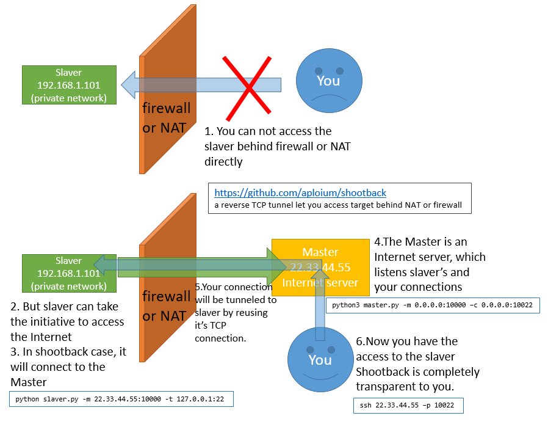

# shootback

<https://github.com/aploium/shootback>

shotback 是一个反向 TCP 隧道让你访问目标后面或防火墙后面的 TCP 通道，访问 NAT 或防火墙
后的内网机器可以被外网访问。
在 800 并发下消耗不到 1% 的 CPU 和 8MB 内存。
slaver 是**单个文件**，仅依赖于 python(2.7/3.4+) 标准库。

## 

## 典型场景

1. 从家里访问公司/学校电脑（没有互联网IP）从家里
连接公司或学校里独立没有外网IP的电脑
2. 使私有网络/站点公开。
使内网或内网站点能够从公网访问
3. 帮助私网渗透。
辅助内网渗透
4. 助力CTF线下比赛
。CTF线下赛，使场外选手也获得比赛网络环境辅助
5. 连接动态IP的设备，如ADSL
连接动态IP的设备，如ADSL
6. slaver和master之间的SSL加密
slaver和master间支持SSL加密

## 入门

1. 要求：

	- 硕士：Python3.4+，独立于操作系统
	- Slaver：Python2.7/3.4+，独立于操作系统
	- 没有外部依赖，只有 python std lib
2. 下载`git clone <https://github.com/aploium/shootback>`
3. （可选）如果你需要一个单文件 slaver.py，运行`python3 build_singlefile_slaver.py`
4. 运行这些命令

```bash
# master listen :10000 for slaver, :10080 for you
python3 master.py -m 203.0.113.1:10000 -c 203.0.113.1:10080

# slaver connect to master, and use example.com as tunnel target
# ps: you can use python2 in slaver, not only py3
python3 slaver.py -m 203.0.113.1:10000 -t example.com:80

# doing request to master
curl -v -H "host: example.com" 203.0.113.1:10080
# -- some HTML content from example.com --
# -- some HTML content from example.com --
# -- some HTML content from example.com --
```

5. 一个更现实的例子（使用 ssl）：
假设你的主人是 203.0.113.1（就像上图一样）

```
# slaver_local_ssh <---> slaver <--[SSL]--> master(203.0.113.1) <--> You
# ---- master ----
python3 master.py -m 203.0.113.1:10000 -c 203.0.113.1:10022 --ssl
# ---- slaver ----
# ps: the `--ssl` option is for slaver-master encryption, not for SSH
python(or python3) slaver.py -m 203.0.113.1:10000 -t 203.0.113.1:22 --ssl
# ---- YOU ----
ssh 203.0.113.1 -p 10022
```

6. 如需更多帮助，请参阅`python3 master.py --help`和`python3 slaver.py --help`

## 提示

1. 在守护进程中运行：
`nohup python(or python3) slaver.py -m host:port -t host:port -q &`
或：

```
# screen is a linux command
screen
python(or python3) slaver.py -m host:port -t host:port
# press ctrl-a d to detach screen
# and if necessary, use "screen -r" to reattach
```

2. 任何使用 TCP 的服务都可以进行回击。HTTP/FTP/代理/SSH/VNC/...
3. 回击本身只是做传输工作，不处理加密或代理。
但是，您可以使用 3rd 方代理（例如：shadowsocks）作为奴隶目标。
例如：
`shadowsocks_server<-->shootback_slaver<-->shootback_master<-->shadowsocks_client(socks5)`

## 警告

1. 在windows中，由于CPython的限制`select.select()`，shootback不能处理超过512的并发，你可能会遇到
`ValueError: too many file descriptors in select()`
如果你必须在windows中处理这么高的并发， 推荐[Anaconda-Python3](https://www.continuum.io/downloads)， [它在windows中的限制是2048](https://github.com/ContinuumIO/anaconda-issues/issues/1241)

## 表现

1. 在我的英特尔 I7-4710MQ 笔记本电脑中，win10 x64：
	- 1.6Gbits/s的环回传输（使用iperf），CPU占用率约为5%。
	- 800 线程 ApacheBench，不到 1% 的 CPU 和 8MB 内存消耗
