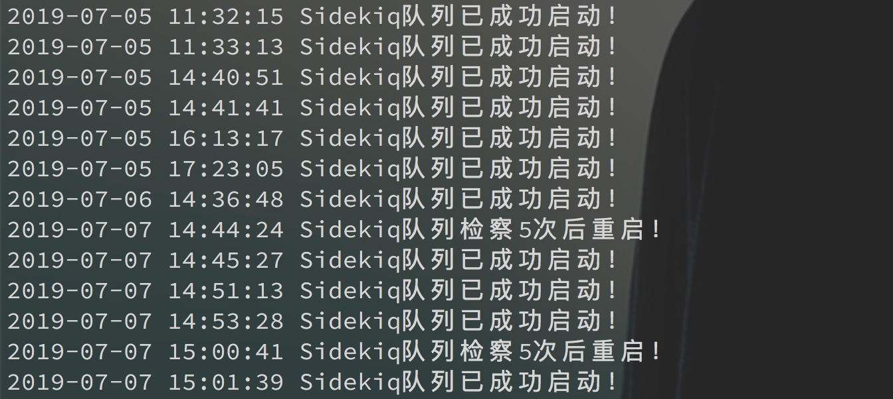

# shell脚本监控进程挂掉自动重启

> GitHub 仓库源文件：[点击打开网页渲染版](https://github.com/ben2023niao/ben-ops-notes/blob/main/doc/md/202304141557-Linux%20%E4%B8%8E%20Shell%2B%E6%97%A5%E5%B8%B8%E8%BF%90%E7%BB%B4%2BPHP%2B%E7%9B%91%E6%8E%A7%E5%91%8A%E8%AD%A6-shell%E8%84%9A%E6%9C%AC%E7%9B%91%E6%8E%A7%E8%BF%9B%E7%A8%8B%E6%8C%82%E6%8E%89%E8%87%AA%E5%8A%A8%E9%87%8D%E5%90%AF.md)

****查看效果****

****

- **生产实践：**

    用于[Gitlab](https://chegva.com/tag/gitlab/ "View all posts in Gitlab") sidekiq进程挂掉自动重启

- **学习技巧：**

    while、if语句、检测记数function，sidekiq启动

- **脚本内容：**

上次搞了个通宵，把公司用了大几年的gitlab从8.11一步步手动编译升级到了11.4.14，没想到踩了个大坑，这个版本的sidekiq调用re2正则库兼容性不好，导致gitlab执行ci时sidekiq会触发bug挂掉。官方目前没有给出解决方案，只能想办法填坑，老板强力要求升级也只能硬刚啊，相关issue如下：

- <https://gitlab.com/gitlab-org/gitlab-ce/issues/60626>
- <https://gitlab.com/gitlab-org/gitlab-ce/issues/54426>
- <https://github.com/mperham/sidekiq/wiki/Problems-and-Troubleshooting#my-sidekiq-process-is-crashing-what-do-i-do>

不过issue有人说升级到11.1没有这个问题，直接看看脚本：

```bash
#!/bin/bash

. /etc/profile

logfile=/home/anzhihe/logs/siqinfo.log

check_service(){
 count=0
 # 用seq来控制每次检测时间，设置的总时间要>sidekiq拉起服务的时间
 for i in `seq 9 13`
 do
 check_sq=$(ps -efa |grep -v grep|grep -c "sidekiq 5.2.1")
 if [ ${check_sq} -eq 0 ]
 then
 ((count++))
 sleep $i
 else
 echo "${date_now} Sidekiq队列已成功启动！" >> ${logfile}
 curl "http://chegva.com/alarm.php?mobile=110&msg='Gitlab Siq队列已重启，请关注！'"
 break
 fi
 done

 if [ $count -eq 5 ];then
 # 检测5次sidekiq队列还没拉起来，则继续重启
 cd /home/git/gitlab && sudo -u git -H RAILS_ENV=production bin/background_jobs start
 echo "${date_now} Sidekiq队列检察5次后重启！" >> ${logfile}
 curl "http://chegva.com/alarm.php?mobile=110&msg='Gitlab Siq队列已检察5次重启，请关注！'"
 fi
}
while true
do
 date_now=$(date +"%Y-%m-%d %H:%M:%S")
 num_sq=$(ps -efa |grep -v grep|grep -c "sidekiq 5.2.1")
 # 脚本每3s扫一次，当sidekiq进程挂了时就自动检测重启
 if [ ${num_sq} -eq 0 ];then
 cd /home/git/gitlab && sudo -u git -H RAILS_ENV=production bin/background_jobs start
 check_service
 else
 sleep 3
 fi
done
#nohup /bin/bash /home/anzhihe/shell/check_queue.sh &
```
