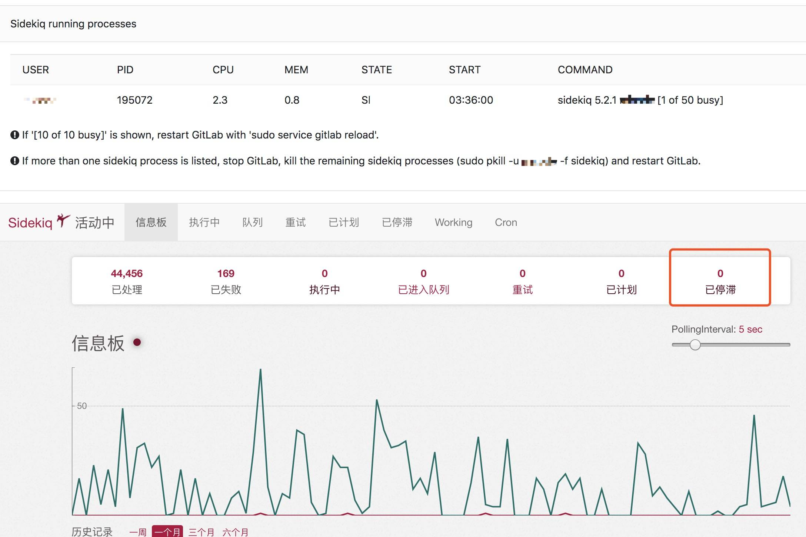

# shell + python脚本监控gitlab ci停滞任务数

****查看效果****

********

****参考：[Gitlab sidekiq队列频繁崩溃问题解决](https://chegva.com/3712.html)****

- **生产实践：**

    用于[Gitlab](https://chegva.com/tag/gitlab/ "View all posts in Gitlab") sidekiq队列停滞任务数清除重启

- **学习技巧：**

    [Shell](https://chegva.com/tag/shell/ "View all posts in Shell") while、function，[Python](https://chegva.com/tag/python/ "View all posts in Python") BeautifulSoup使用

- **脚本内容：**

[Gitlab](https://chegva.com/tag/gitlab/ "View all posts in Gitlab") CI任务停滞数达到几百时会导致发布系统任务阻塞，影响开发使用，之前出过几次问题，搞个脚本监控自动清除停滞任务数还是很有必要的。

**shell脚本**：

**shell脚本** 展开源码

```bash
#!/bin/bash

. /etc/profile

count=0
logfile=/home/anzhihe/scripts/siqinfo.log

function send_message(){
 for i in `cat /home/anzhihe/scripts/phone|sed '/^#/d'`
 do
 curl -s "http://chegva.com/alarm.php?mobile=$i&msg='${date_now} Gitlab Siq队列已有 $block 个任务已停滞,请马上检查！'" >> ${logfile}
 done
}
while true
do
 date_now=$(date +"%Y-%m-%d %H:%M:%S")
 block=$(/home/anzhihe/scripts/gitlab_info.py |sed '/div/d' |awk '{split($0,a,"[><]");print a[3]}' |sed -n '13p')
 if [ $block -ge 100 ];then
 ((count++))
 else
 break
 fi
 if [ $count -ge 3 ];then
 echo "${date_now} Gitlab Siq队列已有 $block 个任务已停滞，请检查原因!" >> ${logfile}
 send_message;
 fi
 sleep 30
 if [ $count -ge 6 ];then
 ssh 203.0.113.1 "cd /home/gitlab/gitlab && sudo -u gitlab -H RAILS_ENV=production bin/background_jobs killall && sudo -u gitlab -H RAILS_ENV=production bin/background_jobs start"
 for i in `cat /home/anzhihe/scripts/phone|sed '/^#/d'`
 do
 curl -s "http://chegva.com/alarm.php?mobile=$i&msg='${date_now} Gitlab Siq队列停滞任务已全部清空,请关注！'" >> ${logfile}
 done
 break
 fi
done
# 查看sidekiq & redis队列信息
/usr/local/Cellar/python/3.7.3/bin/python3 ~/gitlab_info.py |sed '/div/d' | awk '{split($0,a,"[><]");print a[3]}' |sed 'N;s/\n/ /'|awk '{if(NR==9) print $1,$2$3;else print $0}' |sed 's/\(.*\) \(.*\)/\2 \1/' | sed -e '1i ========sidekiq队列信息========' -e '8i ===========Redis信息==========='
# 监控gitlab siq队列停滞任务数 2019/4/4 by anzhihe
*/5 * * * * /bin/bash /home/anzhihe/scripts/siqinfo.sh >/dev/null 2>&1
```

**python脚本**：

**python脚本** 展开源码

```python
# -*- coding: utf-8 -*-
import http.client
import requests
import re
from bs4 import BeautifulSoup

headers = {
 'connection': "keep-alive",
 'user-agent': "Mozilla/5.0 (Macintosh; Intel Mac OS X 10_12_5) AppleWebKit/537.36 (KHTML, like Gecko) Chrome/73.0.3683.103 Safari/537.36",
 'accept': "text/html,application/xhtml+xml,application/xml;q=0.9,image/webp,image/apng,*/*;q=0.8,application/signed-exchange;v=b3",
 'accept-encoding': "gzip, deflate, br",
 'cookie': "sidebar_collapsed=false; remember_user_token=W1s3NjhdLCIkMmEkMTAkajAxbGg0aVNTRkFqR2NsQnpyQ3NOTyIsIjE1NjI2Mzg1MTMuNDY0NjUyNSJd--79a955b7c00ffd2ce1449624d220ac7ea154a1ac; auto_devops_settings_dismissed=true; uLocale=zh_CN; _gitlab_session=e24ba9930ee8e98af7aedc52fd2a52be",
 }

url = "https://gitlab.chegva.com/admin/sidekiq/"
siqdata = requests.get(url, headers=headers)
siqdata.encoding='utf-8'
siqinfo=siqdata.text
soup = BeautifulSoup(siqinfo,'lxml')
for j in soup.find_all('span',attrs={'class':re.compile("desc|count")}):
 print(j)

for k in soup.find_all('div',{'class':'stat'}):
 print(k)
```
