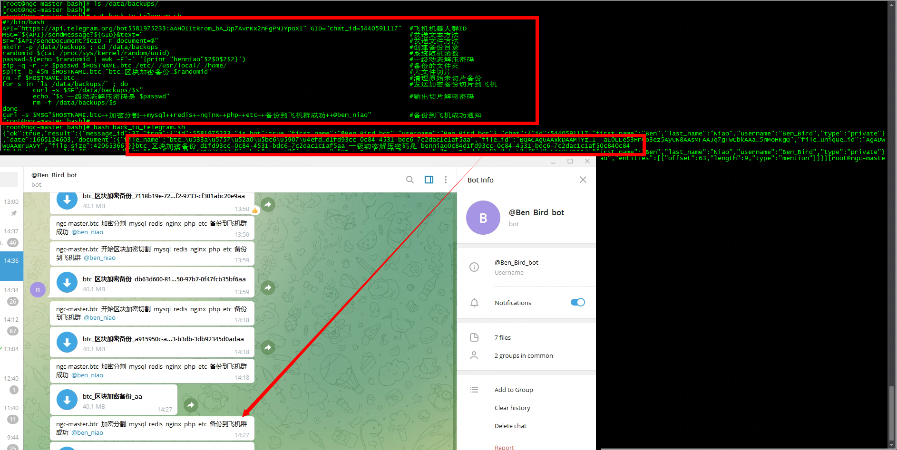

# 加密切片备份到telegram

> GitHub 仓库源文件：[点击打开网页渲染版](https://github.com/ben2023niao/ben-ops-notes/blob/main/doc/md/202304141557-Linux%20%E4%B8%8E%20Shell%2B%E6%97%A5%E5%B8%B8%E8%BF%90%E7%BB%B4%2B%E5%A4%87%E4%BB%BD%E6%81%A2%E5%A4%8D%2B%E7%9F%A5%E8%AF%86%E7%AC%94%E8%AE%B0-%E5%8A%A0%E5%AF%86%E5%88%87%E7%89%87%E5%A4%87%E4%BB%BD%E5%88%B0telegram.md)



**back_to_telegram.sh**

```bash
#!/bin/bash
API="https://api.telegram.org/bot5581975233:AAH0IItRrom_bA_Qp7AvrKx2nFgPNJYpoXI" GID="chat_id=-848933756" #飞机机器人群ID
MSG="${API}/sendMessage?${GID}&text=" #发送文本方法
SF="$API/sendDocument?$GID -F document=@" #发送文件方法
NOW=`date '+%Y%m%d_%H_%M_%S'`
randomid=$(cat /proc/sys/kernel/random/uuid) #系统随机函数
passwd=[已脱敏] $randomid | awk -F'-' '{print "benniao"$2$0$2$2}') #一级动态解压密码

mkdir -p /usr/local/bash/backups ; cd /usr/local/bash/backups #创建备份目录
########################################################################################################################
zip -q -r -P $passwd $HOSTNAME.btc.$NOW /etc/ /log/ #备份的文件夹
########################################################################################################################

mkdir -p /usr/local/bash/backups/telegram
cp $HOSTNAME.btc.$NOW /usr/local/bash/backups/telegram
cd /usr/local/bash/backups/telegram
split -b 45m $HOSTNAME.btc.$NOW "btc_区块加密备份_$randomid" #大文件切片
rm -f $HOSTNAME.btc.$NOW #清理原始未切片备份
for s in `ls /usr/local/bash/backups/telegram/` ; do #发送加密备份切片到飞机
 curl -s $SF"/usr/local/bash/backups/telegram/$s"
 rm -f /usr/local/bash/backups/telegram/$s
done
 echo "$s 一级动态解压密码是 $passwd" > /usr/local/bash/backups/$HOSTNAME.btc.$NOW.txt #输出切片解密密码
#curl -s $MSG"$HOSTNAME.btc.$NOW++加密分割备份到飞机群成功++解压密码 $passwd @ben_niao"                    #备份到飞机成功通知
curl -s $MSG"$HOSTNAME.btc.$NOW++加密分割备份到飞机群成功++解压密码联系 @ben_niao" #备份到飞机成功通知
```
