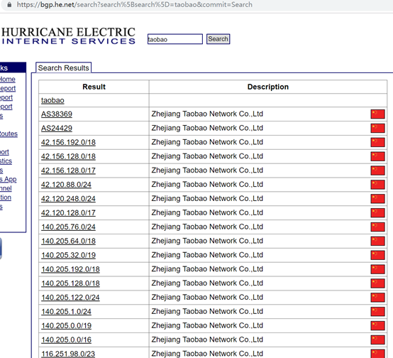
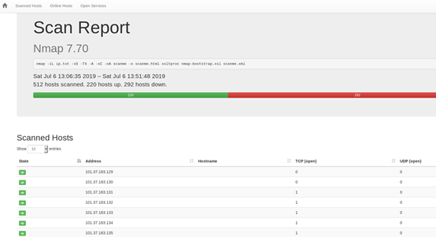
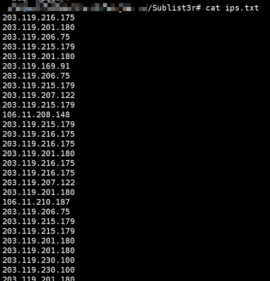
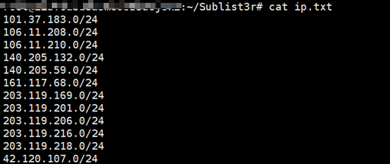

# Ip段资产收集

对于大公司的IP段的信息收集可以使用 [https://bgp.he.net](https://bgp.he.net/)


利用前面获取到的IP段，可以用nmap，masscan进行端口扫描，这里用到了一个nmap的的模板nmap-bootstrap.xsl，这个模板需要自行下载：<https://raw.githubusercontent.com/honze-net/nmap-bootstrap-xsl/master/nmap-bootstrap.xsl>

```
nmap -iL ip.txt -sS -T4 -A -sC -oA scanme xsltproc -o scanme.html nmap-bootstrap.xsl scanme.xml
```

（扫描完打开scanme.html文件可能会是xml格式的，使用xsltproc -o scanme.html nmap-bootstrap.xsl scanme.xml进行转换）


```
for i in `cat dingtalk.com.txt`;do host $i|grep -E -o "([0-9]{1,3}[\.]){3}[0-9]{1,3}";done >ips.txt
```



```
cat ips.txt |sort|uniq|grep -E -o "([0-9]{1,3}[\.]){3}"|uniq -c|awk '{if($1>=2)print $2"0/24"}' > ip.txt
```


