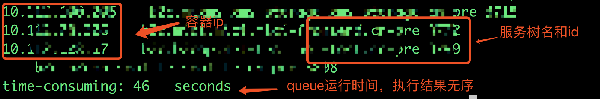

# Shell脚本并发执行

> GitHub 仓库源文件：[点击打开网页渲染版](https://github.com/ben2023niao/ben-ops-notes/blob/main/doc/md/202304141557-Linux%20%E4%B8%8E%20Shell%2B%E6%97%A5%E5%B8%B8%E8%BF%90%E7%BB%B4%2B%E7%9F%A5%E8%AF%86%E7%AC%94%E8%AE%B0-Shell%E8%84%9A%E6%9C%AC%E5%B9%B6%E5%8F%91%E6%89%A7%E8%A1%8C.md)

- **生产实践：**

    使用shell脚本并发查询存在单点容器的服务树节点

- **学习技巧：**

    curl使用、模拟队列并发、fifo管道

- **脚本内容：**

选取404个服务树节点，通过shell脚本并发查出有单点容器的节点并输出单点容器ip、服务树节点信息，使用模拟队列和fifo管道两种查询方式。可以先了解下shell脚本并发多进程：[shell脚本实现并发多进程](https://chegva.com/2549.html)

**> 模拟队列并发：**

**模拟队列并发** 展开源码

```bash
#!/bin/bash
#Njob=15 #任务总数
Nproc=10 #最大并发进程数
function PushQue { #将PID值追加到队列中
 Que="$Que $1"
 Nrun=$(($Nrun+1))
}
function GenQue { #更新队列信息，先清空队列信息，然后检索生成新的队列信息
 OldQue=$Que
 Que=""; Nrun=0
 for PID in $OldQue; do
 if [[ -d /proc/$PID ]]; then
 PushQue $PID
 fi
 done
}
function ChkQue {
 OldQue=$Que
 for PID in $OldQue; do
 if [[ ! -d /proc/$PID ]]; then
 GenQue; break
 fi
 done
 }
function host() {
 tid=$1
 var=`/chegva/get_hosts.sh $tid|wc -l`
 if [ "$var" -le 1 ];then
 treepath=`curl -s -H 'X-Auth-Token: [已脱敏]' "http://chegva.com/.../trees/$tid/info" |grep path | awk -F'"' '{print $4}'`
 echo -ne "`/chegva/get_hosts.sh $tid`    ${treepath} $tid\n";
 else
 #echo -e "$i不存在单结点容器\n"；
 continue;
 fi
}
#for ((i=1; i<=$Njob; i++)); do
for id in $(cat temp3);do
 # echo "progress $id is sleeping for 1 seconds zzz…"
 sleep 1 &
 host $id;
 PID=$!
 PushQue $PID
 while [[ $Nrun -ge $Nproc ]]; do # 如果Nrun大于Nproc，就一直ChkQue
 ChkQue
 sleep 0.1
 done
#done
wait
echo -e "time-consuming: $SECONDS   seconds" #显示脚本执行耗时
```

****> fifo管道：****

**fifo管道** 展开源码

```bash
#!/bin/bash
# 允许的进程数;
THREAD_NUM=10
# 定义描述符为9的管道;
FIFO_FILE="/tmp/$$.fifo"
mkfifo $FIFO_FILE
exec 9<> $FIFO_FILE
# 预先写入指定数量的换行符，一个换行符代表一个进程;
for ((i=0;i<$THREAD_NUM;i++))
do
 echo -ne "\n" 1>&9
done
function host() {
 var=`/chegva/get_hosts.sh $tid|wc -l`
 if [ "$var" -le 1 ];then
 treepath=`curl -s -H 'X-Auth-Token: [已脱敏]' "http://chegva.com/.../trees/$tid/info" |grep path | awk -F'"' '{print $4}'`
 echo -ne "`/chegva/get_hosts.sh $tid`    ${treepath} $tid\n";
 else
 #echo -e "$i不存在单结点容器\n"；
 continue;
 fi
}
for i in $(cat temp3)
do
{
 read -u 9
 {
 sleep 1;
 echo -ne "\n" 1>&9;
 host;
 }&
}
done
wait
echo -e "time-consuming: $SECONDS   seconds"
exec 9>&-
rm -f $FIFO_FILE
```

******◎查看效果******

************

**由上图可以看到fifo管道执行比queue执行要快，fifo执行无序而queue执行是有序的，不过相对于去年测的结果10个并发两者时间差不多，加到20个并发fifo将近快一倍（queue:42s，fifo:21s），加到30个并发(queue:38s,fifo:15s)，不知道是不是api优化了，还是有别的原因。具体两者效率相差多少请大神们测试后告诉我下，多谢多谢。以下是一年前用的总结：**

**实际生产中用脚本测试：使用curl请求400多个服务树容器信息，使用管道并发执行(42s)比队列执行（122s）的大约快3倍(都是10个并发)，不过管道执行是无序的，加大最大并发数速度还能提升速度（提到20个并发费时22s），队列在10个并发进程数时基本是效率最大值，再增大进程数也提升不了多少，不过队列是按顺序执行的，看什么需求选择吧。**
