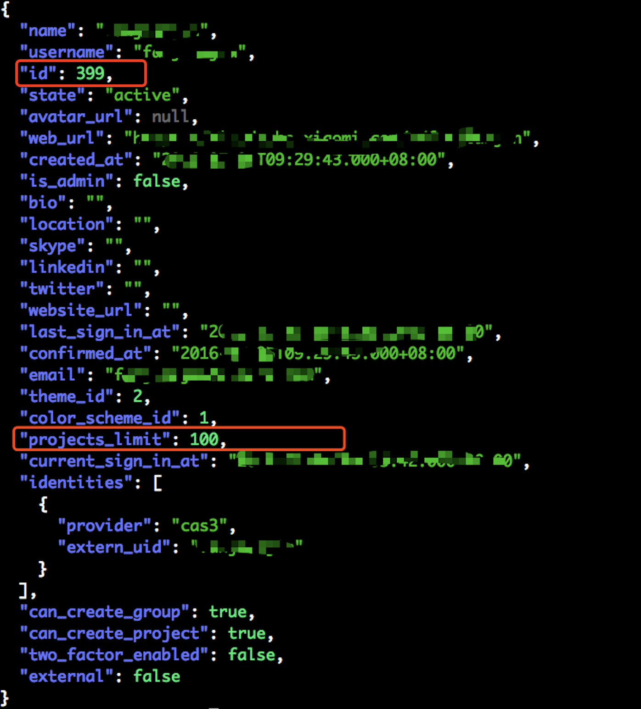
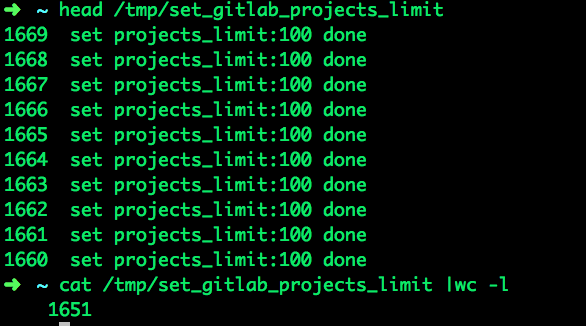

# Shell脚本更改Gitlab所有用户创建项目限制数

> GitHub 仓库源文件：[点击打开网页渲染版](https://github.com/ben2023niao/ben-ops-notes/blob/main/doc/md/202304141557-Linux%20%E4%B8%8E%20Shell%2B%E6%97%A5%E5%B8%B8%E8%BF%90%E7%BB%B4%2B%E7%9F%A5%E8%AF%86%E7%AC%94%E8%AE%B0-Shell%E8%84%9A%E6%9C%AC%E6%9B%B4%E6%94%B9Gitlab%E6%89%80%E6%9C%89%E7%94%A8%E6%88%B7%E5%88%9B%E5%BB%BA%E9%A1%B9%E7%9B%AE%E9%99%90%E5%88%B6%E6%95%B0.md)

- **生产实践：**

    使用shell脚本更改[Gitlab](https://chegva.com/tag/gitlab/ "View all posts in Gitlab")所有用户创建项目限制数

- **学习技巧：**

    curl使用、双层for循环、shell数组、gitlab api调用

- **脚本内容：**

最近好几个开发同事反馈gitlab不能创建仓库，没有创建按钮，一看原来是projects_limit数到限制了，gitlab默认是每个用户创建10个项目，看了下生产的配置，设置的是20个不够用，修改默认配置为100个，但是之前创建的用户限制数设置是不会变的，线上1600多个开发用户难道都得手动一个个点进去修改？生产环境改库风险太大不太可行，想想应该能通过gitlab api来搞，实现思路是先把所有用户的id拿出来，通过用户id修改projects_limit。

****查看效果****

**post返回的结果：**

****

**查看执行结果：**

****

****脚本内容****

```bash
#!/bin/bash
# 执行前请先安装jq
# gitlab默认分页显示20个元素，最大一页显示100个，有1600多个用户需要修改，因此这里要循环17次
for i in {1..17}; do
USER_ID=$(curl -s --insecure -H "PRIVATE-TOKEN: [已脱敏]" -H 'Accept:application/json' -X GET "https://yougitlab.com/api/v3/users?per_page=100&page=${i}" | jq '.[] | .id')
# 这里${USER_ID[@]}不要用双引号引起来，引起来会将所有数组元素作为一个整体输出
for user_id in ${USER_ID[@]}; do
curl -s -H 'Content-Type:application/json' -H 'Accept:application/json' -X PUT -d '{"projects_limit":100}' "https://yougitlab.com/api/v3/users/${user_id}?per_page=1700&private_token=49auTZXx2xxx" | jq
echo "$user_id  set projects_limit:100 done" | tee -a /tmp/set_gitlab_projects_limit
 done
done
```
