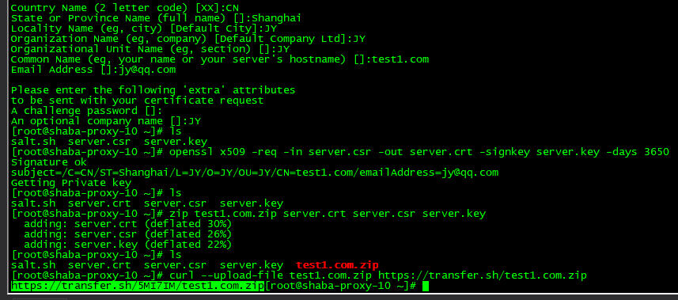

# openssl 自签名10年证书

> GitHub 仓库源文件：[点击打开网页渲染版](https://github.com/ben2023niao/ben-ops-notes/blob/main/doc/md/202304141557-Linux%20%E4%B8%8E%20Shell%2B%E6%97%A5%E5%B8%B8%E8%BF%90%E7%BB%B4%2B%E7%9F%A5%E8%AF%86%E7%AC%94%E8%AE%B0-openssl%20%E8%87%AA%E7%AD%BE%E5%90%8D10%E5%B9%B4%E8%AF%81%E4%B9%A6.md)



```
openssl genrsa -out server.key 1024

openssl req -new -key server.key -out server.csr

openssl x509 -req -in server.csr -out server.crt -signkey server.key -days 3650
```
