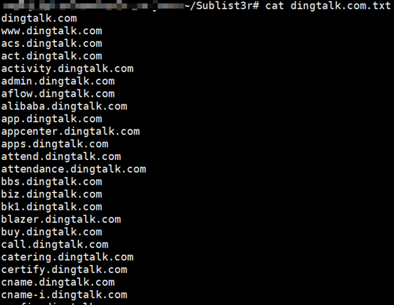
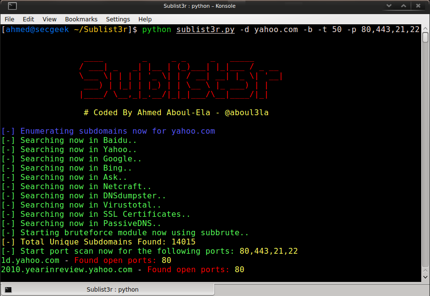

# 子域名收集

> GitHub 仓库源文件：[点击打开网页渲染版](https://github.com/ben2023niao/ben-ops-notes/blob/main/doc/md/202304141557-Linux%20%E4%B8%8E%20Shell%2B%E6%97%A5%E5%B8%B8%E8%BF%90%E7%BB%B4%2B%E7%9F%A5%E8%AF%86%E7%AC%94%E8%AE%B0-%E5%AD%90%E5%9F%9F%E5%90%8D%E6%94%B6%E9%9B%86.md)

使用Sublist3r进行枚举枚举子域名

```
git clone https://github.com/aboul3la/Sublist3r.git
pip install -r requirements.txt
python sublist3r.py -d dingtalk.com -b -t 50 -o dingtalk.com.txt
```



