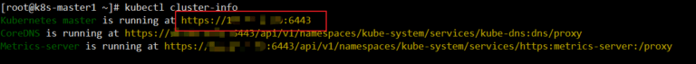

# 2 Zabbix监控K8S 获取k8s的api地址

> GitHub 仓库源文件：[点击打开网页渲染版](https://github.com/ben2023niao/ben-ops-notes/blob/main/doc/md/202304141557-%E5%8F%AF%E8%A7%82%E6%B5%8B%E6%80%A7%2B%E7%9B%91%E6%8E%A7%2BKubernetes%2B%E7%9B%91%E6%8E%A7%E5%91%8A%E8%AD%A6-2%20Zabbix%E7%9B%91%E6%8E%A7K8S%20%E8%8E%B7%E5%8F%96k8s%E7%9A%84api%E5%9C%B0%E5%9D%80.md)

```
查看K8S的api地址的命令如下，在k8s的master节点执行
注意获取到的地址确保外部可以访问
[root@k8s-master1 ~]# kubectl cluster-info
```


