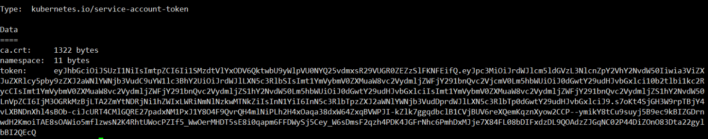

# 3 Zabbix监控K8S Master节点获取token

> GitHub 仓库源文件：[点击打开网页渲染版](https://github.com/ben2023niao/ben-ops-notes/blob/main/doc/md/202304141557-%E5%8F%AF%E8%A7%82%E6%B5%8B%E6%80%A7%2B%E7%9B%91%E6%8E%A7%2BKubernetes%2B%E7%9B%91%E6%8E%A7%E5%91%8A%E8%AD%A6-3%20Zabbix%E7%9B%91%E6%8E%A7K8S%20Master%E8%8A%82%E7%82%B9%E8%8E%B7%E5%8F%96token.md)

一般我们在部署K8S集群中，因为K8S安全性要求很高的，我们都是通过HTTPS的方式去访问的，同时我们也会创建很多的访问的`token`进行授权访问

注意：你也可以单独创建一个token用来供zabbix去采集数据。

