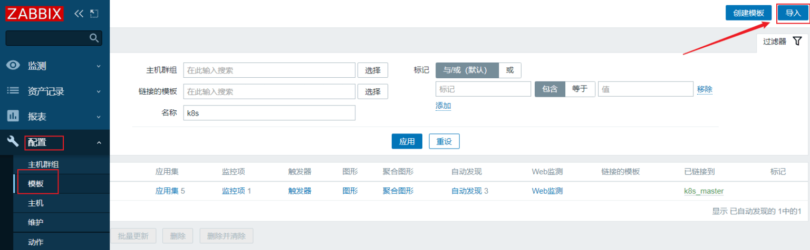
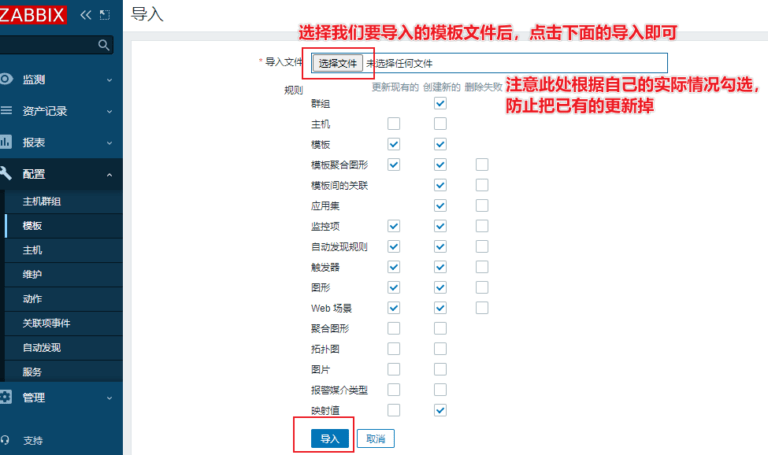
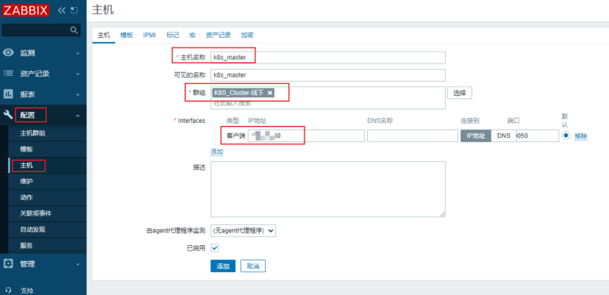
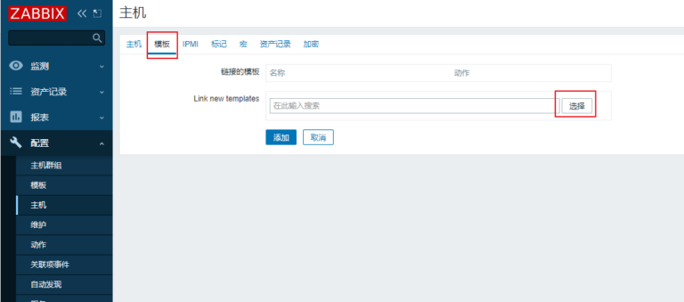

# 5 Zabbix监控K8S 创建主机并套用脚本

> GitHub 仓库源文件：[点击打开网页渲染版](https://github.com/ben2023niao/ben-ops-notes/blob/main/doc/md/202304141557-%E5%8F%AF%E8%A7%82%E6%B5%8B%E6%80%A7%2B%E7%9B%91%E6%8E%A7%2BKubernetes%2B%E7%9B%91%E6%8E%A7%E5%91%8A%E8%AD%A6-5%20Zabbix%E7%9B%91%E6%8E%A7K8S%20%E5%88%9B%E5%BB%BA%E4%B8%BB%E6%9C%BA%E5%B9%B6%E5%A5%97%E7%94%A8%E8%84%9A%E6%9C%AC.md)

- 注意：主机名称必须与上面采集数据py脚本中定义的`clientname`的值保持一致

## 1、上传模板

- 将K8S监控的zabbix模板文件上传至zabbix服务端，通过web界面导入即可

## 2、创建主机

## 3、绑定模板

## 
