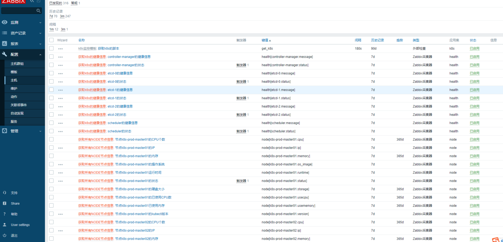

# Zabbix监控K8S

> GitHub 仓库源文件：[点击打开网页渲染版](https://github.com/ben2023niao/ben-ops-notes/blob/main/doc/md/202304141557-%E5%8F%AF%E8%A7%82%E6%B5%8B%E6%80%A7%2B%E7%9B%91%E6%8E%A7%2BKubernetes%2B%E7%9B%91%E6%8E%A7%E5%91%8A%E8%AD%A6-Zabbix%E7%9B%91%E6%8E%A7K8S.md)

一、环境准备和说明
1、下载python3安装包
2、安装依赖包文件
3、创建目录并安装
4、建立执行文件软链
5、zabbix-sender安装

二、获取k8s的api地址

三、Master节点获取token

四、创建脚本并修改脚本
1、创建目录和脚本
2、创建外部采集脚本

五、创建主机并套用脚本
1、上传模板
2、创建主机
3、绑定模板

六、查看获取到的数据

七、查看监控告警信息
