# JVM性能调优监控工具详解(jps,jstack,jmap,jhat,jstat,jinfo,jconsole)

> GitHub 仓库源文件：[点击打开网页渲染版](https://github.com/ben2023niao/ben-ops-notes/blob/main/doc/md/202304141557-%E5%8F%AF%E8%A7%82%E6%B5%8B%E6%80%A7%2B%E7%9B%91%E6%8E%A7%2BLinux%2BJava-JVM%E6%80%A7%E8%83%BD%E8%B0%83%E4%BC%98%E7%9B%91%E6%8E%A7%E5%B7%A5%E5%85%B7%E8%AF%A6%E8%A7%A3%28jps%2Cjstack%2Cjmap%2Cjhat%2Cjstat%2Cjinfo%2Cjconsol.md)

现实企业级Java开发中，会碰到如下问题：
1.OutOfMemoryError，内存不足
2.内存溢出
3.线程锁死
4.锁征用
5.Java进程消耗CPU过高
通过JVM一些常用的监控性能调优工具，可以很好的监控与发现问题所在。

在中银项目中出现了内存溢出的现象，通过使用各种工具配合使用来发现是那些对象没有成功释放，从而解决内存溢出的问题。

jps（Java Virtual Machine Process Status Tool）主要用来输出JVM中运行的进程状态信息。语法格式如下：

```
jps [options] [hostid]
```

如果不指定hostid就默认为当前主机或服务器。
命令行参数如下：

```
-q 不输出类名、Jar名和传入main方法的参数
-m 输出传入main方法的参数
-l 输出main类或Jar的全限名
-v 输出传入JVM的参数
```

如下图：
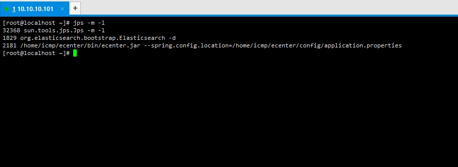

jstack主要用来查看某个Java进程内的线程堆栈信息。语法格式如下：

```
jstack [option] pid
jstack [option] executablecore
jstack [option] [server-id@]remote-hostname-or-ip
```

命令行参数如下：

```
-l long listings，会打印出额外的锁信息，在发生死锁时可以用jstack -l pid来观察锁持有情况
-m mixed mode，不仅会输出Java堆栈信息，还会输出C/C++堆栈信息（比如Native方法）
```

jstack可以定位到线程堆栈，根据堆栈信息我们可以定位到具体代码，所以它在JVM性能调优中使用得非常多。找出某个Java进程中最耗费CPU的Java线程并定位堆栈信息，用到的命令有ps、top、printf、jstack、grep。操作如下：
1.查询Java进程ID，如下图：
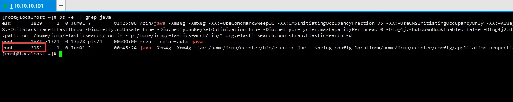

2.通过进程ID查询对CPU消耗最大的线程，可以使用ps -Lfp pid或者ps -mp pid -o THREAD，tid，time或者top -Hp pid，我这里用第三个，如下图：
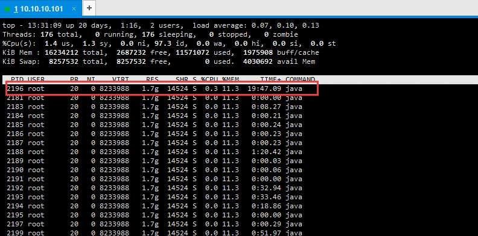

将线程ID转成16进制用于查询，使用如下命令即可实现：

```
printf "%x\n" pid
```

3.使用jstack输出进程的堆栈信息，如下图：
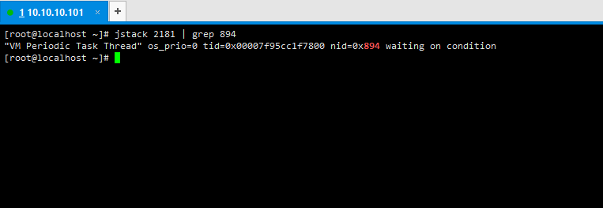

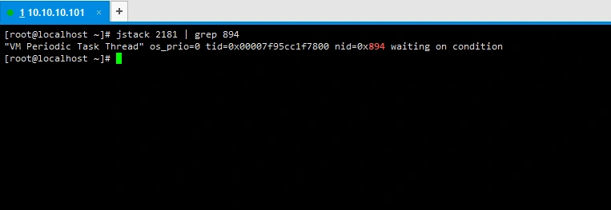

jmap（Memory Map）用来查看堆内存使用状况，一般结合jhat（Java Heap Analysis Tool）使用。语法格式如下：

```
jmap [option] pid
jmap [option] executablecore
jmap [option] [server-id@]remote-hostname-or-ip
```

1.没有参数打印进程的类加载器和类加载器加载的持久代对象信息，输出：类加载器名称、对象是否存活（不可靠）、对象地址、父类加载器、已加载的类大小等信息，如下图：

```
jmap pid
```

``

2.查看进程堆内存使用情况，包括使用的GC算法、堆配置参数和各代中堆内存使用情况。比如下面的例子：

```
jmap -heap pid
```

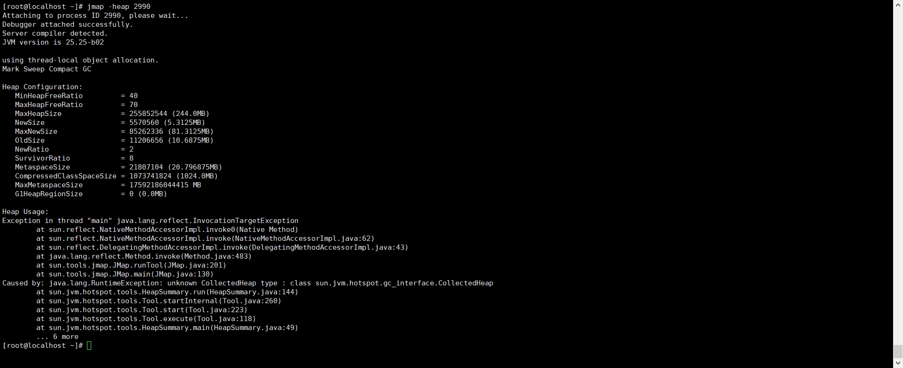

3.使用jmap -histo[:live] pid查看堆内存中的对象数目、大小统计直方图，如果带上live则只统计活对象并且会强制执行一次GC，如下：

```
jmap -histo pid
jmap -histo:live pid
```

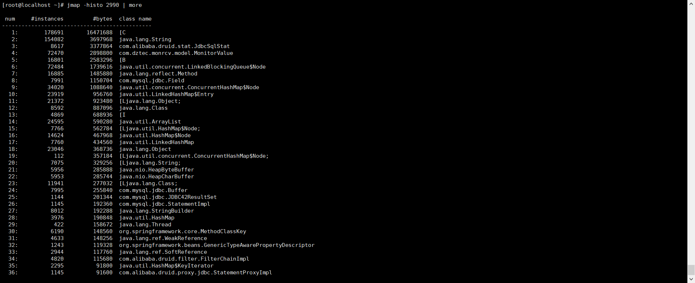

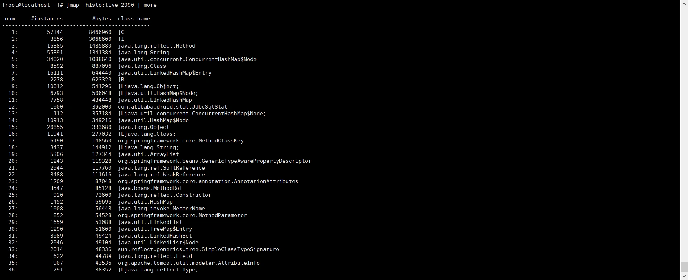

class name是对象类型，说明如下：

```
B  byte
C  char
D  double
F  float
I  int
J  long
Z  boolean
[  数组，如[I表示int[]
[L+类名 其他对象
```

还有一个很常用的情况是：用jmap把进程内存使用情况dump到文件中，再用jhat分析查看。jmap进行dump命令格式如下：

```
jmap -dump:format=b,file=dumpFileName pid (文件的后缀建议采用".hprof")
```

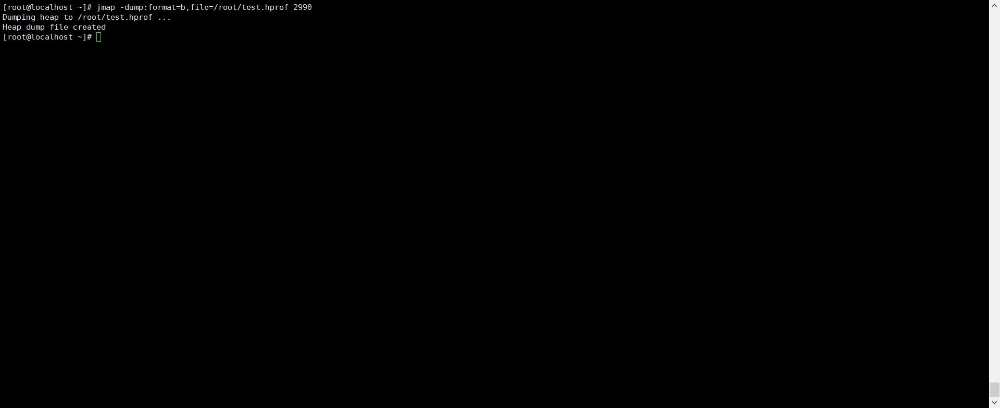

dump出来的文件可以用MAT、VisualVM等工具查看，这里用jhat查看：

```
jhat -port xxxx dumpFileName
```

`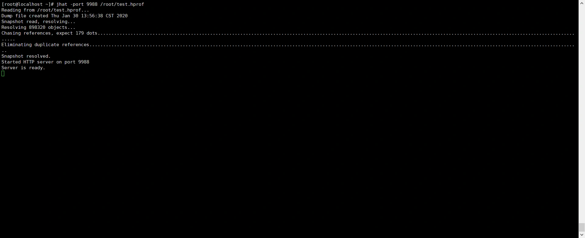
然后就可以在浏览器中输入主机地址:port查看了：
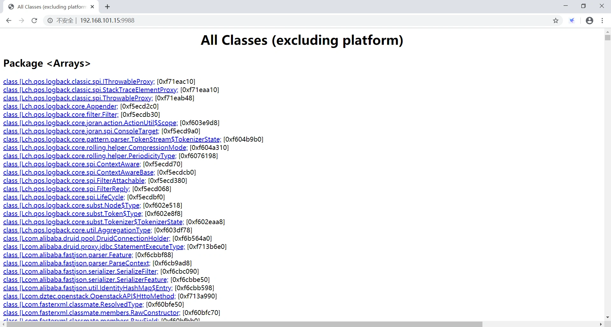`

jstat（JVM统计监测工具），监控的内容有：类装载、内存、垃圾收集、jit编译的信息。语法格式如下：

```
jstat [ generalOption | outputOptions vmid [interval[s|ms] [count]] ]
```

vmid是虚拟机ID，在Linux/Unix系统上一般就是进程ID。interval是采样时间间隔。count是采样数目。比如下面输出的是GC信息，采样时间间隔为250ms，采样数为4：
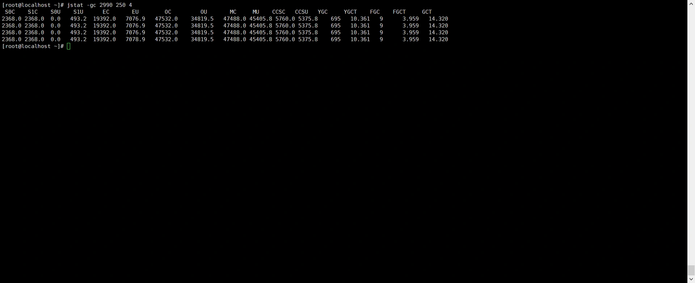
要明白上面各列的意义，先看JVM堆内存布局：
``

可以看出：

```
堆内存 = 年轻代 + 年老代 + 永久代
年轻代 = Eden区 + 两个Survivor区（From和To）
```

各列含义：

```
S0C、S1C、S0U、S1U：Survivor 0/1区容量（Capacity）和使用量（Used）
EC、EU：Eden区容量和使用量
OC、OU：年老代容量和使用量
PC、PU：永久代容量和使用量
YGC、YGT：年轻代GC次数和GC耗时
FGC、FGCT：Full GC次数和Full GC耗时
GCT：GC总耗时
```

jinfo（实时查看与调整虚拟机的各项参数），语法格式如下：

```
jinfo [option] <pid>
jinfo [option] <executable <core>
jinfo [option] [server_id@]<remote server IP or hostname>
```

Java内置监控工具：`jconsole`（终端输入命令即可打开）
作用有：内存监控、线程监控、死锁。
``
