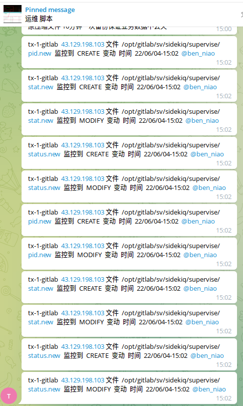

# linux 文件变动监控 bash

> GitHub 仓库源文件：[点击打开网页渲染版](https://github.com/ben2023niao/ben-ops-notes/blob/main/doc/md/202304141557-%E5%8F%AF%E8%A7%82%E6%B5%8B%E6%80%A7%2B%E7%9B%91%E6%8E%A7%2BLinux%2BRedis-linux%20%E6%96%87%E4%BB%B6%E5%8F%98%E5%8A%A8%E7%9B%91%E6%8E%A7%20bash.md)

https://运维.[gitbook.io/devops/jian-kong/wen-jian-bian-dong-jian-kong](http://gitbook.io/devops/jian-kong/wen-jian-bian-dong-jian-kong)


```bash
#!/bin/bash
IP=$(curl -s ip.me)
API="https://api.telegram.org/bot2133309226:AAECwiIYa-WuTtpW3S9_7U6ZwZ_z0GcBEwQ" #飞机机器人API
GID="chat_id=-674687594" #飞机机器人群ID
MSG="${API}/sendMessage?${GID}&text=" #发送文本方法
SF="$API/sendDocument?$GID -F document=@" #发送文件方法
#监控目录
ROOT='/root/'
HOME='/home'
BOOT='/boot/'
OPT='/opt/'
WWW_ROOT='/www/'
ETC='/etc/'
BIN='/bin/'
USR_BIN='/usr/bin'
SBIN='/sbin/'
USR_SBIN='/usr/sbin'
LIB='/lib/'
USR_LIB='/usr/lib/'
LIB64='/lib64/'
USR_LIB64='/usr/lib64/'
USR_INCLUDE='/usr/include'
USR_LOCAL='/usr/local'
SSH_LOG='/var/log/check_user_history.log'
echo 8192000 > /proc/sys/fs/inotify/max_user_watches
#yum install inotify-tools
inotifywait -mrq --timefmt '%y/%m/%d %H:%M' --format '%T %w%f %e' --event delete,modify,create,attrib \
$ROOT $HOME $BOOT $OPT $WWW_ROOT $ETC $BIN $USR_BIN $SBIN $USR_SBIN $LIB $USR_LIB $LIB64 $USR_LIB64 $USR_INCLUDE $USR_LOCAL $SSH_LOG | \
while read date time file event
do
text=$(echo "$HOSTNAME++$IP+文件++$file++监控到++$event++变动++时间++$date-$time++@ben_niao" | \
grep -v '.git/index.lock' |\
grep -v 'nginx/fastcgi_temp/' |\
grep -v 'storage/framework/cache/data' |\
grep -v 'storage/framework/sessions' | \
grep -v '/www/server/panel/data/' | \
grep -v '/www/server/data/' | \
grep -v '/www/server/cron' | \
grep -v '/www/server/panel/logs/request/' | \
grep -v '/www/wwwlogs/' | \
grep -v '/www/backup/' | \
grep -v '/www/server/redis' | \
grep -v '/usr/local/qcloud/' | \
grep -v '/usr/local/uniagent' | \
grep -v '/usr/local/hostguard' | \
grep -v '/usr/local/bin/black' | \
grep -v '/etc/pki/nssdb/dbTemp')
case $event in
MODIFY|CREATE|MOVE|MODIFY,ISDIR|CREATE,ISDIR|MODIFY,ISDIR|MOVED_FROM|MOVED_FROM,ISDIR|DELETE|DELETE,ISDIR)
echo "$text"
if [ "$text" ] ; then curl -s $MSG"$text" ; echo "$text" ; fi
;;
*)
if [ "$text" ] ; then echo "不匹配 $text" ; fi
;;
esac
done
#启动监控脚本命令 nohup bash /data/bash/check_wwwroot.sh >> /data/bash/check_wwwroot.sh.log &
#查看监控日志 tail -f check_wwwroot.sh.log
#结束监控脚本命令 ps -ef | grep check_wwwroot.sh | grep -v grep | awk '{print $2}' | xargs kill -9
```
