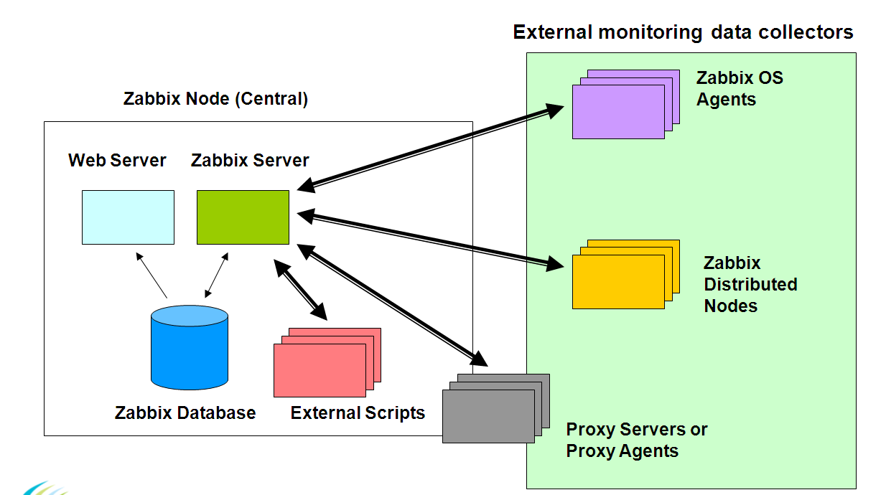
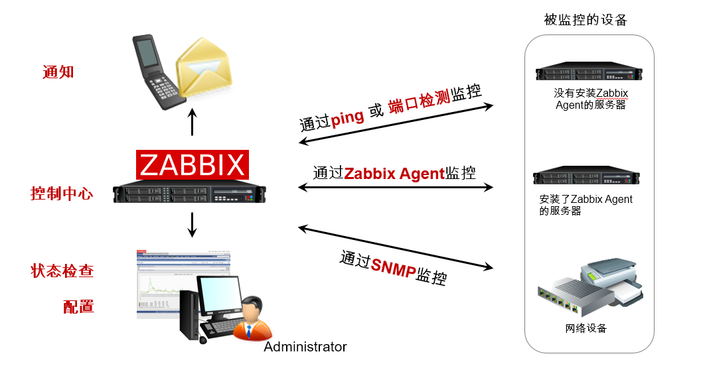
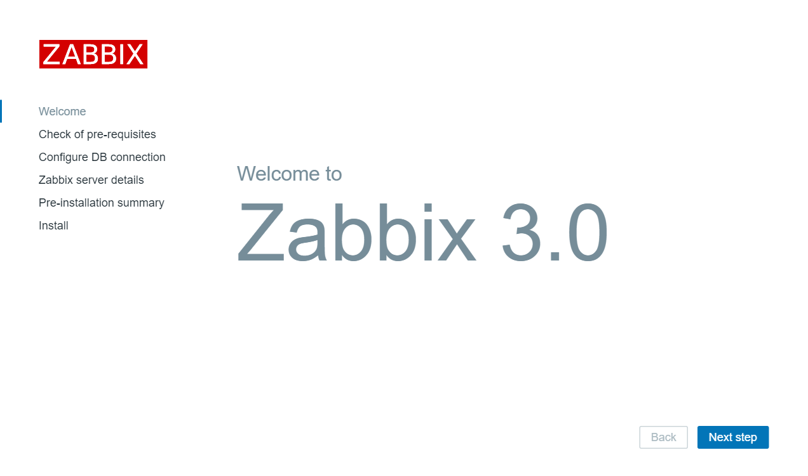
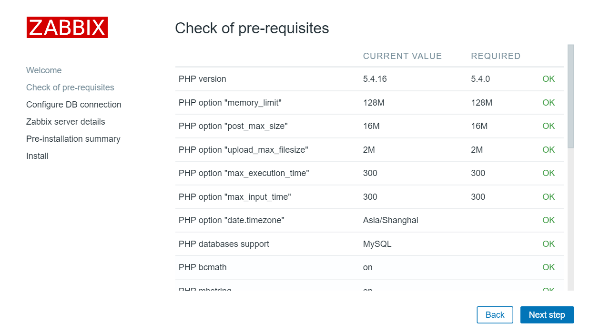
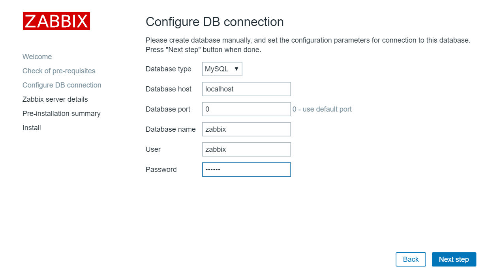
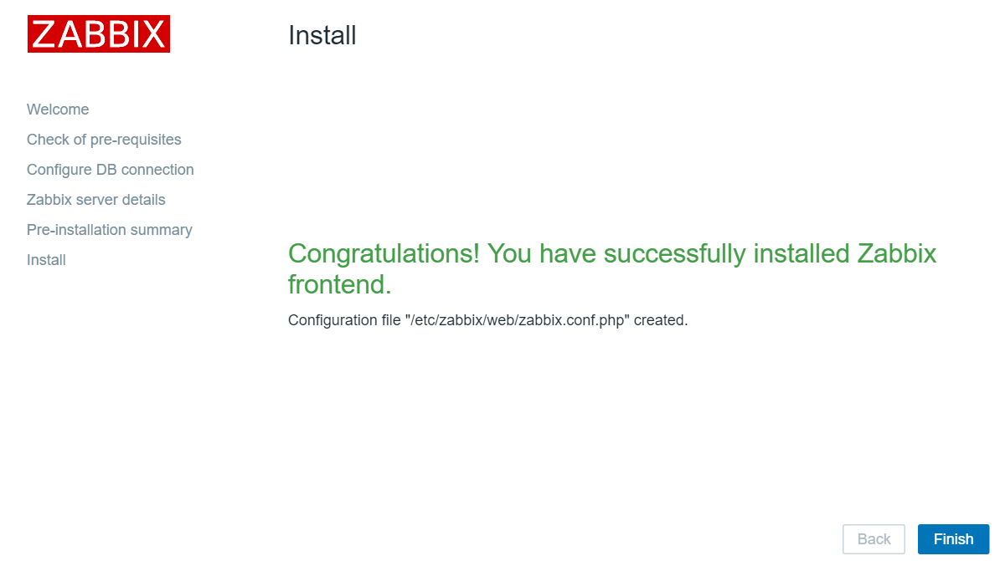
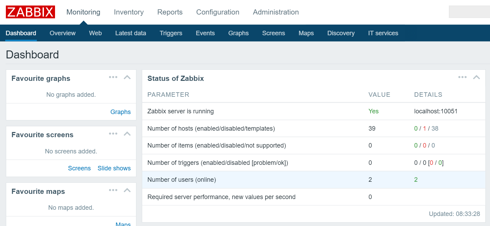

# 分布式监控系统Zabbix学习一

> GitHub 仓库源文件：[点击打开网页渲染版](https://github.com/ben2023niao/ben-ops-notes/blob/main/doc/md/202304141557-%E5%8F%AF%E8%A7%82%E6%B5%8B%E6%80%A7%2B%E7%9B%91%E6%8E%A7%2BLinux%2BWindows-%E5%88%86%E5%B8%83%E5%BC%8F%E7%9B%91%E6%8E%A7%E7%B3%BB%E7%BB%9FZabbix%E5%AD%A6%E4%B9%A0%E4%B8%80.md)

## Zabbix [[官网](http://www.zabbix.com/)]

> "Our aims are to develop an exceptional monitoring solution and to provide responsive and dependable support to resolve any issues regarding its installation, operation and use..." --Zabbix Team

Zabbix 是由 Zabbix LLC团队开发维护的一种分布式网络监控、管理系统，基于Server-Client 架构。可用于监视各种网络服务、服务器和网络机器等状态，同时提供灵活的通知机制可以让系统管理员快速定位/解决存在的各种问题。 [zabbix](https://chegva.com/tag/zabbix/ "View all posts in zabbix")提供的WEB管理端frontend基于PHP和Javascript所构成，Server端与Agent基于C语言开发。Zabbix server可以通过SNMP，Zabbix agent，Ping，端口监视等方法提供对远程服务器/网络状态的监视，数据收集等功能，它可以运行在Linux，Solaris，HP-UX，AIX，Free BSD，Open BSD，OS X等平台上，Zabbix通过C/S模式采集监控数据，通过B/S模式在WEB端管理和展示。

## 系统构成

Zabbix 系统由以下各种独立的模块组成。

- Zabbix Server
- Zabbix Agent
- Zabbix Frontend
- Zabbix API（非必要）
- Zabbix Proxy(非必要)

## 主要特点与功能

Zabbix的主要特点：

- 安装与配置简单，学习成本低
- 支持多语言（包括中文）
- 免费开源
- 自动发现服务器与网络设备
- 分布式监视以及WEB集中管理功能
- 可以无agent监视
- 用户安全认证和柔软的授权方式
- 通过WEB界面设置或查看监视结果
- email等通知功能

Zabbix主要功能：

- CPU负荷
- 内存使用
- 磁盘使用
- 网络状况
- 端口监视
- 日志监视

## 工作原理

> aabbix agent需要安装在被监视的目标服务器上，它主要完成对硬件信息或与操作系统有关的内存，CPU等信息的收集。zabbix agent可以运行在Linux,Solaris,HP-UX,AIX,Free BSD,Open BSD, OS X, Tru64/OSF1, Windows NT4.0, Windows (2000/2003/XP/Vista)等系统之上。 zabbix server可以单独监视远程服务器的服务状态；同时也可以与zabbix agent配合，可以轮询zabbix agent主动接收监视数据（agent方式），同时还可被动接收zabbix agent发送的数据（trapping方式）。 另外zabbix server还支持SNMP (v1,v2)，可以与SNMP软件(例如：net-snmp)等配合使用。

- 工作原理图
- 

## Zabbix3.0安装部署

### 1.环境准备

- ```
查看系统版本内核及IP

[root@linux-node1 ~]# cat /etc/redhat-release
CentOS Linux release 7.2.1511 (Core)
[root@linux-node1 ~]# uname -r
3.10.0-327.18.2.el7.x86_64
[root@linux-node1 ~]# ifconfig eth0|awk -F "[ :]+" 'NR==2{print $3}'
203.0.113.1
[root@linux-node1 ~]# hostname
linux-node1.example.com

关闭SELINUX及防火墙

[root@linux-node1 ~]# getenforce  //查看SELINUX是否已关闭
Disabled
[root@linux-node1 ~]# systemctl status firewalld //查看防火墙是否已关闭
● firewalld.service - firewalld - dynamic firewall daemon
   Loaded: loaded (/usr/lib/systemd/system/firewalld.service; disabled; vendor preset: enabled)
   Active: inactive (dead)
若SELINUX没有关闭，执行以下命令重启
[root@linux-node1 ~]# sed -i "s/SELINUX=enforcing/SELINUX=disabled/g" /etc/selinux/config
[root@linux-node1 ~]# systemctl stop firewalld //关闭防火墙，禁用 disable

```
```

```
### 2.Zabbix安装

- 安装Zabbix官方yum源及组件
- ```sql
1.安装yum源
[root@linux-node1 ~]# rpm -ivh http://repo.zabbix.com/zabbix/3.0/rhel/7/x86_64/zabbix-release-3.0-1.el7.noarch.rpm
2.安装Zabbix Server Web Agent端组件及Mysql服务
[root@linux-node1 ~]# yum install zabbix-server-mysql zabbix-web-mysql zabbix-agent mariadb-server -y

初始化数据库

[root@linux-node1 ~]# systemctl start mariadb
[root@linux-node1 ~]# mysql -uroot -p
1.创建zabbix数据库并赋权限
MariaDB [(none)]> create database zabbix character set utf8 collate utf8_bin;
Query OK, 1 row affected (0.00 sec)
MariaDB [(none)]> grant all privileges on zabbix.* to zabbix@'localhost' identified by 'zabbix';
Query OK, 0 rows affected (0.00 sec)
MariaDB [(none)]> flush privileges;
Query OK, 0 rows affected (0.00 sec)
2.初始化Zabbix数据库
[root@linux-node1 ~]# cd /usr/share/doc/zabbix-server-mysql-3.0.3/
[root@linux-node1 zabbix-server-mysql-3.0.3]# zcat create.sql.gz | mysql -uroot -prootroot zabbix //若root没设密码则写mysql -uroot zabbix

修改配备文件

1.修改Zabbix连接数据库配置如下：
[root@linux-node1 ~]# grep ^D /etc/zabbix/zabbix_server.conf
DBHost=localhost
DBName=zabbix
DBUser=zabbix
DBPassword=zabbix
2.启动Zabbix服务进程
[root@linux-node1 ~]# systemctl start zabbix-server
3.编辑Zabbix前端PHP参数配置
[root@linux-node1 ~]# vi /etc/httpd/conf.d/zabbix.conf
php_value max_execution_time 300
php_value memory_limit 128M
php_value post_max_size 16M
php_value upload_max_filesize 2M
php_value max_input_time 300
php_value always_populate_raw_post_data -1
php_value date.timezone Asia/Shanghai
4.启动Apache Web服务器
[root@linux-node1 ~]# systemctl start httpd
```

```
```

### 3.安装Zabbix Web

> 1.在浏览器打开网址<http://zabbix_server_ip/zabbix> 如<http://203.0.113.1/zabbix会显示安装向导>
>
> 
>
> 2.安装前的配置检查，OK继续
>
> 
>
> 3.数据库连接配置，输入你之前设置的zabbix数据库密码
>
> 
>
> 4.保持默认一直继续下一步，显示成功安装
>
> 
>
> 5.上一部点完成后直接跳转到登陆界面，默认密码为Admin/zabbix,快快开始愉快的Zabbix之旅吧！
>
> 
>
> 参考： <https://www.zabbix.com/documentation/3.0/manual/installation/install_from_packages>
>
>             <http://www.xuliangwei.com/xubusi/455.html>
