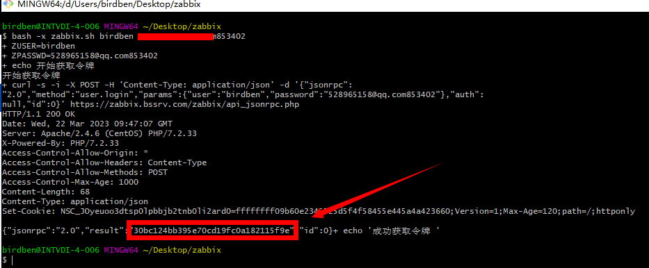

# 1 zabbix API调用 认证并取得加密字段



```bash
ZUSER="$1"
ZPASSWD="$2"
echo "开始获取令牌"

curl -s -i -X POST -H 'Content-Type: application/json' -d '{"jsonrpc":
"2.0","method":"user.login","params":{"user":"'$ZUSER'","password":"'$ZPASSWD'"},"auth":
null,"id":0}' https://zabbix.bssrv.com/zabbix/api_jsonrpc.php

echo "成功获取令牌 $AUTH" > session.txt
```
