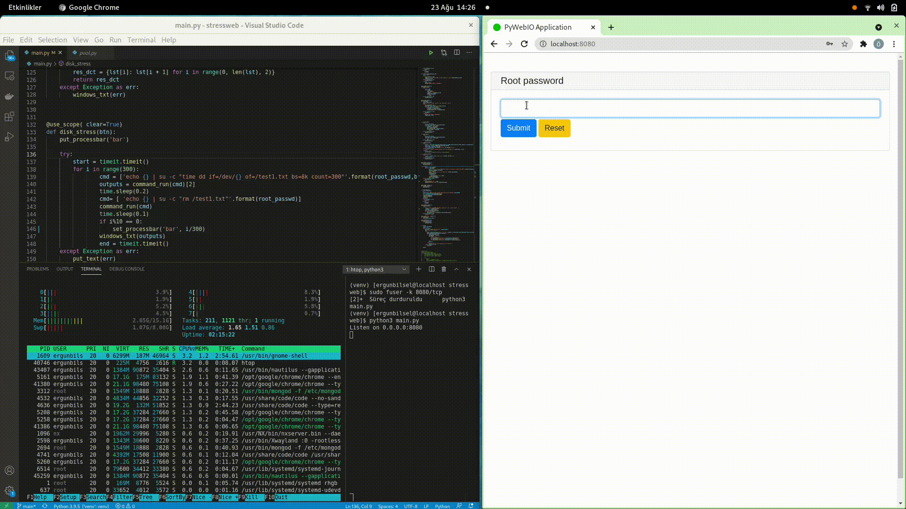

# 内存 磁盘 cpu 监控

> GitHub 仓库源文件：[点击打开网页渲染版](https://github.com/ben2023niao/ben-ops-notes/blob/main/doc/md/202304141557-%E5%8F%AF%E8%A7%82%E6%B5%8B%E6%80%A7%2B%E7%9B%91%E6%8E%A7%2BWindows%2B%E7%9B%91%E6%8E%A7%E5%91%8A%E8%AD%A6-%E5%86%85%E5%AD%98%20%E7%A3%81%E7%9B%98%20cpu%20%E7%9B%91%E6%8E%A7.md)



**requirements.txt** 展开源码

```
Jinja2==3.0.1
MarkupSafe==2.0.1
parse==1.6.6
prettytable==2.1.0
psutil==5.8.0
pydbus==0.6.0
pyecharts==1.9.0
python-iptables==1.0.0
pywebio==1.2.3
simplejson==3.17.3
tornado==6.1
ua-parser==0.10.0
user-agents==2.2.0
wcwidth==0.2.5
WereSync==1.1.5
Yapsy==1.11.223
```

**main.py** 展开源码

```python
import threading
from asyncio.tasks import sleep
from pywebio import start_server
from pywebio.input import input_group
from pywebio.output import *
from pywebio.input import *
from pywebio.session import hold, info as session_info, register_thread
from functools import partial
from functools import partial
from datetime import datetime, time
import os,subprocess
import time,timeit,sys
from multiprocessing import Pool
from multiprocessing import cpu_count
root_passwd = None
time_stress = None
loop = None
def stress_memory(btn):
global loop
try:
loop = True
amount_of_ram= input("how many megabyte of ram will be written and remove?",type=NUMBER)
t1 = threading.Thread(target=memory_stress,args=(amount_of_ram,))
t2 = threading.Thread(target=memory_view)
register_thread(t1)
register_thread(t2)
t1.start()
t2.start()
except Exception as err:
print(err)
finally:
t1.join()
t2.join()
def memory_stress(amount_of_ram):
global loop
try:
print(amount_of_ram)
cmd=["cat <( </dev/zero head -c {}m) <(sleep 1) | tail".format(amount_of_ram)]
command_run(cmd)
except Exception as err:
windows_txt(err)
finally:
loop = False
pop_up('MEMORY STRESS',"FINISHED")
@use_scope(clear=True)
def memory_view():
try:
global loop
while loop:
time.sleep(1)
cmd=["free -m"]
_,output,_ = command_run(cmd)
windows_txt(output)
if loop == False:
break
except Exception as err:
windows_txt(err)
@use_scope(clear=True)
def cpu_usage():
global time_stress
cmd=["top -b -n1 | grep 'Cpu(s)' | awk '{print $2 + $4}'"]
try:
put_processbar('bar')
old_time = time.time()+ float(time_stress+2)
while old_time > time.time():
print(old_time,time.time())
_,output,_ = command_run(cmd)
set_processbar('bar', int(output)/100)
except Exception as err:
print(err)
finally:
pop_up('CPU STRESS',"FINISHED")
time_stress = None
def cpu_stress():
try:
global time_stress
old_time = time.time()+ float(time_stress)
while old_time > time.time():
processes = cpu_count()
pool = Pool(processes)
pool.map(cpu_time, range(processes))
if time.time() > old_time:
break
except Exception as err:
windows_txt(err)
def cpu_time(x):
try:
global time_stress
old_time = time.time()+ float(time_stress)
while old_time > time.time():
x*x
except Exception as err:
windows_txt(err)
def command_run(cmd):
try:
process = subprocess.Popen(cmd,stderr=subprocess.PIPE,stdout=subprocess.PIPE, shell=True,preexec_fn=os.setsid)
outs, errs = process.communicate(input=root_passwd)
result_code = process.returncode
return result_code, outs.decode("utf-8"), errs.decode("utf-8")
except Exception as e:
return 1, 'Could not execute command: {0}. Error Message: {1}'.format(cmd, str(e)), ''
finally:
process.kill()
#os.killpg(os.getpgid(process.pid), signal.SIGTERM)
def convert_dict(lst):
try:
res_dct = {lst[i]: lst[i + 1] for i in range(0, len(lst), 2)}
return res_dct
except Exception as err:
windows_txt(err)
@use_scope( clear=True)
def disk_stress(btn):
put_processbar('bar')
try:
start = timeit.timeit()
for i in range(300):
cmd = ['echo {} | su -c "time dd if=/dev/{} of=/test1.txt bs=8k count=300"'.format(root_passwd,btn)]
outputs = command_run(cmd)[2]
time.sleep(0.2)
cmd= [ 'echo {} | su -c "rm /test1.txt"'.format(root_passwd)]
command_run(cmd)
time.sleep(0.1)
if i%10 == 0:
set_processbar('bar', i/301)
windows_txt(outputs)
end = timeit.timeit()
except Exception as err:
put_text(err)
finally:
windows_txt("Total Time: {}".format(start-end))
@use_scope( clear=True)
def windows_txt(txt):
put_text(txt)
def test_cpu(btn):
global time_stress
try:
time_stress= input("How many seconds should the stress continue?",type=NUMBER)
t1 = threading.Thread(target=cpu_stress)
t2 = threading.Thread(target=cpu_usage)
register_thread(t1)
register_thread(t2)
t1.start()
t2.start()
except Exception as err:
print(err)
finally:
t1.join()
t2.join()
@use_scope( clear=True)
def test_disk(btn):
try:
cmd = ["lsblk -io KNAME,TYPE,SIZE | grep part | awk  '{print $1,$3}' " ]
result_code,output,error = command_run(cmd)
list_part = output.split()
dct = convert_dict(list_part)
for btn in dct.keys():
put_buttons(["{}".format(btn)],onclick=disk_stress)
except Exception as err:
print("Err: ",err)
@use_scope('time', clear=True)
def show_time():
put_text(datetime.now())
@use_scope(clear=True)
def pop_up(title,text):
with popup(title):
put_text(text)
def main():
global root_passwd
done = False
while not done:
password = [已脱敏]"Root password", type=PASSWORD)
cmd = ["su", "-c", "id" ]
try:
pipe = subprocess.Popen(["su", "-c", "id" ], shell=True,stdin=subprocess.PIPE,stderr=subprocess.PIPE,preexec_fn=os.setsid)
pipe.communicate(input=password.encode())
if pipe.returncode == 0:
root_passwd = password
put_table([
['Id', 'Actions'],
[1, put_buttons(['Disk Test'], onclick=partial(test_disk))],
[2, put_buttons(['CPU Test'], onclick=partial(test_cpu))],
[3, put_buttons(['MEM Test'], onclick=partial(stress_memory))],
])
done=True
else:
pop_up("Warning","root password is not correct")
except Exception as err:
print(err)
hold()
# Belki sonra
# @use_scope(clear=True)
# def gauge_chart(hardware,val):
#     from pywebio.output import put_html
#     from pyecharts import options as opts
#     from pyecharts.charts import Gauge
#     c = (
#         Gauge()
#         .add("", [(hardware, val)])
#         .set_global_opts(title_opts=opts.TitleOpts(title="Gauge-Stress"))
#     )
#     c.width = "100%"
#     put_html(c.render_notebook())
if __name__ == '__main__':
start_server(main, debug=True, port=8080, cdn=False)
```

**运行方式**

```
python3 -m venv check #创建虚拟环境 check
. check/bin/activate                     #进入虚拟环境 check
pip3 install -r requirements.txt             #虚拟环境内安装依赖
python3 main.py                       #运行项目 默认8080端口 （可到 main.py 最后一行自定义端口）
```

***核心代码示例***

**内存**

```
cmd=["cat <( </dev/zero head -c {}m) <(sleep 1) | tail".format(amount_of_ram)]
```

**磁盘**

```
cmd = ['echo {} | su -c "time dd if=/dev/{} of=/test1.txt bs=8k count=300"'.format(root_passwd,btn)]
```

**CPU**

```python
def cpu_stress():
try:
global time_stress
old_time = time.time()+ float(time_stress)
while old_time > time.time():
processes = cpu_count()
pool = Pool(processes)
pool.map(cpu_time, range(processes))
if time.time() > old_time:
break
except Exception as err:
windows_txt(err)
def cpu_time(x):
try:
global time_stress
old_time = time.time()+ float(time_stress)
while old_time > time.time():
x*x
except Exception as err:
windows_txt(err)
```
