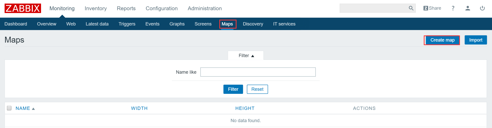
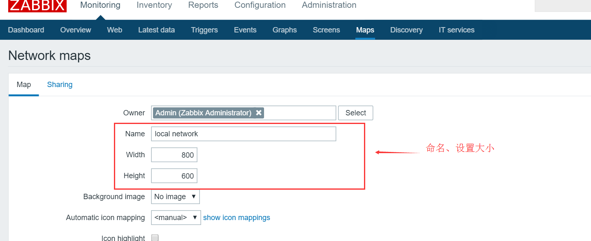
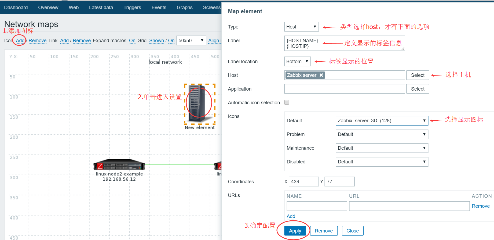
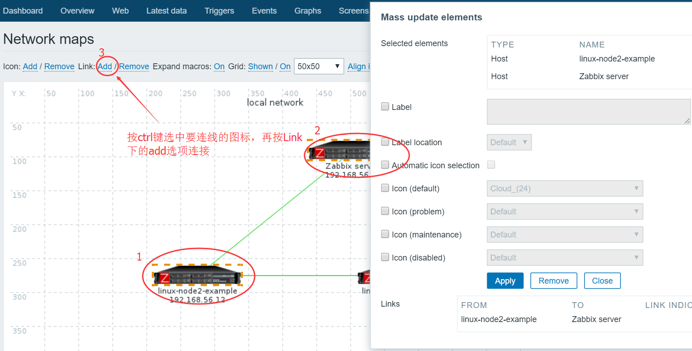
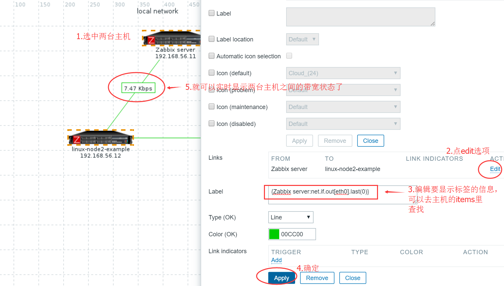
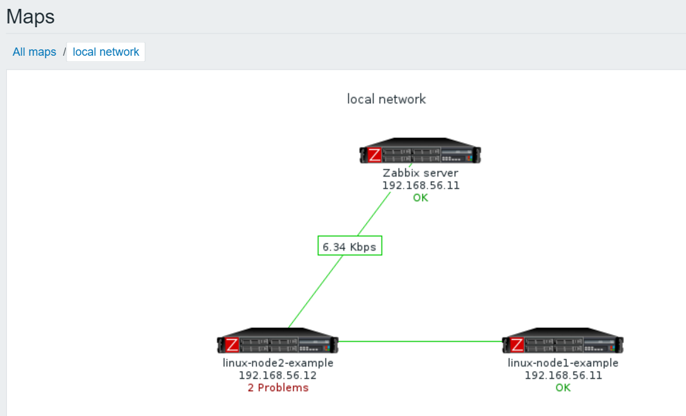

# 分布式监控系统Zabbix学习三

## Zabbix自定义map拓扑图

> 当监控的主机不是很多时(几十台)，使用[zabbix](https://chegva.com/tag/zabbix/ "View all posts in zabbix")的maps功能画一个简单的拓扑图很方便就能把主机之间的状态显示出来，非常实用方便，那我们就动手吧！

### 1.创建一个map

#### 2.编辑map

#### 3.添加一个主机icon

4.添加主机间连接

5.显示主机间想显要的信息

6.保存编辑

#### 7.最终效果图，很简单实用，快去试试吧！

