# 分布式监控系统Zabbix学习二

## Zabbix自定义主机模板监控项

### 1.创建监控模板

- 创建监控组，方便管理，组名建议使用英文，方便后续调用接口

**Zabbix操作界面总览图**
- 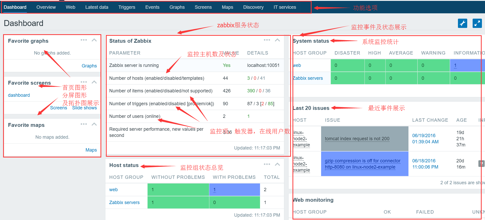
- 添加监控组
- 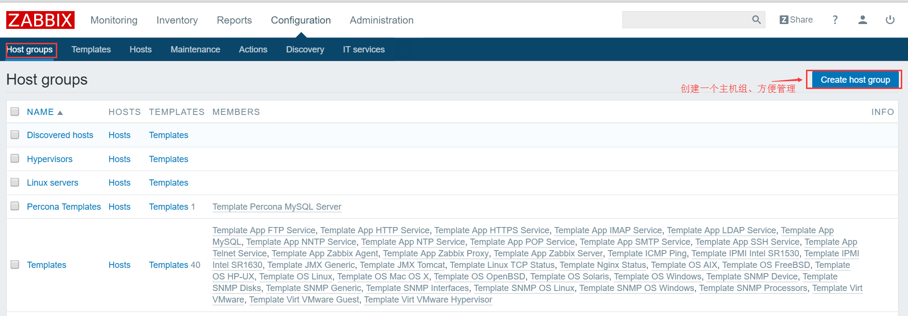
- 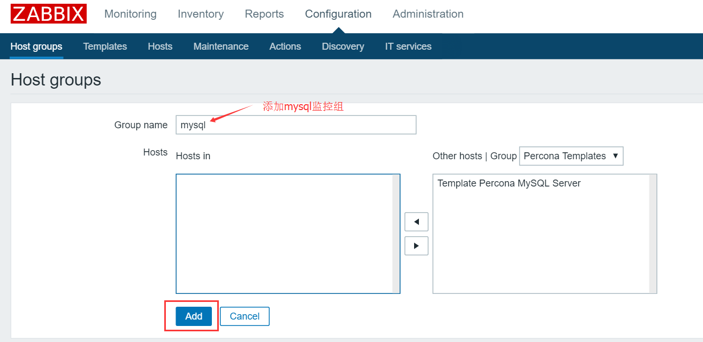
- 添加主机，这里重点是监控主机和模板的添加配置

添加主机
- 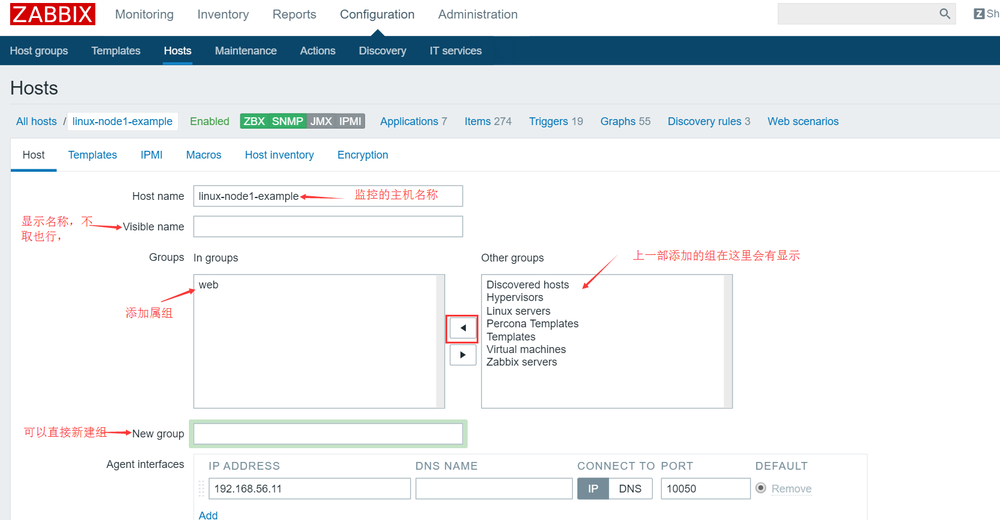
- 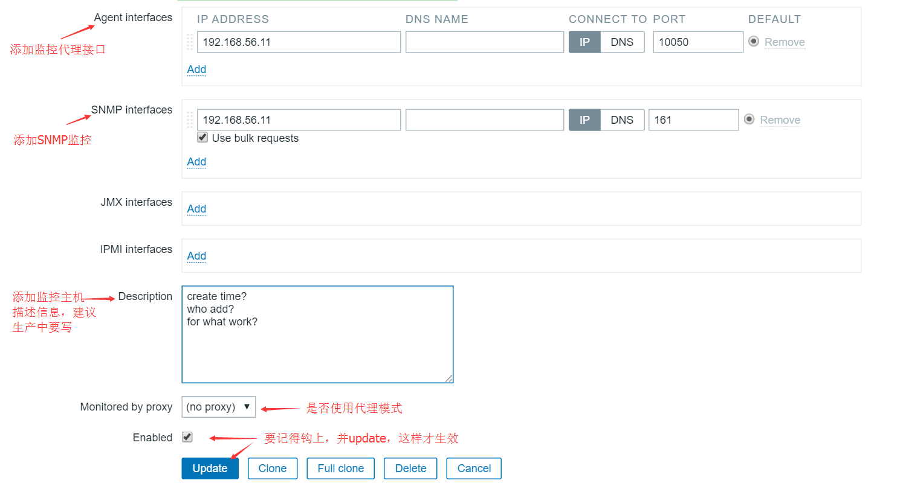
- 给主机添加模板
- 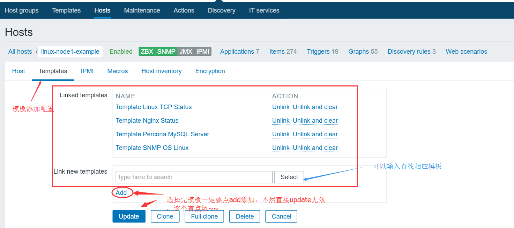
- 查看主机状态
- 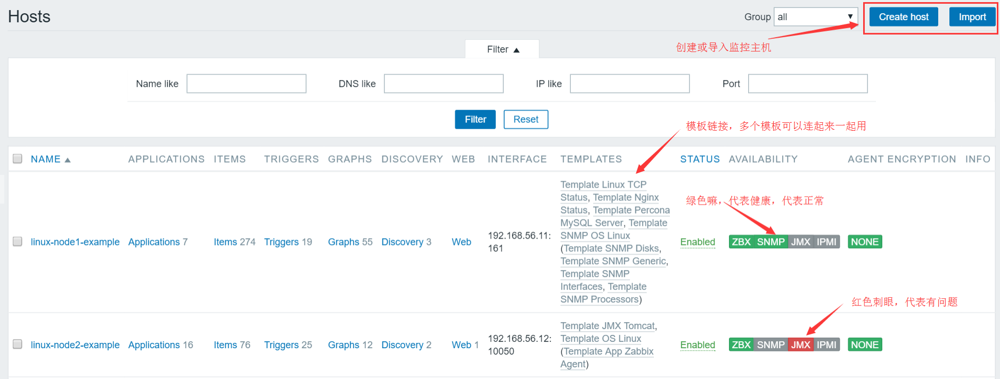
- 模板配置简单介绍
- 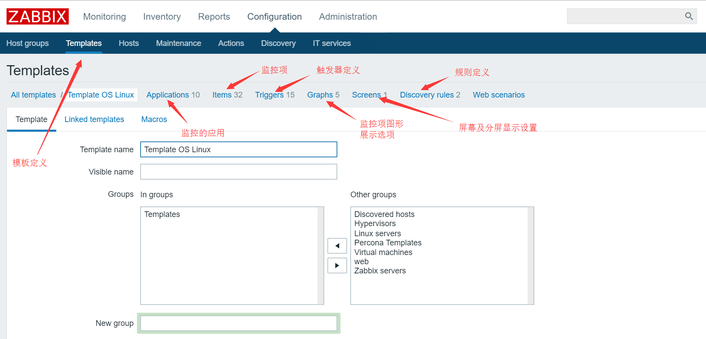
- ### 2.添加自定义item图形监控项

	- 添加item
- 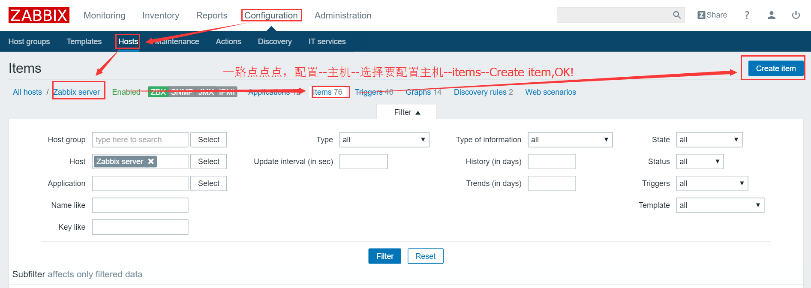
- item配置
- 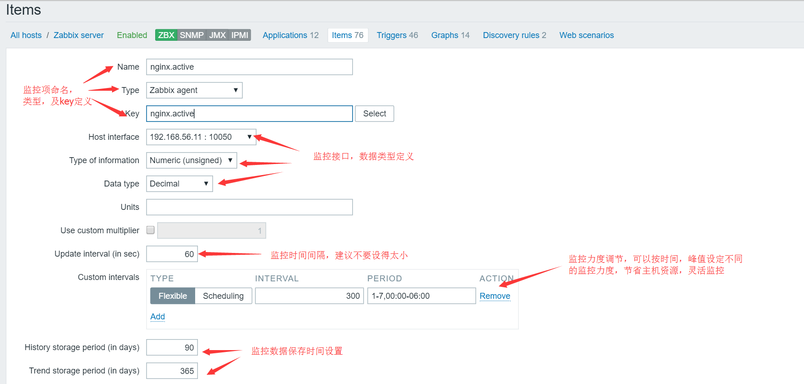
- 给添加的item添加graphs图形显示界面

创建graph
- 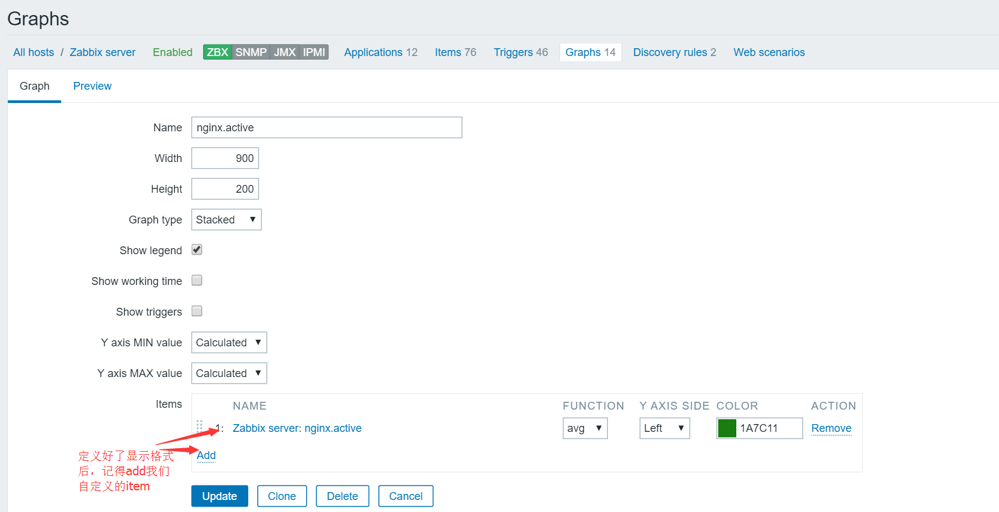
- 效果展示
- 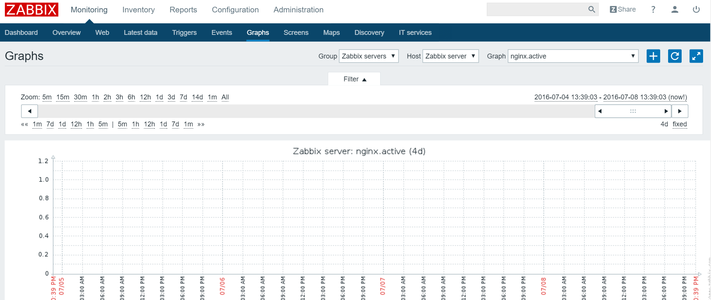
