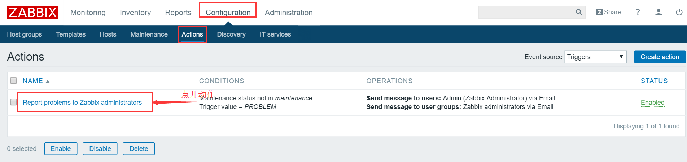
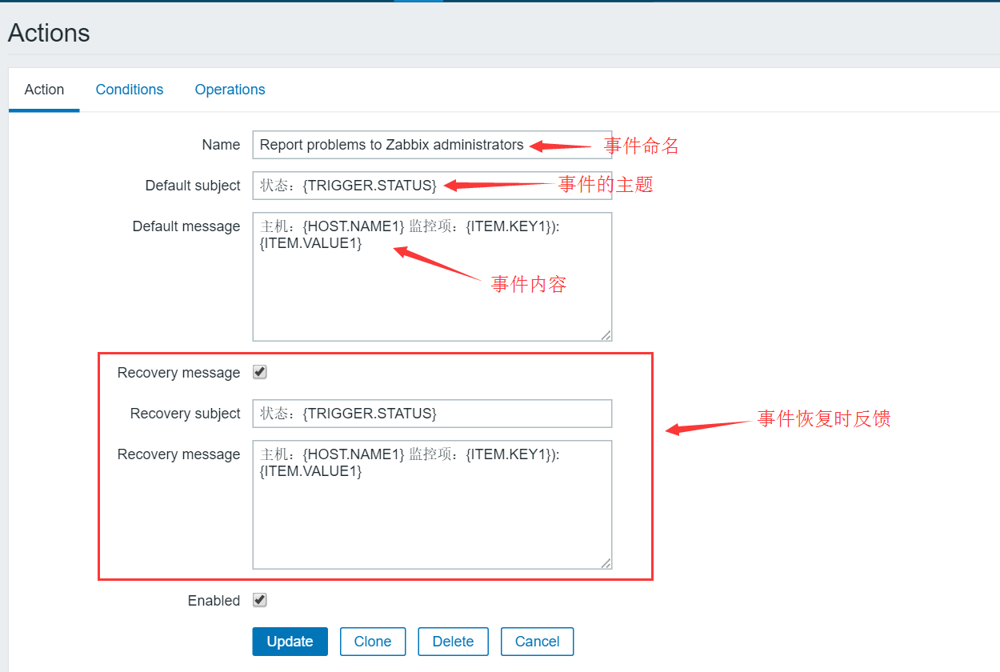
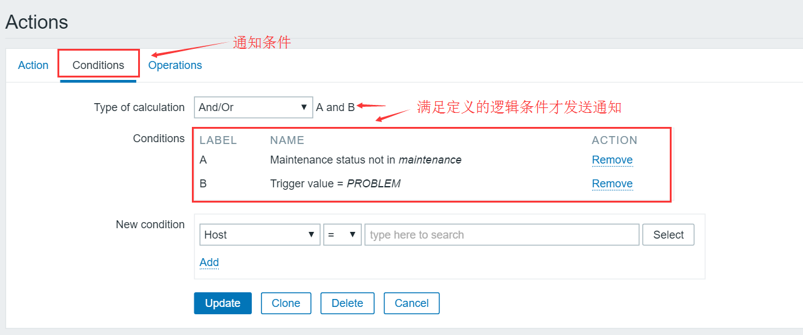
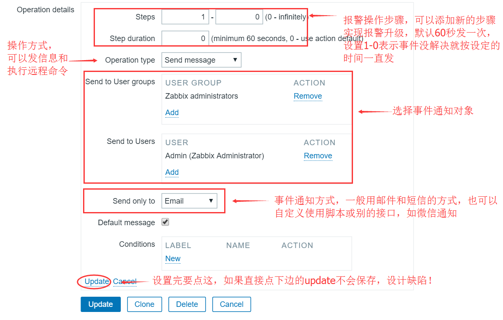
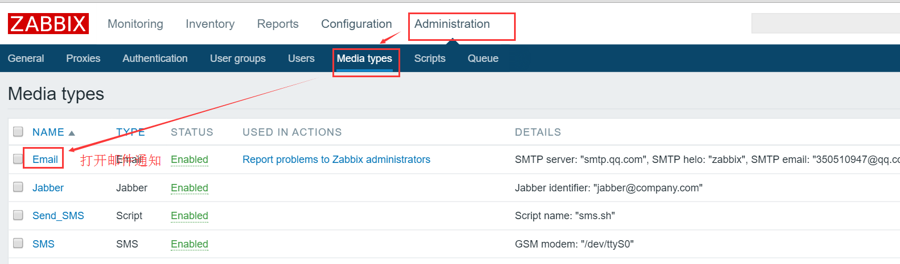
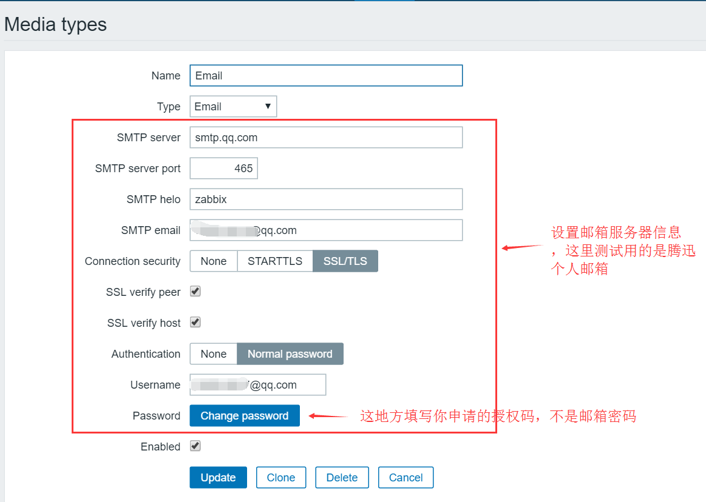
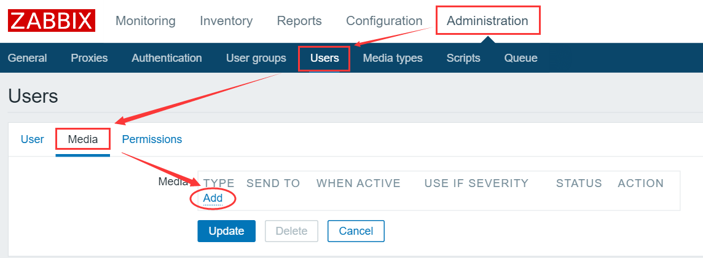
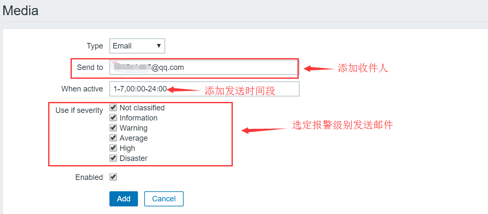

# 分布式监控系统Zabbix学习四

> GitHub 仓库源文件：[点击打开网页渲染版](https://github.com/ben2023niao/ben-ops-notes/blob/main/doc/md/202304141557-%E5%8F%AF%E8%A7%82%E6%B5%8B%E6%80%A7%2B%E7%9B%91%E6%8E%A7%2B%E7%9B%91%E6%8E%A7%E5%91%8A%E8%AD%A6%2BZabbix-%E5%88%86%E5%B8%83%E5%BC%8F%E7%9B%91%E6%8E%A7%E7%B3%BB%E7%BB%9FZabbix%E5%AD%A6%E4%B9%A0%E5%9B%9B.md)

## Zabbix告警添加流程

> [zabbix](https://chegva.com/tag/zabbix/ "View all posts in zabbix")事件通知要注意两个方面——一是怎么通知？二是通知对象是谁？在zabbix中通过定义actions动作来定义通知事件，同时通过添加报警媒介来通知指定对象。

### 1.创建编辑事件action

#### 2.定义action

#### 3.定义action触发条件

4.定义action触发后操作步骤及方式

#### 5.添加事件action发送媒介，可以使用邮件、短信、自定义脚本都可以，这里用邮件的方式

#### 6.邮件发送服务器配置

#### 7.添加发送媒介

8.指定收件人及相关配置

