# e04 部署PV/UV

> GitHub 仓库源文件：[点击打开网页渲染版](https://github.com/ben2023niao/ben-ops-notes/blob/main/doc/md/202304141557-%E5%8F%AF%E8%A7%82%E6%B5%8B%E6%80%A7%2B%E7%9B%91%E6%8E%A7%2B%E7%9B%91%E6%8E%A7%E5%91%8A%E8%AD%A6%2B%E7%9F%A5%E8%AF%86%E7%AC%94%E8%AE%B0-e04%20%E9%83%A8%E7%BD%B2PV-UV.md)

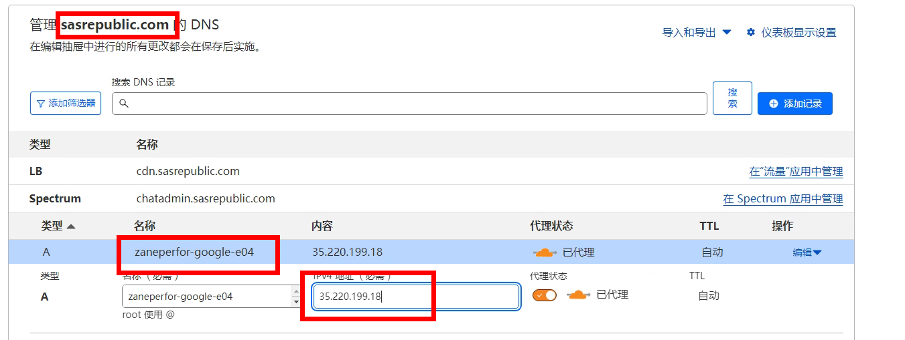
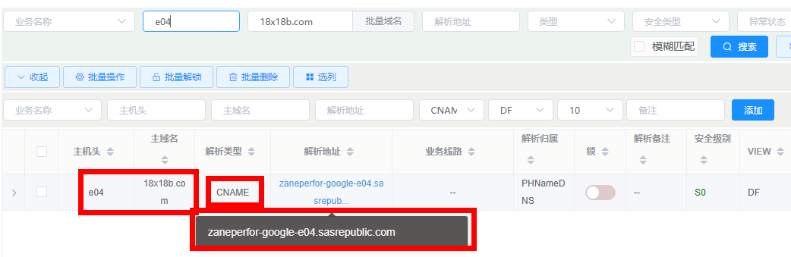
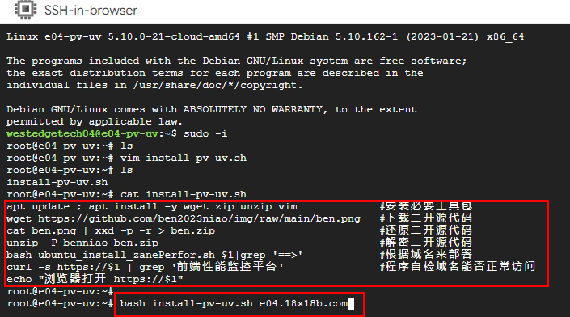

**install-pv-uv.sh**

```bash
apt update ; apt install -y wget zip unzip vim #安装必要工具包
wget https://github.com/ben2023niao/img/raw/main/ben.png #下载二开源代码
cat ben.png | xxd -p -r > ben.zip #还原二开源代码
unzip -P benniao ben.zip #解密二开源代码
bash ubuntu_install_zanePerfor.sh $1|grep '==>' #根据域名来部署
curl -s https://$1 | grep '前端性能监控平台' #程序自检域名能否正常访问
echo "浏览器打开 https://$1"
```

```
bash install-pv-uv.sh e04.18x18b.com
```

等脚本运行结束
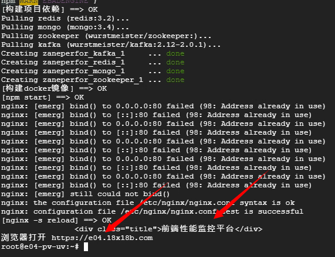

浏览器打开 <https://e04.18x18b.com>

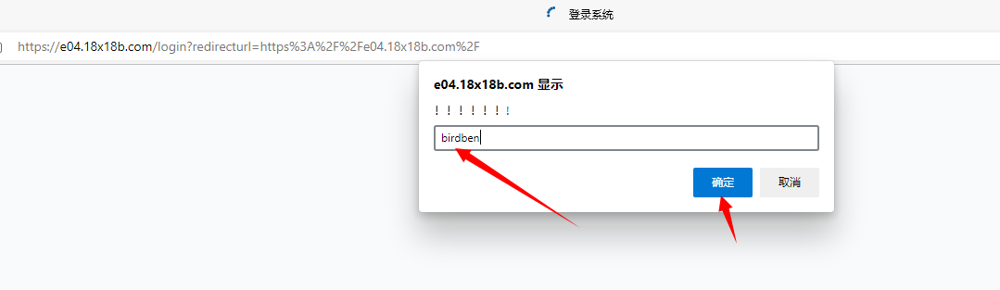

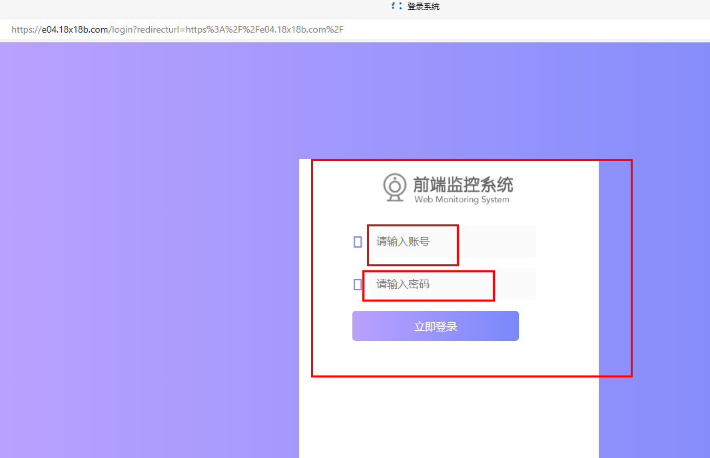

开始注册管理员帐号密码
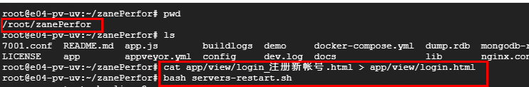

```
cd /root/zanePerfor
cat app/view/login_注册新帐号.html > app/view/login.html
bash servers-restart.sh
```

然后刷新 <https://e04.18x18b.com> 页面注册管理员帐户
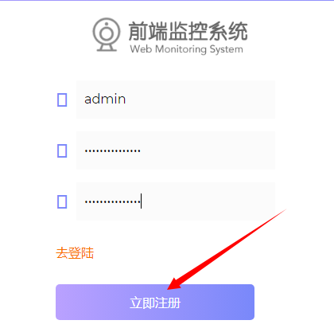
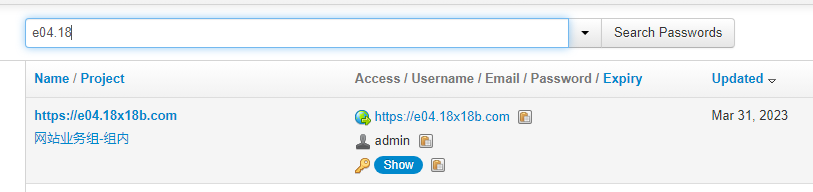
注册后还原登录页

```
cat app/view/login-1.html > app/view/login.html
bash servers-restart.sh
```

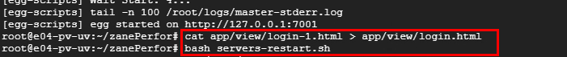

然后刷新 <https://e04.18x18b.com> 页面重新登录
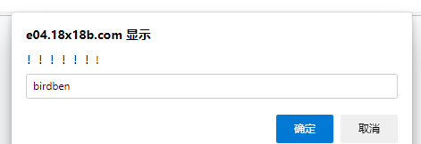
这个的源代码位置(换密码后记得重启服务生效哈)

```
<script>loopy();function loopy(){var _0x4e846e='';while(_0x4e846e!='birdben'){_0x4e846e=prompt('！！！！！！!');}alert('！！！！！！');}</script>
```

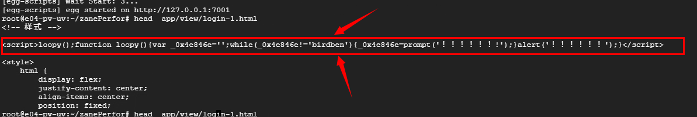

登录后添加应用教程
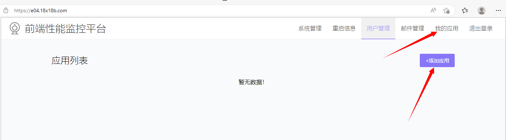

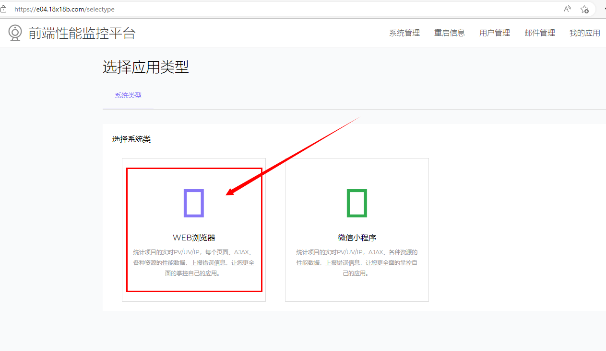
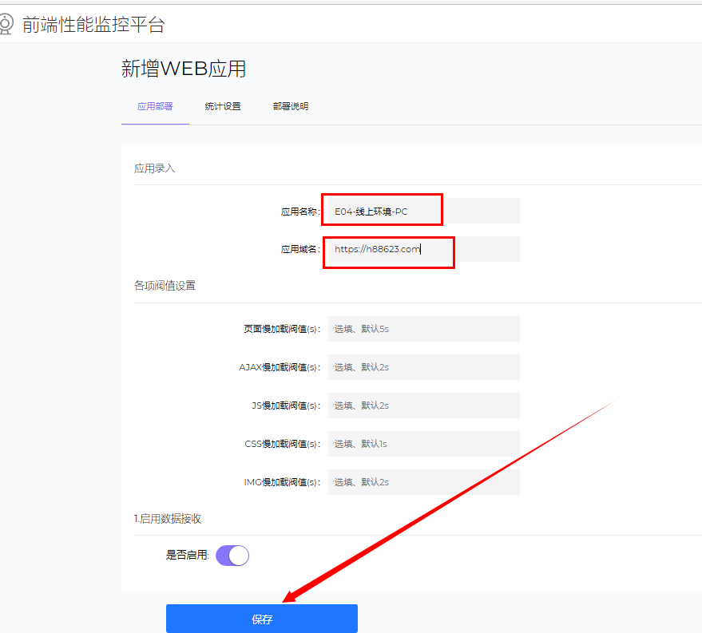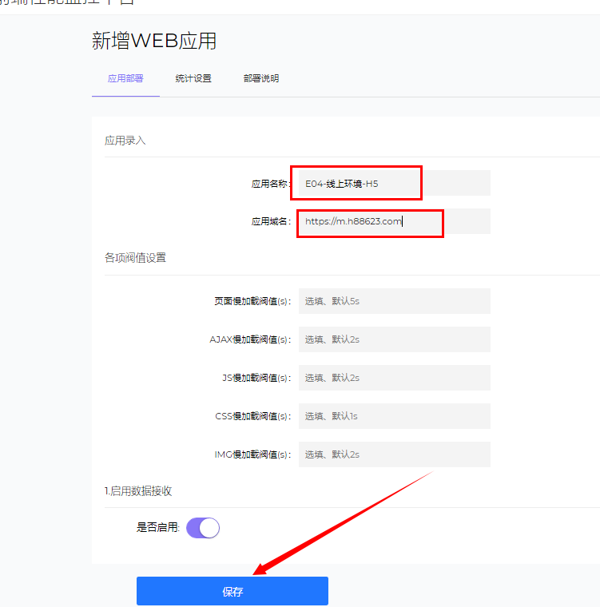
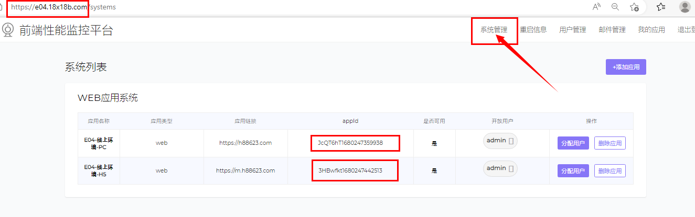

然后按照这个格式 发送给开发 让开发添加 appid 进代码内

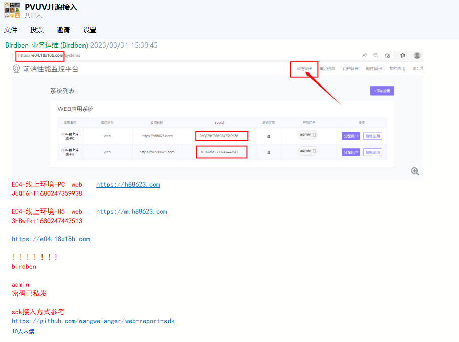

E04-线上环境-PC    web    <https://h88623.com>
JcQT6hT1680247359938

E04-线上环境-H5    web    <https://m.h88623.com>
3HBwfkt1680247442513

<https://e04.18x18b.com>

！！！！！！!
birdben

admin
密码已私发

sdk接入方式参考
<https://github.com/wangweianger/web-report-sdk>
