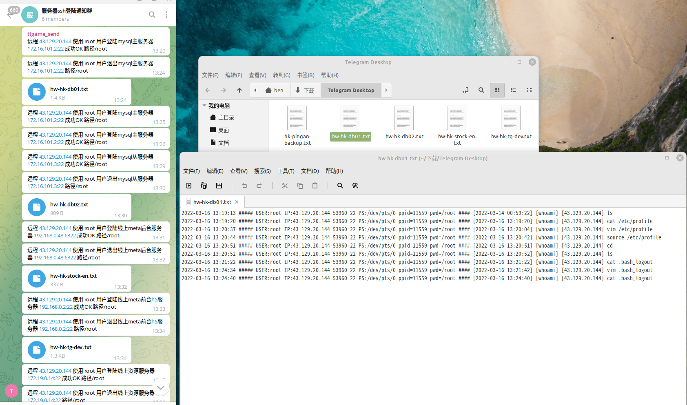

# ssh 登录/登出监控

源文地址 https://[运维.gitbook.io/devops/jian-kong/ssh-deng-lu-deng-chu-jian-kong](http://xn--6o0a585a.gitbook.io/devops/jian-kong/ssh-deng-lu-deng-chu-jian-kong)


Telegram接收SSH登陆提醒

```bash
#!/bin/sh
# Telegram接收SSH登陆提醒
#编辑 /etc/ssh/sshrc 放入以下代码
IP="$(echo $SSH_CONNECTION | cut -d " " -f 1)"
HOSTNAME=$(hostname)
NOW=$(date +"%e %b %Y, %a %r")
CONTENT="$IP 登录到主机 $HOSTNAME 时间 $NOW."
RES=$(curl -X POST \
-F "chat_id=-446223495" \
-F "text=${CONTENT}" \
-o /dev/null --silent \
-w %{http_code} \
"https://api.telegram.org/bot1964244239:AAFIY_CqMoCR0V7dN04ADrjJxZ-rfdrAcXU/sendMessage")
#每次登陆 SSH 后 Telegram Bot 都会发送一条通知给你
#注意
#创建了 ~/.ssh/rc 的用户在登陆时只执行该文件，/etc/ssh/sshrc 会被忽略。
#ssh登录端口转发时会触发，但是开启 -N 选项后不会触发。
#当然这也并不是就万无一失了。提高安全意识，按时更换密码和私钥，不使用来历不明的代码才是正确的姿势。
```

Telegram接收SSH退出提醒

```bash
#!/bin/sh
# Telegram接收SSH退出提醒
#编辑 /root/.bash_logout 放入以下代码
IP="$(echo $SSH_CONNECTION | cut -d " " -f 1)"
HOSTNAME=$(hostname)
NOW=$(date +"%e %b %Y, %a %r")
CONTENT="$IP 登出exit主机 $HOSTNAME 时间 $NOW."
RES=$(curl -X POST \
-F "chat_id=-446223495" \
-F "text=${CONTENT}" \
-o /dev/null --silent \
-w %{http_code} \
"https://api.telegram.org/bot1964244239:AAFIY_CqMoCR0V7dN04ADrjJxZ-rfdrAcXU/sendMessage")
#每次退出 SSH 后 Telegram Bot 都会发送一条通知给你
cat /var/log/check_user_history.log | grep $(date "+%Y-%m-%d") > /var/log/$HOSTNAME.txt
curl -s "https://api.telegram.org/bot1964244239:AAFIY_CqMoCR0V7dN04ADrjJxZ-rfdrAcXU/senddocument?chat_id=-446223495&" \
-F document=@"/var/log/$HOSTNAME.txt"
#每次退出 SSH 后 Telegram Bot 都会发送操作记录到群
```
