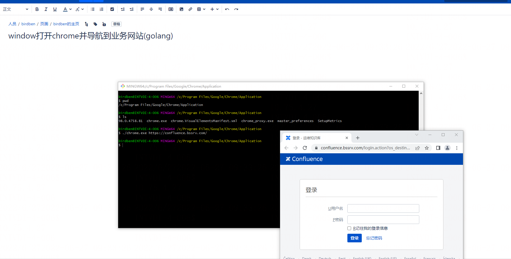

# window打开chrome并导航到业务网站(golang)

```
```



```
C:\Program Files\Google\Chrome\Application 路径下打开 git-bash
./chrome.exe https://confluence.bssrv.com/
如果浏览器的安装路径中有空格，可以用“ ”代替，如下：

C:\Program Files\Mozilla Firefox\firefox.exe

可以替换为C:\Program" "Files\Mozilla" "Firefox\firefox.exe

1、用IE浏览器打开网页的批处理代码：start c:\progra~1\Intern~1\iexplore.exe 网址

例子：

@echo off
title 打开网页
start c:\progra~1\Intern~1\iexplore.exe "http://www.baidu.com"
2、用谷歌浏览器打开网页的批处理代码：安装路径 网址

例子：

@echo off
title 打开网页
start C:\Users\Administrator\AppData\Local\Google\Chrome\Application\chrome.exe http://www.google.com.hk
3、用火狐浏览器打开网页的批处理代码：安装路径 网址

例子：

@echo off
title 打开网页
start C:\Program" "Files\Mozilla" "Firefox\firefox.exe "http://www.163.com"
4、批量打开网页的代码(转载)：

@echo off
mode con lines=16
title 批量打开网页
color 2f
cls
echo.
echo 现在是 %date% %time%echo
echo ━━━━━━━━━━━━━━━━━━━━━━━━━━━━━━━━━━━━━━━━
start www.baidu.com
start www.jb51.net
echo 开启完成，正在返回！
5、关闭浏览器的批处理代码：

@echo off
title 结束进程
taskkill /f /t /im iexplore.exe
taskkill /f /t /im chrome.exe
taskkill /f /t /im firefox.exe
```
