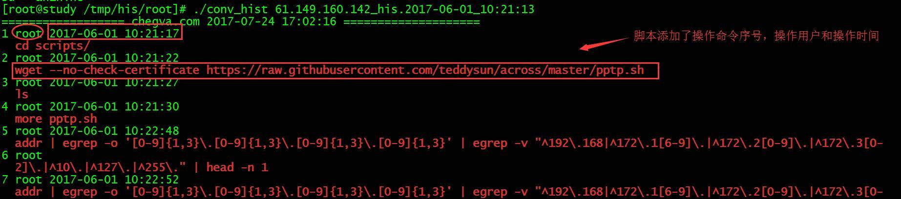

# 用户终端操作历史记录文件格式转换

> GitHub 仓库源文件：[点击打开网页渲染版](https://github.com/ben2023niao/ben-ops-notes/blob/main/doc/md/202304141557-%E5%8F%AF%E8%A7%82%E6%B5%8B%E6%80%A7%2B%E7%9B%91%E6%8E%A7%2B%E7%9F%A5%E8%AF%86%E7%AC%94%E8%AE%B0-%E7%94%A8%E6%88%B7%E7%BB%88%E7%AB%AF%E6%93%8D%E4%BD%9C%E5%8E%86%E5%8F%B2%E8%AE%B0%E5%BD%95%E6%96%87%E4%BB%B6%E6%A0%BC%E5%BC%8F%E8%BD%AC%E6%8D%A2.md)

- **生产实践：**

     用户终端操作历史记录文件格式转换

- **学习技巧：**

    if语句、for循环及sed、awk使用

查看效果



**脚本内容**

```
#/bin/bash
RED='\e[1;31m'
redb='\e[5;41m' # 红底闪烁
NC='\e[0m' # 没有颜色
LOGNAME=$1
#BASEPATH=$(cd `dirname $0`; pwd)
BASEPATH=$(basename `pwd`)
if [ "$1" == "" -o "$#" -gt 1 ]
then
 echo -e "${RED}  :) ${NC} Usage: ./`basename $0` [HISTFILE name]";
 exit;
elif [ ! -f "$LOGNAME" ];then
 echo -e "${RED} :( ${NC} ${redb} ${LOGNAME} ${NC} does not exist,please check it!";
 exit;
else
 echo "================== chegva.com `date +%F\ %T` ====================";
fi
#elif [ ! -f "${LOGNAME}" ]
#    echo "${LOGNAME} does not exist,please check it!";
#         exit;
#LOGFILE=${LOGNAME}.his
#if [ ! -f "$LOGFILE" ]; then
#    touch ${LOGFILE}
#else
#    >${LOGFILE}
#fi
#
for line in $(<$LOGNAME)
do
if [[ `echo ${line:0:1}` == "#" ]]
then
#echo $line
LOGTIME=`echo ${line:1}`
#echo $LOGTIME
LOGLINE=`date -s @${LOGTIME} +'%F %T'`
#echo $LOGLINE
sed -i "s/$line/$LOGLINE/" ${LOGNAME}
fi
done
awk -v count=1 '{ if (NR%2==1) { print count" '"$BASEPATH"' "$0;count++;}
else {print "\033[1;31m" "  " $0 "\033[0m"}}' ${LOGNAME}
echo "===================" "历史命令记录格式已转换:)" "========================="
exit 0
```
