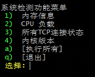

# 菜单脚本



```bash
$ cat menu-simple.sh
#!/bin/bash
# utf-8
# 脚本编码类型 utf-8
# 自定义色彩
##
NORMAL='\e[0m'
RED='\e[31;1m'
GREEN='\e[32;1m'
BLUE='\e[34;1m'
YELLOW='\e[33;1m'
##
# Bash菜单脚本
#   - 内存信息
#   - CPU 负载
#   - 多少个TCP链接
#   - 内核版本
##
function title()
{
 echo "*****************************"
 echo "${1}"
 echo "*****************************"
}
function memory_check() {
 title "内存使用情况: "
 free -h
}
function cpu_check() {
 title "CPU信息: "
 uptime
}
function check_netstat() {
 title "网络各种链接状态: "
 netstat -n | awk '/^tcp/ {++S[$NF]} END {for(a in S) print a, S[a]}'
}
function kernel_check() {
 title "内核版本: "
 uname -a
 lsb_release -a
}
function all_checks() {
 memory_check
 cpu_check
 check_netstat
 kernel_check
}
function usage() {
 echo -ne "
系统检测功能菜单
${GREEN} 1) ${NORMAL} 内存信息
${GREEN} 2) ${NORMAL} CPU 负载
${GREEN} 3) ${NORMAL} 所有TCP连接状态
${GREEN} 4) ${NORMAL} 内核版本
${GREEN} a) ${NORMAL} [执行所有]
${GREEN} q) ${NORMAL} [退出]
${YELLOW} 选择: ${NORMAL}"
}
function main_menu() {
 while [ 1 ]; do
 clear # 清除屏幕
 usage # 提示字符串
 read cmd # 等待输入，以回车结束
 case $cmd in # 这里内容自由发挥
 '1') memory_check ;;
 '2') cpu_check ;;
 '3') check_netstat ;;
 '4') kernel_check ;;
 'a') all_checks ;;
 'q') return 0 ;;
 *) echo -e $RED"错误选项."$NORMAL ;;
 esac
 read -n 1 # 暂停，除非收到任何字符
 done
}
main_menu
```
