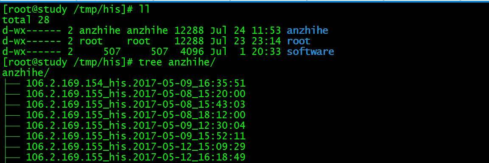
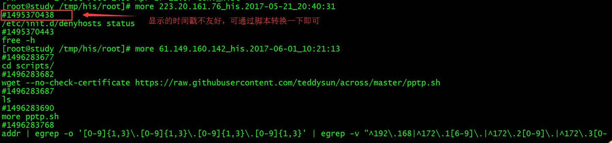

# 记录所有登录用户终端操作命令

查看效果





将以下配置添加至/etc/profile文件中，然后执行source /etc/profile命令

**/etc/profile**

```
PS1="[`whoami`@`hostname` "'$PWD]# '
history
USER_IP=`who -u am i 2>/dev/null| awk '{print $NF}'|sed -e 's/[()]//g'`
if [ "$USER_IP" = "" ]
then
USER_IP=`hostname`
fi
if [ ! -d /tmp/his ]
then
mkdir /tmp/his
chmod 777 /tmp/his
fi
if [ ! -d /tmp/his/${LOGNAME} ]
then
mkdir /tmp/his/${LOGNAME}
chmod 300 /tmp/his/${LOGNAME}
fi
export HISTSIZE=4096
export HISTFILESIZE=4096
#export HISTCONTROL=erasedups
export HISTCONTROL=ignoredups
#export HISTCONTROL=ignorespace
export HISTIGNORE="pwd:ls:ls -al:ll:ls -a:"
HISTTIMEFORMAT="%F %T `whoami` [$PWD] "
export HISTTIMEFORMAT
DT=`date +%Y-%m-%d_%H:%M:%S`
export HISTFILE="/tmp/his/${LOGNAME}/${USER_IP}_his.${DT}"
chmod 600 /tmp/his/${LOGNAME}/*his* 2>/dev/null
```
