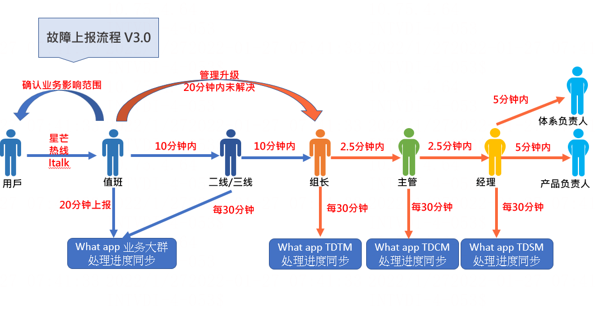

# 故障上报流程及规范-v3 *必问*

> GitHub 仓库源文件：[点击打开网页渲染版](https://github.com/ben2023niao/ben-ops-notes/blob/main/doc/md/202304141557-%E5%9F%BA%E7%A1%80%E8%AE%BE%E6%96%BD%E4%B8%8E%E4%B8%9A%E5%8A%A1%E6%9E%B6%E6%9E%84%2B%E4%B8%9A%E5%8A%A1%E7%B3%BB%E7%BB%9F%2B%E5%A4%87%E4%BB%BD%E6%81%A2%E5%A4%8D%2B%E7%9F%A5%E8%AF%86%E7%AC%94%E8%AE%B0-%E6%95%85%E9%9A%9C%E4%B8%8A%E6%8A%A5%E6%B5%81%E7%A8%8B%E5%8F%8A%E8%A7%84%E8%8C%83-v3%20-%E5%BF%85%E9%97%AE.md)

## [故障上报流程及规范-v3](https://confluence.bssrv.com/pages/viewpage.action?pageId=51633464) 

## **故障上报模板：**

| **故障信息结案模板** |

| --- |

| 【故障描述】：星芒系统无法进行登陆.【影响业务】：全产品全部无法提交工单。【开始时间】：hh:hh【结束时间】：hh:hh【处理进度】：系统功能恢复【故障原因】：XXXXXXXXXXX【故障描述】：星芒系统无法进行登陆 |
