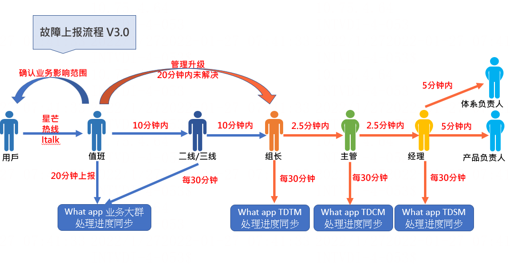

# 新人熟悉业务架构

> GitHub 仓库源文件：[点击打开网页渲染版](https://github.com/ben2023niao/ben-ops-notes/blob/main/doc/md/202304141557-%E5%9F%BA%E7%A1%80%E8%AE%BE%E6%96%BD%E4%B8%8E%E4%B8%9A%E5%8A%A1%E6%9E%B6%E6%9E%84%2B%E6%9E%B6%E6%9E%84%E7%86%9F%E6%82%89%2BDNS%2BRedis-%E6%96%B0%E4%BA%BA%E7%86%9F%E6%82%89%E4%B8%9A%E5%8A%A1%E6%9E%B6%E6%9E%84.md)

访问域名过程
客户端-pc-h5-apk-app   --> 业务域名

业务域名 -->  DNS服务器返回 A CNAME 等记录 --> 客户端-pc-h5-apk-app

                                                                                                 --> A 记录                          -->  直接请求源服务器 web服务(nginx apache) -->  服务器判断是否有证书 ssl --> 根据(nginx apache)配置路由到后台
                                                                                                 --> A 记录+txt等证书记录 -->  直接请求源服务器 web服务(nginx apache)                                                   --> 根据(nginx apache)配置路由到后台
客户端-pc-h5-apk-app  --> 根据缓存策略缓存DNS解析信息
                                                                                                 --> CNAME记录                 -->  直接请求cdn  --> HYU  TFSs *自建CDN       --> CDN验证判断证书ssl           --> 根据压缩和缓存等规则返回 html css js 以及图片静态资源  --> 客户端-pc-h5-apk-app*                                                                                                                                                                                       域名   |
                                                                                                                                                                                       异常   |
                                                                                                                                                                                       切入  V
                                                                                                                                                                          --> *CLF                        --> CDN验证判断证书ssl           --> 根据压缩和缓存等规则返回 html css js 以及图片静态资源  --> 客户端-pc-h5-apk-app*

获取到前台代码
浏览器工作流程：构建DOM -> 构建CSSOM -> 构建渲染树 -> 布局 -> 绘制
客户端-pc-h5-apk-app  --> 解析HTML --> 生成DOM树 --> 解析CSS --> 生成cssom树 --> DOM树和CSSOM树结合生成渲染树**(Render Tree) --> Painting(重绘):根据渲染树以及回流得到的几何信息，得到节点的绝对像素 --> Display: 将像素发送给GPU调用操作系统Native GUI的API绘制页面上。**                                                                                                                                                  A                                                                            |
                                                                                                                                                  |                                                                             V
                                                                                                           **Layout(回流)**:根据生成的渲染树，进行回流(Layout)，得到节点的几何信息（位置，大小）

- CSSOM会阻塞渲染，只有当CSSOM构建完毕后才会进入下一个阶段构建渲染树。(页面白屏环节原因)
- 通常情况下DOM和CSSOM是并行构建的，但是当浏览器遇到一个不带defer或async属性的script标签时，DOM构建将暂停，如果此时又恰巧浏览器尚未完成CSSOM的下载和构建，由于JavaScript可以修改CSSOM，所以需要等CSSOM构建完毕后再执行JS，最后才重新DOM构建。

(页面白屏原理)

###########################################################################################################################################################################################################################
静态链路
获取前台代码
客户端-pc-h5-apk-app  --> 业务域名 -->  CDN安全/ssl/地区等规则 --> CDN静态加速(X-Forwarded-Fo) --> netscaler防火墙 --> (前端)香港服务器210/220/230机房 提供静态资源 --> netscaler防火墙 --> CDN --> 客户端-pc-h5-apk-app
常见问题
 根据DNS解析强制缓存解析记录      gzip压缩级别/限流/防盗缓存静态资源/苹果签/上架/报毒问题                        机房互通内网/带宽/公网Ip/端口/防火墙/                            证书过期/刷新缓存/地区时区
 ###########################################################################################################################################################################################################################  动态链路
根据前台代码和后台接口交互
客户端-pc-h5-apk-app --> 业务域名 --> 渲染出前台代码 --> api域名 --> DNS解析  --> CDN动态加速/安全/ssl/地区等规则(X-Forwarded-Fo) --> netscaler防火墙 --> (后端)菲律宾服务器190/140/240机房 提供动态接口服务  --> netscaler防火墙 --> CDN --> 客户端-pc-h5-apk-app
常见问题
设备/版本/语法兼容        爬虫/接口防刷/token验证/有效期/数据验证校验拦截   cdn政策时期抽风/ssl兼容/ipv6/刷流量                                                                           机房安全/续费/实名制/DHCP内网固定ip稳定性问题/多网卡互通/内外网/磁盘恢复
###########################################################################################################################################################################################################################
动态链路
用户登录(token+redis)
客户端-pc-h5-apk-app(生成一个唯一标识ID) --> 业务域名 --> api域名 --> CDN --> netscaler防火墙 --> 后端服务器nginx(检查ssl/请求方法/跨域/token/ip/地区/url资源地址/伪静态等) --> 根据负载算法proxy到upstream配置的vip --> mysql数据库查询用户是否存在

用户存在 --> 携带传递ID和token --> 中间件redis集群是否命中用户uuid --> 还在有效期内就正常登录/失效就掉线重新登录

```
var uuid = "user-token:" + UUID.randomUUID();
 redisTemplate.opsForValue().set(uuid, byUsernameAndPassword.getId().toString(), 30, TimeUnit.MINUTES);
 return new Result<>(true, uuid);
```

用户不存在 --> mysql返回json --> 前台js代码提示用户不存在并引导注册
前端在请求头中放入Token,之后从请求头中获取Token,从Redis中获取token是否存在,存在返回为true并且重新设置有效期,不存在就返回false设置响应状态为401 参考代码

```
@Override
public boolean preHandle(HttpServletRequest request, HttpServletResponse response, Object handler) throws Exception {
 var token = [已脱敏]"token");
 if (token != null && redisTemplate.opsForValue().get(token) != null) {
 redisTemplate.expire(token, 30, TimeUnit.MINUTES);
 return true;
 }
 response.setStatus(HttpServletResponse.SC_UNAUTHORIZED);
 return false;
}
```

```
正常登录过程还要做 验证码/3方短信/邮箱等逻辑
```

```
常见问题
```

```
前端框架漏洞 redis DB库没区分导致冲突 目录遍历 redis安全没做导致被黑 防火墙/CDN限制到真实用户ip 3方短信/验证码异常 密码弱加密被破解 前后端拦截检查不到位被sql注入/空字符绕过等 xss漏洞注入导致Cookie、SessionID等泄漏
```

CSRFnginx配置 * 被伪造跨站 携带上用户Cookie登录/json劫持等  XML格式数据的XEE攻击  SSLStrip 攻击 OpenSSL Heartbleed 安全漏洞 CCS 注入漏洞 证书有效性验证漏洞 文件换后缀/类型上传
业务漏洞是跟具体的应用程序相关，比如参数篡改（连续编号 ID / 订单、1 元支付）、重放攻击（伪装支付）、权限控制（越权操作）等。

HTTP/1.1（RFC2616）规范定义了 HTTP TRACE 方法，主要是用于客户端通过向 Web 服务器提交 TRACE 请求来进行测试或获得诊断信息。当 Web 服务器启用 TRACE 时，提交的请求头会在服务器响应的内容（Body）中完整的返回，
其中 HTTP 头很可能包括 Session Token、Cookies 或其它认证信息。攻击者可以利用此漏洞来欺骗合法用户并得到他们的私人信息。

**解决方案**

禁用 HTTP TRACE 方法。
强制 HTTP/2.0 协议

```
###########################################################################################################################################################################################################################
运维组织架构
 业务运维部
```

                          业务值班组
                          产品业务组
                          支付业务组

              技术平台部
                         基础平台组
                         应用开发组
                         数据库组(dba）
                         新平台组(k8s)
###########################################################################################################################################################################################################################
SLA指标

核心SLA目标为99.7%
全产品核心SLA目标为98.00%
       单产品核心SLA目标为99.93%
              运维部核心SLA目标为99.30%
              产品业务组核心SLA目标为99.60%
              网站业务核心SLA目标为99.70%
              游戏业务核心SLA目标为99.90%

非核心SLA目标为98%
全产品非核心SLA目标为95.00%
       单产品非核心SLA目标为99.5%
              运维部非核心SLA目标为98.00%
              产品业务组非核心SLA目标为98.00%
              网站业务非核心SLA目标为98.00%
              游戏业务非核心SLA目标为98.00%

产品业务组KPI
产品核心SLA  产品非核心SLA  产品速度  产品速度  培训类  优化类  项目类  组长评价  产品评价
激励选项
外部表扬  特殊贡献
扣分选项
星芒工单质量  失误率  遭受投诉  推诿责任
###########################################################################################################################################################################################################################

**故障上报模板：**

| **故障信息结案模板** |

| --- |

| 【故障描述】：星芒系统无法进行登陆.【影响业务】：全产品全部无法提交工单。【开始时间】：hh:hh【结束时间】：hh:hh【处理进度】：系统功能恢复【故障原因】：XXXXXXXXXXX【故障描述】：星芒系统无法进行登陆 |

###########################################################################################################################################################################################################################
SLA指标

[配置netscaler](https://confluence.bssrv.com/pages/viewpage.action?pageId=36905976&src=contextnavpagetreemode)
