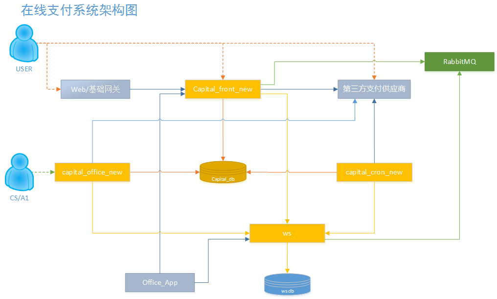
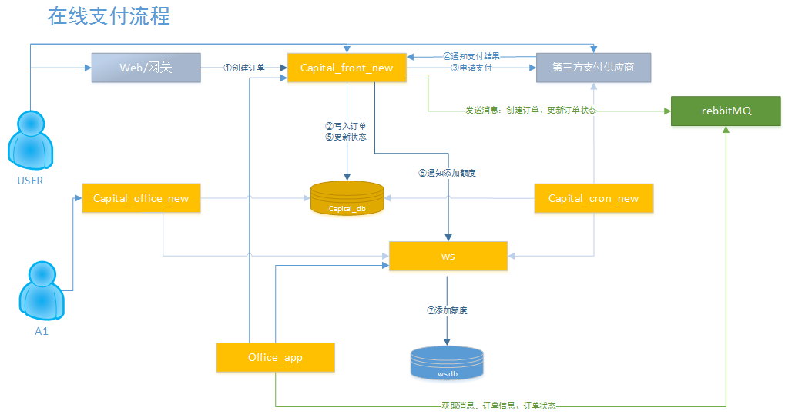
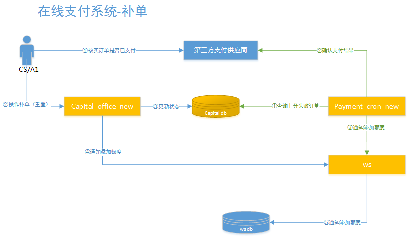
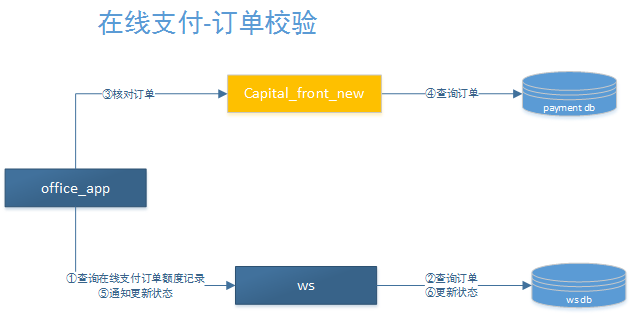

# 2 银行卡存取款过程



```
graph-easy <<< '[user] <-> [neptune_web] <-> [capital_front_new] <-> [3_play] [capital_front_new],[ws] -> [rabbitmq] [CS/A1] <-> [capital_office_new] <-> [3_play],[capital_db],[ws] [ws] <-> [ws_db] [office_app] -> [ws],[capital_front_new]'
 +-------------------+
 | v
 | +-------+ +--------------------+ +----------+
 | | ws_db | <--> | ws | ---> | rabbitmq | <------+
 | +-------+ +--------------------+ +----------+ |
 | ^ |
 | | |
 | | |
 | v |
 | +-------+ +--------------------+ +----------+ +-------------------+ +-------------+ +------+
 | | CS/A1 | <--> | capital_office_new | <--> | 3_play | <--> | capital_front_new | <--> | neptune_web | <--> | user |
 | +-------+ +--------------------+ +----------+ +-------------------+ +-------------+ +------+
 | ^ ^
 | | |
 | | |
 | v |
 | +--------------------+ +-------------------+
 | | capital_db | +-------------------- | office_app |
 | +--------------------+ | +-------------------+
 | |
 +-----------------------------------------+
```



```
graph-easy <<< '[user] <-> [neptune_web] <-> [capital_front_new] <-> [3_play],[capital_db],[ws],[rabbitmq] [office_app] <-> [capital_front_new],[ws],[rabbitmq]'
 +-------------------------------+
 v v
+----+ +------------+ +-------------------+ +-------------+ +------+
| ws | <--> | office_app | <--> | | <--> | neptune_web | <--> | user |
+----+ +------------+ | | +-------------+ +------+
 ^ | |
 | | capital_front_new |
 | | |
 v | |
 +------------+ | | +-------------+
 | rabbitmq | <--> | | <--> | 3_play |
 +------------+ +-------------------+ +-------------+
 ^
 |
 |
 v
 +-------------------+
 | capital_db |
 +-------------------+

graph-easy <<< '[capital_front_new] <-> [rabbitmq] <-> [office_app] <-> [capital_front_new],[ws] [capital_front_new] <-> [capital_db] [ws] <-> [ws_db]'
 +--------------------------------------------+
 v v
+----------+ +-------------------+ +------------+ +----+ +-------+
| rabbitmq | <--> | capital_front_new | <--> | office_app | <--> | ws | <--> | ws_db |
+----------+ +-------------------+ +------------+ +----+ +-------+
 ^
 |
 |
 v
 +-------------------+
 | capital_db |
 +-------------------+

graph-easy <<< '[A1] <-> [capital_office_new] <-> [capital_db] <-> [capital_cron_new] [capital_cron_new] <-> [3_play],[ws] [ws] <-> [ws_db],[office_app],[capital_office_new]'
 +-------------------------------------------------------------------------+
 v v
+----+ +--------------------+ +------------+ +------------------+ +-------+ +------------+
| A1 | <--> | capital_office_new | <--> | capital_db | <--> | capital_cron_new | <--> | ws | <--> | office_app |
+----+ +--------------------+ +------------+ +------------------+ +-------+ +------------+
 ^ ^
 | |
 | |
 v v
 +------------------+ +-------+
 | 3_play | | ws_db |
 +------------------+ +-------+
```




