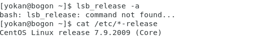
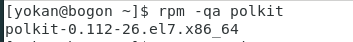
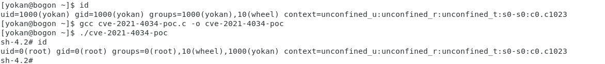

# Polkit权限提升漏洞（CVE-2021-4034）

> GitHub 仓库源文件：[点击打开网页渲染版](https://github.com/ben2023niao/ben-ops-notes/blob/main/doc/md/202304141557-%E5%AE%89%E5%85%A8%E4%B8%8E%E5%A0%A1%E5%9E%92%E6%9C%BA%2B%E5%AE%89%E5%85%A8%E8%BF%90%E7%BB%B4%2BCVE%2BLinux-Polkit%E6%9D%83%E9%99%90%E6%8F%90%E5%8D%87%E6%BC%8F%E6%B4%9E%EF%BC%88CVE-2021-4034%EF%BC%89.md)

## Linux Polkit权限提升漏洞（CVE-2021-4034）

**漏洞描述**：该漏洞是由于pkexec无法正确处理调用参数，从而将环境变量作为命令执行，具有任意用户权限的攻击者都可以在默认配置下通过修改环境变量来利用此漏洞，从而获得受影响主机的root权限。

**受影响linux**：

2009年5月至 2022 年1月26日发布的**所有** Polkit 版本
Polkit预装在**CentOS、Ubuntu、Debian、Redhat、Fedora、Gentoo、Mageia**等多个Linux发行版上，所有存在该版本范围Polkit的Linux系统均受影响。

**受影响国产化操作系统：**
银河麒麟高级服务器操作系统 V10
银河麒麟高级服务器操作系统 V10 SP1
银河麒麟高级服务器操作系统 V10 SP2
统信 UOS 服务器操作系统 V20
银河麒麟桌面版操作系统 V10
银河麒麟桌面版操作系统 V10 SP1
统信 UOS 桌面版操作系统 V20
中标麒麟桌面版操作系统 V7.0

**版本检测:**

Linux系统用户可以通过查看Polkit版本来判断当前系统是否在受影响范围内，主流Linux发行版命令如下：

CentOS、RedHat 系列：

```
rpm -qa polkit
```

Debian、Ubuntu 系列：

```
dpkg -l policykit-1
```

**不受影响版本**

CentOS：

```
CentOS 6：polkit-0.96-11.el6_10.2
CentOS 7：polkit-0.112-26.el7_9.1
CentOS 8.0：polkit-0.115-13.el8_5.1
CentOS 8.2：polkit-0.115-11.el8_2.2
CentOS 8.4：polkit-0.115-11.el8_4.2
```

Ubuntu：

```
Ubuntu 14.04 ESM：policykit-1-0.105-4ubuntu3.14.04.6+esm1
Ubuntu 16.04 ESM：policykit-1-0.105-14.1ubuntu0.5+esm1
Ubuntu 18.04 LTS：policykit-1-0.105-20ubuntu0.18.04.6
Ubuntu 20.04 LTS：policykit-1-0.105-26ubuntu1.2
Ubuntu 21.10：policykit-1-0.105-31ubuntu0.1
```

Debain：

```
Debain stretch：policykit-1 0.105-18+deb9u2
Debain buster：policykit-1 0.105-25+deb10u1
Debain bullseye：policykit-1 0.105-31+deb11u1
Debain bookworm,bullseye：policykit-1 0.105-31.1
```

**漏洞复现：**

CentOS环境




利用：



exp网上很多。也很稳定。也算是个”神洞“了。
